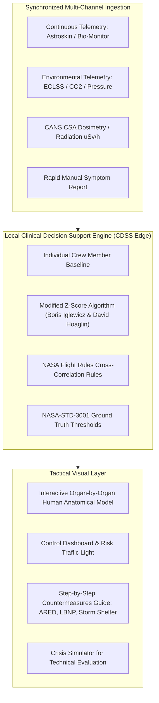

# 🚀 ASTHA: Autonomous Space Telemetry & Health Analytics
### Autonomous Space Telemetry & Health Analytics | NASA Space Apps Challenge 2026
### NASA Space Apps Challenge | Create Health Monitoring Software for Astronauts on Space Missions

[](https://angelcontres.github.io/ASTHA-SpaceApps/)
[](https://www.spaceappschallenge.org/2026/challenges/health-monitoring-software/?tab=resources)
[](https://standards.nasa.gov/)
[](docs/SRS%20–%20Software%20de%20Monitoreo%20de%20Salud%20para%20Astronautas.md)
[](docs/SDD/README.md)
[](https://visualization.osdr.nasa.gov/biodata/api/v2/)
[](docs/User-historias/README.md)
[](docs/Casos-de-uso/README.md)
[](docs/Criterios-de-aceptacion/README.md)
[](docs/MATRIZ_DE_TRAZABILIDAD_RTM.md)
[](wireframe.html)
[](docs/GLOSARIO_TERMINOLOGICO_AEROESPACIAL.md)
[](#)

---

> 🎮 **LIVE DEMOS & DEPLOYMENTS:**
> * **🚀 Production PWA + Rust Sync Hub (Docker / Caddy):** Deployed via [`cd.yml`](.github/workflows/cd.yml) on self-hosted AWS EC2 (`astha-pwa` + `astha-hub` + `astha-caddy`)
> * **👉 [Static Showcase on GitHub Pages](https://angelcontres.github.io/ASTHA-SpaceApps/)** *(SPE storm simulator, CO₂ leak, SANS, interactive anatomical map, and NASA OSDR explorer)*
> * **📐 [Interactive Wireframe & Blueprint Prototype](https://angelcontres.github.io/ASTHA-SpaceApps/wireframe.html)** *(Cabin technical dimensions, glove-ready ergonomics $\ge 48\text{px}$, WCAG AAA accessibility, and view switcher)*

---

## 🛰️ 1. Operational Problem Statement (The Deep Space Challenge)

On the International Space Station (LEO), any medical decompensation has access to live telemedicine with Houston and mission abort capability. **On a transit to Mars (up to 400 million km), that paradigm collapses:**

* **Unavoidable Radio Latency:** Electromagnetic communication delay of up to **22 minutes one-way (44 minutes round-trip)**. Real-time telemedicine is physically impossible.
* **No Medical Evacuation (*No MEDEVAC*):** The crew must diagnose, triage, and treat emergencies *in-situ*.
* **Non-Specialist Crew:** Crew members are engineers, pilots, and scientists, not critical-care physicians. The system must translate physiological complexity into **executable step-by-step action protocols**.

---

## 🧬 2. Space Biomedical Foundation (NASA R.I.D.G.E. Framework)

**ASTHA** (**Autonomous Space Telemetry & Health Analytics**) continuously correlates the space exposome against human physiology:

1. **Radiation (Space Radiation):** Exposure to GCR and Solar Particle Events (SPE). Secondary neutron monitoring (~30% of the biological dose in cabin) calibrated against the Canadian Space Agency (CSA) **CANS** spectrometer.
2. **Isolation & Confinement:** Circadian rhythm disruption and autonomic depression detected via Heart Rate Variability (**HRV rMSSD**).
3. **Distance from Earth:** Self-sufficiency and **100% offline (Edge)** operation.
4. **Gravity Fields (Microgravity 0G / Moon 1/6G / Mars 3/8G):**
   * **SANS (Spaceflight Associated Neuro-ocular Syndrome):** Cephalad fluid shift that flattens the globe and causes optic disc edema.
   * **Accelerated Bone Loss ($1.0\% - 1.5\%$ per month):** Hypercalciuria and critical risk of **renal calculi (kidney stones)**.
5. **Hostile Closed Environments:** Detection of $CO_2$ pockets ($> 3.0\text{ mmHg} / > 3950\text{ ppm}$) and cabin deoxygenation.

---

## ⚙️ 3. System Architecture and Capabilities



### Drift Detection Algorithm (Modified Z-Score)
To avoid false alarms caused by outliers and inter-individual variability, ASTHA uses the Median Absolute Deviation ($MAD$):

$$M_i = \frac{0.6745 \cdot (x_i - \tilde{x})}{MAD}$$

A value $|M_i| \ge 2.5$ triggers an early physiological drift warning before the astronaut experiences incapacitating symptoms.

### Multi-Input Telemetry Ingestion Boundary
All data sources—manual vitals (`9` variables + `5` one-tap symptoms), NASA OSDR 90-day reference telemetry (`adaptReferenceDataset`), Ed25519-signed mission JSON imports (`parseImport`), crisis simulator injections, and any external sensor/wearable/ECLSS bridge—converge on a unified schema validation and normalization pipeline (`astha-pwa/src/storage/ingestAdapter.ts` implementing `POST /ingest/telemetry` from [`openapi.yaml`](docs/Modelo-datos-y-APIs/openapi.yaml)). Every accepted reading passes through `validateValue()` (flagging implausible readings as `isSuspect` per `RF-ING-05` without discarding clinical data), is written as an immutable CRDT operation (`HLC`), encrypted with `AES-GCM-256`, signed with `Ed25519`, replicated across devices via the Rust Sync Hub, and evaluated by the isolated Clinical Engine Worker in under `50 ms`. Connected crew nodes (`GET /api/v1/health`), active input channels, and an interactive JSON telemetry tester are directly inspectable from the PWA header sync pill (**Connected Devices & Telemetry Links**) or **Tab 4 · Simulator**. See [`03-Contratos-API-OpenAPI-y-Eventos.md`](docs/Modelo-datos-y-APIs/03-Contratos-API-OpenAPI-y-Eventos.md#5-multi-input-data-capture--ingestion-boundary).

---

## 📁 4. Repository Structure and Documentation

```text
ASTHA-SpaceApps/
├── .github/workflows/
│   ├── ci.yml                                                  # PWA verify + Rust Sync Hub + hub e2e + Docker verify
│   └── cd.yml                                                  # Publish GHCR images & auto-deploy on self-hosted AWS
├── astha-pwa/                                                  # Offline-first Svelte 5 PWA (Vite, TypeScript, Web Workers)
│   ├── src/
│   │   ├── data/                                               # Bundled 90d reference dataset & OSDR human studies JSON
│   │   ├── engine/                                             # Pure clinical engine (NASA-STD-3001, Z-score, RangeValidator)
│   │   ├── storage/                                            # CRDT (HLC/G-Set), AES-GCM-256 + Ed25519, ingestAdapter, SyncClient
│   │   ├── ui/                                                 # Svelte 5 cockpit (LockScreen, Anatomy 3D/SVG, EntryPad, Simulator)
│   │   └── workers/                                            # Isolated clinical.worker.ts & dataSync.worker.ts
│   ├── tests/                                                  # 17 Vitest suites (clinical rules, CRDT, crypto, UI, infra, hub e2e)
│   ├── nginx/                                                  # Hardened static HTTP server config & /healthz
│   ├── Dockerfile                                              # Multi-stage Vite build -> read-only nginxinc/nginx-unprivileged
│   └── README.md
├── sync-hub/                                                   # Zero-knowledge LAN Sync Hub in Rust (Axum, TLS 1.3, Ed25519)
│   ├── src/                                                    # /api/v1/* REST, /ws/sync relay, disk Op-Log, mDNS, enrollment
│   ├── Dockerfile                                              # Distroless non-root Rust binary container
│   └── README.md
├── deploy/
│   ├── Caddyfile                                               # Reverse proxy (/ws/sync & /api/v1/* -> astha-hub; / -> astha-pwa)
│   ├── server-bootstrap.sh                                     # Multi-distro Linux Docker/UFW host preparation
│   └── .env.example
├── docker-compose.yml                                          # Production stack (astha-pwa + --profile tls astha-hub & caddy)
├── LOCAL_TEST_GUIDE.md                                         # Local PowerShell/Docker verification guide
├── docs/
│   ├── CICD_DOCKER_DEPLOYMENT.md                               # Container architecture, CI/CD & AWS deployment runbook
│   ├── User-historias/                                         # Catalog of 20 Aerospace BDD User Stories
│   │   ├── README.md                                           # Epic map, archetypes (personas), and DoD
│   │   ├── HU-01-Monitoreo-Telemetria-Vital.md                 # Epic 1: Continuous ingestion, sleep, and environmental data
│   │   ├── HU-02-Triage-Clinico-Modelo-Anatomico.md            # Epic 2: Body hotspots, SANS, and Z-score
│   │   ├── HU-03-Protocolos-Contramedidas-Emergencia.md        # Epic 3: Non-physician checklists, SPE, LBNP, and ARED
│   │   ├── HU-04-Arquitectura-Edge-Red-Malla.md                # Epic 4: Zero-ping offline, DTN, and SEU tolerance
│   │   └── HU-05-Explorador-NASA-OSDR.md                       # Epic 5: NASA OSDR API, Inspiration4, and simulator
│   ├── Casos-de-uso/                                           # Formal Specification of 12 Use Cases (UML / ISO 29148)
│   │   ├── README.md                                           # Actor model, Mermaid diagram, and matrix
│   │   ├── CU-01-Monitoreo-Telemetria-Ingesta.md               # CU-01 Continuous ingestion, CU-02 CO2/CANS, CU-03 Symptoms
│   │   ├── CU-02-Triage-Diagnostico-Soporte.md                 # CU-04 Anatomical map, CU-05 SANS, CU-06 Z-Score
│   │   ├── CU-03-Contramedidas-Emergencias-Vuelo.md            # CU-07 Checklists, CU-08 SPE Storm, CU-09 LBNP
│   │   └── CU-04-Arquitectura-Red-Resiliencia-Edge.md          # CU-10 P2P Mesh Network, CU-11 DTN Houston, CU-12 EPS <5W
│   ├── Criterios-de-aceptacion/                                # Verification & Validation Framework (NASA V&V)
│   │   ├── README.md                                           # I/A/D/T methods and criteria classification
│   │   ├── CRITERIOS_FUNCIONALES_AC_CLINICOS.md                # AC-CLIN-01 to 07: NASA-STD-3001 ranges, SANS, and CO2
│   │   ├── CRITERIOS_NO_FUNCIONALES_AC_TECNICOS.md             # AC-TECH-01 to 06: Zero-ping, <5W power, and SEU
│   │   └── MATRIZ_VERIFICACION_Y_VALIDACION_NASA.md            # Cross-compliance matrix (100% PASS)
│   ├── MATRIZ_DE_TRAZABILIDAD_RTM.md                           # Master End-to-End Traceability Matrix (RTM)
│   ├── GLOSARIO_TERMINOLOGICO_AEROESPACIAL.md                  # Formal glossary with >60 terms (SANS, LBNP, CANS, etc.)
│   ├── WIREFRAME_Y_DISENO_UI_UX.md                             # Touch ergonomics and UI/UX design specification
│   ├── SRS – Software de Monitoreo de Salud para Astronautas.md   # Formal ISO/IEC/IEEE 29148 specification
│   ├── SDD/                                                    # Detailed Design SDD Folder (Modular UML Collection v3.0.0)
│   │   ├── README.md                                           # Master Index, Authority Rule, and ADR/C4 Map
│   │   ├── 01-Arquitectura-Global-del-Sistema.md               # SDD-01: Hexagonal, Event-Driven Web Workers, and Z-Score MAD
│   │   ├── 02-Diagrama-de-Clases-UML.md                        # SDD-02: SRS §5.1 Entities, WebCrypto AES-GCM, and CRDT
│   │   ├── 03-Diagramas-de-Secuencia-UML.md                    # SDD-03: ADR-013 Alarm Escalation, On-Demand 3D, Signed JSON
│   │   ├── 04-Diagrama-de-Componentes-UML.md                   # SDD-04: Svelte 5, uPlot, Clinical & Data Workers, Sync Hub
│   │   ├── 05-Diagrama-de-Despliegue-UML.md                    # SDD-05: Isolated LAN Topology C4-L4 and Cabin Displays
│   │   ├── 06-Diseno-de-Datos-y-Contratos-de-Interfaz.md       # SDD-06: JSON Schemas, Encrypted Envelope, CRDT HLC, and AAA Tokens
│   │   ├── 07-Matriz-de-Trazabilidad-SRS-a-SDD.md              # SDD-07: 100% Traceability (42 RF + 19 RNF + 10 R-* + 3 D-*)
│   │   └── 08-Architecture-decisions.md                          # SDD-08: Consolidated Registry of 20 ADRs (ADR-001..020)
│   ├── c4/                                                     # C4 Architecture Model (Context, Containers, Components, Deployment)
│   ├── Diseno-UI-UX/                                           # Modular UI/UX Design (Wireframes, Design System, Mockups)
│   │   ├── README.md                                           # Normative UI/UX Index (SRS, C4, and ADR traceability)
│   │   ├── 01-Wireframes-y-Arquitectura-de-Pantalla.md         # View A/B/C wireframes, 12-col grid, and breakpoints
│   │   ├── 02-Guia-de-Estilo-y-Design-System.md                # WCAG AAA tokens (#fca5a5), 630nm dual coding, and 960Hz audio
│   │   └── 03-Mockups-y-Especificacion-de-Componentes.md       # Hi-Fi mockups, Svelte 5 components, and <5W Survival Mode
│   ├── Modelo-datos-y-APIs/                                    # Data Model (ERD, Dictionary) & OpenAPI 3.1.0 Contracts
│   │   ├── README.md                                           # Index and encryption/CRDT/LAN principles
│   │   ├── 01-Diagrama-Entidad-Relacion.md                     # Entity-Relationship Diagram (ERD) and IndexedDB Object Stores
│   │   ├── 02-Diccionario-de-Datos.md                          # Complete dictionary with NASA-STD-3001 thresholds
│   │   ├── 03-Contratos-API-OpenAPI-y-Eventos.md               # REST/WSS (Sync Hub), Worker postMessage, Multi-Input Ingestion & DSN Export
│   │   └── openapi.yaml                                        # Formal importable OpenAPI 3.1.0 specification
│   ├── SDD – Software Design Description ASTHA.md                 # Complementary consolidated technical document
│   ├── VALIDACION_FUENTES_OFICIALES_NASA.md                    # Cross-certification against NASA-STD-3001
│   ├── DOCUMENTO_DOMINIO_Y_PROBLEMATICA_ESPACIAL.md            # Operational domain analysis
│   └── HEALTH_MONITORING_SOFTWARE_SPEC.md                      # Initial technical specification
├── data/
│   ├── nasa_real_human_telemetry.json                          # 100% real Inspiration4 telemetry (OSD-574)
│   ├── nasa_osdr_api_human_studies.json                        # 116 official human studies from NASA OSDR API
│   ├── nasa_osdr_enriched_human_studies.json                   # 10 enriched studies (Inspiration4, SANS, etc.)
│   └── nasa_official_telemetry/                                # Real ISS packets and ISA-Tab tables
├── index.html                                                  # Standalone HTML prototype (GitHub Pages showcase)
├── wireframe.html                                              # Interactive Wireframe & Blueprint visual prototype
├── .nojekyll                                                   # GitHub Pages deployment support
├── .gitignore
└── README.md
```

---

## 🛠️ 5. Quick Start, Testing & Production Deployment

### 5.1 Local Development & Verification

- **PWA Verification (`svelte-check` + `eslint` + `vitest` + bundle budget <= 5 MB):**
  ```bash
  cd astha-pwa && npm install && npm run verify
  ```
- **PWA Dev Server (UI only):**
  ```bash
  cd astha-pwa && npm run dev
  ```
- **Rust Sync Hub (`fmt` + `clippy` + `cargo test`):**
  ```bash
  cd sync-hub && cargo test && cargo clippy --all-targets -- -D warnings
  ```
- **Local PWA + Sync Hub End-to-End (No TLS Certificates):**
  ```bash
  cd astha-pwa && npm run build:hub
  cd ../sync-hub && cargo run -- --insecure-http --no-mdns --bind 127.0.0.1:8443 --static-dir ../astha-pwa/dist --auto-enroll
  ```
  Open `http://localhost:8443` in two separate browser profiles to test real-time WebSocket CRDT synchronization.

### 5.2 Containerized Deployment with Docker Compose (`astha-pwa` + `astha-hub` + `caddy`)

1. **Bootstrap Docker Engine on a fresh Linux host** (Debian/Ubuntu/RHEL-family, optional):
   ```bash
   curl -fsSL https://raw.githubusercontent.com/angelcontres/ASTHA-SpaceApps/main/deploy/server-bootstrap.sh | bash
   ```
2. **Start the full production stack (`astha-pwa`, `astha-hub`, and `astha-caddy`):**
   - **Behind a TLS proxy / Cloudflare Tunnel or local HTTP (`:80`):**
     ```bash
     ASTHA_DOMAIN=":80" ASTHA_HUB_AUTO_ENROLL=true docker compose --profile tls up -d --build
     ```
   - **Direct HTTPS with automatic Let's Encrypt or Caddy internal TLS (`443`):**
     ```bash
     ASTHA_DOMAIN="astha.example.com" ASTHA_HUB_AUTO_ENROLL=false docker compose --profile tls up -d --build
     ```
3. **Verify container health & reverse proxy routes:**
   ```bash
   docker compose --profile tls ps
   docker exec astha-pwa wget -qO- http://127.0.0.1:8080/healthz
   docker exec astha-hub /usr/local/bin/astha-sync-hub healthcheck
   curl -fsS http://127.0.0.1:80/api/v1/health
   ```
4. **Device Enrollment (`ADR-020`):**
   - With `ASTHA_HUB_AUTO_ENROLL=true`, any browser supporting Web Crypto `Ed25519` enrolls automatically on its first signed WebSocket handshake.
   - With `ASTHA_HUB_AUTO_ENROLL=false` (strict flight allow-list), open **Simulator → Sync Hub enrollment record (ADR-020)** in the PWA, copy the JSON, and run:
     ```bash
     docker exec astha-hub astha-sync-hub enroll '{"deviceId":"...","publicJwk":{...}}'
     ```

### 5.3 Automated CI/CD Deployment on Self-Hosted AWS EC2 / Lightsail

Merging or pushing to `main` runs [`.github/workflows/cd.yml`](.github/workflows/cd.yml):
1. `build-and-publish-image` runs `npm run verify`, builds `ghcr.io/angelcontres/astha-spaceapps-pwa` (with `VITE_ASTHA_HUB=1`) and `ghcr.io/angelcontres/astha-spaceapps-hub`, and pushes both images to GHCR.
2. `deploy-aws` runs directly on the `[self-hosted, Linux, X64]` runner on the AWS host, copies [`docker-compose.yml`](docker-compose.yml) and [`deploy/Caddyfile`](deploy/Caddyfile) to `DEPLOY_DIR` (`/opt/astha`), writes `.env`, pulls the immutable SHA images, and starts `--profile tls`.

| GitHub Setting | Type | Default | Purpose |
| :--- | :--- | :--- | :--- |
| `ASTHA_DOMAIN` | Variable | `:80` (HTTP) | Public domain for automatic Caddy HTTPS; when unset, Caddy serves `:80` (compatible with Cloudflare Proxy SSL **Flexible** or `cloudflared` tunnel). Set to your domain when terminating HTTPS directly on EC2 with ports `80`/`443` open. |
| `ASTHA_HUB_AUTO_ENROLL` | Variable | `false` | Set to `true` to auto-enroll browsers on first `Ed25519` handshake (demo mode); keep `false` for manual `devices.json` allow-listing. |
| `DEPLOY_DIR` | Variable | `/opt/astha` | Target deployment directory on the self-hosted AWS host. |
| `ASTHA_MISSION_SECRET` | Secret | Built-in demo secret | Shared mission secret used to derive crew wrapping keys across synchronized devices. |

For detailed operational runbooks, firewall ports, and rollback instructions, see [`LOCAL_TEST_GUIDE.md`](LOCAL_TEST_GUIDE.md), [`sync-hub/README.md`](sync-hub/README.md), and [`docs/CICD_DOCKER_DEPLOYMENT.md`](docs/CICD_DOCKER_DEPLOYMENT.md).

---

## 📊 6. Datasets and Scientific Validation

* **NASA OSDR Study OSD-574 (SOMA):** Clinical and microgravity adaptation data from the SpaceX Inspiration4 commercial crew mission.
* **NASA Planetary Data System (PDS) RAD:** Deep-space radiation telemetry from the Mars Science Laboratory.
* **Canadian Space Agency (CSA):** Specifications for the *Astroskin/Bio-Monitor* smart garment and *CANS* neutron dosimetry.
* **NASA-STD-3001 (Volume 1 & 2):** Mandatory standard for permissible medical exposure limits and cabin environmental factors.

---

## 👥 Development Team & Credits
* **Challenge:** NASA Space Apps Challenge 2026
* **Topic:** *Create Health Monitoring Software for Astronauts on Space Missions*
* **Requirements Engineering:** @angel & Team
