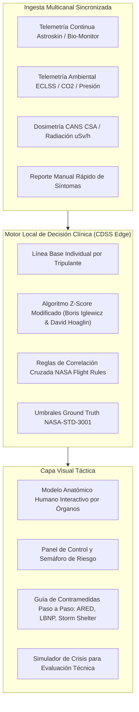

# 🚀 AstroVital: Autonomous Deep-Space Health Guardian & CDSS
### NASA Space Apps Challenge | Create Health Monitoring Software for Astronauts on Space Missions

[](https://angelcontres.github.io/AstroVital-SpaceApps/)
[](https://www.spaceappschallenge.org/2026/challenges/health-monitoring-software/?tab=resources)
[](https://standards.nasa.gov/)
[](docs/SRS%20–%20Software%20de%20Monitoreo%20de%20Salud%20para%20Astronautas.md)
[](https://visualization.osdr.nasa.gov/biodata/api/v2/)
[](docs/User-historias/README.md)
[](docs/Casos-de-uso/README.md)
[](docs/Criterios-de-aceptacion/README.md)
[](docs/MATRIZ_DE_TRAZABILIDAD_RTM.md)
[](#)

---

> 🎮 **PROBADOR EN VIVO (LIVE WEB DEMO):** Puedes probar la aplicación interactiva de inmediato en tu navegador en:  
> **👉 [https://angelcontres.github.io/AstroVital-SpaceApps/](https://angelcontres.github.io/AstroVital-SpaceApps/)**  
> *(Incluye simulador de tormenta solar, fuga de CO₂, SANS, mapa anatómico táctico interactivo y explorador de la API de NASA OSDR)*

---

## 🛰️ 1. Declaración del Problema Operacional (The Deep Space Challenge)

En la Estación Espacial Internacional (LEO), cualquier descompensación médica cuenta con telemedicina en vivo con Houston y posibilidad de aborto de misión. **En el viaje hacia Marte (hasta 400 millones de km), ese paradigma colapsa:**

* **Latencia de Radio Ineludible:** Retraso de comunicación electromagnética de hasta **22 minutos por sentido (44 minutos ida y vuelta)**. La telemedicina en tiempo real es físicamente imposible.
* **Cero Evacuación Médica (*No MEDEVAC*):** La tripulación debe diagnosticar, clasificar y tratar emergencias *in-situ*.
* **Tripulación No Especialista:** Los tripulantes son ingenieros, pilotos y científicos, no médicos intensivistas. El sistema debe traducir la complejidad fisiológica en **protocolos de acción ejecutables paso a paso**.

---

## 🧬 2. Fundamento Biomédico Espacial (NASA R.I.D.G.E. Framework)

AstroVital correlaciona continuamente el exposoma espacial contra la fisiología humana:

1. **Radiation (Radiación Espacial):** Exposición a GCR y tormentas solares (SPE). Monitoreo de neutrones secundarios (~30% de la dosis biológica en cabina) calibrado con el espectrómetro **CANS** de la Agencia Espacial Canadiense (CSA).
2. **Isolation & Confinement (Aislamiento):** Ruptura de ritmos circadianos y depresión autonómica detectada mediante Variabilidad de la Frecuencia Cardíaca (**HRV rMSSD**).
3. **Distance from Earth (Distancia):** Autosuficiencia y funcionamiento **100% offline (Edge)**.
4. **Gravity Fields (Microgravedad 0G / Luna 1/6G / Marte 3/8G):**
   * **SANS (Spaceflight Associated Neuro-ocular Syndrome):** Desplazamiento cefálico de fluidos que aplana el globo ocular y produce edema papilar.
   * **Pérdida Ósea Acelerada ($1.0\% - 1.5\%$ mensual):** Hipercalciuria y riesgo crítico de **cálculos renales**.
5. **Hostile Closed Environments (Entornos Cerrados):** Detección de bolsas de $CO_2$ ($> 3.0\text{ mmHg} / > 3950\text{ ppm}$) y desoxigenación en cabina.

---

## ⚙️ 3. Arquitectura y Capacidades del Sistema



### Algoritmo de Detección de Deriva (Modified Z-Score)
Para evitar falsas alarmas derivadas de valores atípicos y heterogeneidad individual, AstroVital utiliza la Desviación Absoluta de la Mediana ($MAD$):

$$M_i = \frac{0.6745 \cdot (x_i - \tilde{x})}{MAD}$$

Un valor $|M_i| \ge 2.5$ dispara una alerta preventiva de deriva fisiológica antes de que el astronauta experimente síntomas incapacitantes.

---

## 📁 4. Estructura del Repositorio y Documentación

```text
Nasa-Project/
├── docs/
│   ├── User-historias/                                         # Catálogo de 20 Historias de Usuario BDD Aeroespaciales
│   │   ├── README.md                                           # Mapa de épicas, arquetipos (personas) y DoD
│   │   ├── HU-01-Monitoreo-Telemetria-Vital.md                 # Épica 1: Ingesta continua, sueño y ambientales
│   │   ├── HU-02-Triage-Clinico-Modelo-Anatomico.md            # Épica 2: Hotspots corporales, SANS y Z-score
│   │   ├── HU-03-Protocolos-Contramedidas-Emergencia.md        # Épica 3: Checklists no médicos, SPE, LBNP y ARED
│   │   ├── HU-04-Arquitectura-Edge-Red-Malla.md                # Épica 4: Zero-ping offline, DTN y tolerancia SEU
│   │   └── HU-05-Explorador-NASA-OSDR.md                       # Épica 5: API NASA OSDR, Inspiration4 y simulador
│   ├── Casos-de-uso/                                           # Especificación Formal de 12 Casos de Uso (UML / ISO 29148)
│   │   ├── README.md                                           # Modelo de actores, diagrama Mermaid y matriz
│   │   ├── CU-01-Monitoreo-Telemetria-Ingesta.md               # CU-01 Ingesta continua, CU-02 CO2/CANS, CU-03 Síntomas
│   │   ├── CU-02-Triage-Diagnostico-Soporte.md                 # CU-04 Mapa anatómico, CU-05 SANS, CU-06 Z-Score
│   │   ├── CU-03-Contramedidas-Emergencias-Vuelo.md            # CU-07 Checklists, CU-08 Tormenta SPE, CU-09 LBNP
│   │   └── CU-04-Arquitectura-Red-Resiliencia-Edge.md          # CU-10 Red Malla P2P, CU-11 DTN Houston, CU-12 EPS <5W
│   ├── Criterios-de-aceptacion/                                # Marco de Verificación y Validación (NASA V&V)
│   │   ├── README.md                                           # Métodos I/A/D/T y clasificación de criterios
│   │   ├── CRITERIOS_FUNCIONALES_AC_CLINICOS.md                # AC-CLIN-01 a 07: Rangos NASA-STD-3001, SANS y CO2
│   │   ├── CRITERIOS_NO_FUNCIONALES_AC_TECNICOS.md             # AC-TECH-01 a 06: Zero-ping, potencia <5W y SEU
│   │   └── MATRIZ_VERIFICACION_Y_VALIDACION_NASA.md            # Matriz de cumplimiento cruzado (100% PASS)
│   ├── MATRIZ_DE_TRAZABILIDAD_RTM.md                           # Matriz Maestra de Trazabilidad End-to-End (RTM)
│   ├── SRS – Software de Monitoreo de Salud para Astronautas.md   # Especificación formal ISO/IEC/IEEE 29148
│   ├── VALIDACION_FUENTES_OFICIALES_NASA.md                    # Certificación cruzada contra NASA-STD-3001
│   ├── DOCUMENTO_DOMINIO_Y_PROBLEMATICA_ESPACIAL.md            # Análisis de dominio operacional
│   └── HEALTH_MONITORING_SOFTWARE_SPEC.md                      # Especificación técnica inicial
├── data/
│   ├── nasa_real_human_telemetry.json                          # Telemetría 100% real Inspiration4 (OSD-574)
│   ├── nasa_osdr_api_human_studies.json                        # 116 estudios oficiales humanos de NASA OSDR API
│   ├── nasa_osdr_enriched_human_studies.json                   # 10 estudios enriquecidos (Inspiration4, SANS, etc.)
│   └── nasa_official_telemetry/                                # Paquetes reales ISS y tablas ISA-Tab
├── index.html                                                  # Dashboard táctico interactivo 100% offline
├── .nojekyll                                                   # Soporte para despliegue en GitHub Pages
├── .gitignore
└── README.md
```

---

## 📊 5. Datasets y Validación Científica

* **NASA OSDR Study OSD-574 (SOMA):** Datos clínicos y de adaptación a microgravedad de la tripulación comercial de la misión SpaceX Inspiration4.
* **NASA Planetary Data System (PDS) RAD:** Telemetría de radiación en espacio profundo del Mars Science Laboratory.
* **Canadian Space Agency (CSA):** Especificaciones de prenda inteligente *Astroskin/Bio-Monitor* y dosimetría de neutrones *CANS*.
* **NASA-STD-3001 (Volume 1 & 2):** Estándar mandatorio para límites permisibles de exposición médica y factores ambientales de cabina.

---

## 👥 Equipo de Desarrollo y Créditos
* **Desafío:** NASA Space Apps Challenge 2026
* **Reto:** *Create Health Monitoring Software for Astronauts on Space Missions*
* **Ingeniería de Requisitos:** @angel & Team
