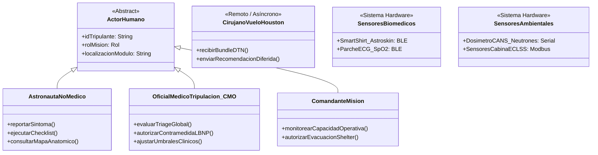
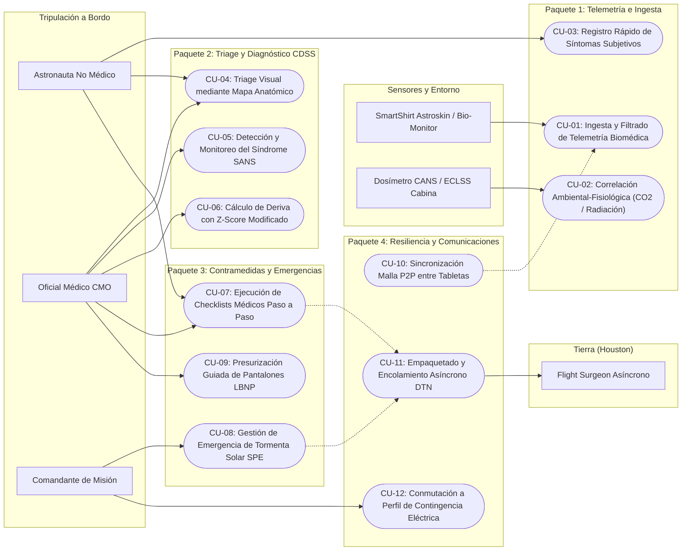

# 📐 Modelo y Catálogo de Casos de Uso del Sistema ASTHA
### NASA Space Apps Challenge | Create Health Monitoring Software for Astronauts on Space Missions
**Marco Normativo:** ISO/IEC/IEEE 29148 | UML 2.5 | NASA Systems Engineering Handbook (NASA/SP-2016-6105)

---

## 🎯 1. Propósito y Alcance del Modelo de Casos de Uso

Este documento define la interacción operacional y sistémica entre los actores (humanos y automatizados) y el sistema **ASTHA** en misiones tripuladas de espacio profundo hacia Marte. 

A diferencia de las Historias de Usuario (que expresan el valor de usuario y los criterios de aceptación ágiles), los **Casos de Uso (CU)** especifican formalmente:
* Precondiciones y Postcondiciones del estado de la nave y de la tripulación.
* Secuencia paso a paso del flujo principal de eventos (Actor $\leftrightarrow$ Sistema).
* Flujos alternativos y ramificaciones clínicas.
* Manejo estricto de excepciones (pérdida de bioseñales, eventos de radiación cósmica, fallos de red).
* Requisitos no funcionales asociados a cada caso de uso (tiempos de respuesta, consumo energético y ergonomía).

---

## 👥 2. Catálogo de Actores del Sistema

### Descripción de Actores:
1. **Astronauta en Misión (Actor Primario):** Tripulante sin formación médica avanzada (ej. piloto, geólogo, ingeniero de propulsión). Interactúa con el software bajo condiciones de estrés, fatiga o microgravedad.
2. **Oficial Médico de la Tripulación (CMO - Dra. Hayley Arceneaux):** Responsable de la salud a bordo con entrenamiento en soporte vital avanzado. Supervisa la salud grupal y ejecuta procedimientos diagnósticos diferenciales.
3. **Comandante de Misión (Jared Isaacman):** Responsable de la seguridad general de la nave y de la toma de decisiones que afecten el perfil de vuelo (ej. aborto de EVA o evacuación a módulo blindado).
4. **Cirujano de Vuelo en Tierra (Houston Flight Surgeon):** Médico especialista en JSC que opera en modo **100% asíncrono** debido a la latencia de 22 minutos por sentido (44 min RTT).
5. **Sensores Biomédicos de Vuelo (Actor de Sistema):** Prenda inteligente *Astroskin / Bio-Monitor* (CSA) y parches continuos que emiten paquetes de telemetría a 1 Hz por Bluetooth Low Energy.
6. **Sensores Ambientales de Nave (Actor de Sistema):** Espectrómetro de neutrones *CANS* de la CSA y sensores atmosféricos *ECLSS* que miden $ppCO_2$, presión de cabina y radiación.

---

## 🗺️ 3. Diagrama General de Casos de Uso (Mermaid UML)

---

## 📊 4. Matriz de Casos de Uso vs Historias de Usuario vs Requisitos SRS

| Caso de Uso | Título Formal | Actores Principales | Historias Trazadas | Requisitos SRS Trazados |
| :--- | :--- | :--- | :--- | :--- |
| **CU-01** | Ingesta y Filtrado de Telemetría Biomédica Continua | SmartShirt, Astronauta | HU-01 | RF-ING-01, RF-DSH-01, RNF-POW-03 |
| **CU-02** | Correlación Fisiológica con Factores Ambientales | Sensores ECLSS/CANS, CMO | HU-03 | RF-ING-02, RF-EVA-04, RF-DSH-04 |
| **CU-03** | Registro Fricción-Cero de Síntomas Subjetivos | Astronauta | HU-04 | RF-ING-03, RNF-USA-01, RNF-USA-02 |
| **CU-04** | Triage Visual mediante Exploración del Mapa Anatómico | Astronauta, CMO | HU-05, HU-08 | RF-ANA-01..04, RF-DSH-03 |
| **CU-05** | Detección Precoz y Estratificación de SANS | CMO, Paciente | HU-06 | RF-EVA-01, RF-EVA-03, RF-GUI-01 |
| **CU-06** | Detección Algorítmica de Deriva Fisiológica (Z-Score) | CMO, Sistema CDSS | HU-07 | RF-DER-01..03, RNF-USA-05 |
| **CU-07** | Ejecución de Protocolos de Contramedida (Checklists) | Astronauta, CMO | HU-09, HU-12 | RF-GUI-01..04, RNF-USA-04 |
| **CU-08** | Activación de Protocolo ante Tormenta Solar (SPE) | Comandante, Tripulación | HU-10 | RF-EVA-04, RF-GUI-03, RNF-USA-04 |
| **CU-09** | Presurización y Monitoreo de Pantalones LBNP | CMO, Paciente | HU-11 | RF-GUI-01, RF-GUI-02, RF-ANA-02 |
| **CU-10** | Sincronización Malla P2P entre Dispositivos de Cabina | Nodos Malla, Software Eng. | HU-15, HU-16 | RNF-NET-02, RNF-NET-04, RNF-SEC-04 |
| **CU-11** | Empaquetado y Encolamiento Asíncrono DTN para Houston | Sistema Edge, Flight Surgeon | HU-14 | RF-GUI-05, RNF-NET-03, RNF-SEC-01 |
| **CU-12** | Conmutación a Modo de Contingencia Eléctrica (< 5W) | Comandante, Bus EPS | HU-20 | RNF-POW-01..04, RNF-POW-03 |

---

## 📁 5. Documentos Detallados de Casos de Uso

Los 12 casos de uso se encuentran documentados con estructura formal completa en los siguientes archivos:

* [`CU-01-Monitoreo-Telemetria-Ingesta.md`](CU-01-Monitoreo-Telemetria-Ingesta.md): Casos de uso CU-01, CU-02 y CU-03.
* [`CU-02-Triage-Diagnostico-Soporte.md`](CU-02-Triage-Diagnostico-Soporte.md): Casos de uso CU-04, CU-05 y CU-06.
* [`CU-03-Contramedidas-Emergencias-Vuelo.md`](CU-03-Contramedidas-Emergencias-Vuelo.md): Casos de uso CU-07, CU-08 y CU-09.
* [`CU-04-Arquitectura-Red-Resiliencia-Edge.md`](CU-04-Arquitectura-Red-Resiliencia-Edge.md): Casos de uso CU-10, CU-11 y CU-12.
