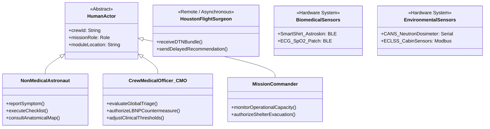
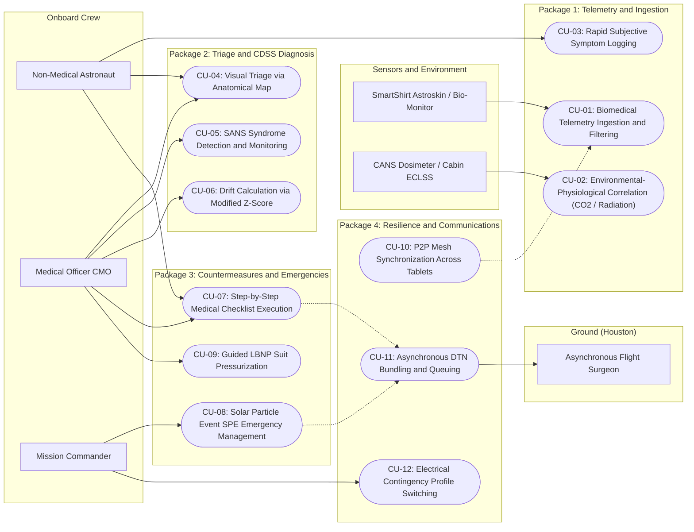

# 📐 ASTHA System Use Case Model and Catalog
### NASA Space Apps Challenge | Create Health Monitoring Software for Astronauts on Space Missions
**Regulatory Framework:** ISO/IEC/IEEE 29148 | UML 2.5 | NASA Systems Engineering Handbook (NASA/SP-2016-6105)

---

## 🎯 1. Purpose and Scope of the Use Case Model

This document defines the operational and systemic interaction between actors (human and automated) and the **ASTHA** system during crewed deep-space missions to Mars.

Unlike User Stories (which express user value and agile acceptance criteria), **Use Cases (CU)** formally specify:
* Preconditions and Postconditions of spacecraft and crew state.
* Step-by-step sequence of the main flow of events (Actor $\leftrightarrow$ System).
* Alternative flows and clinical branches.
* Strict exception handling (loss of biosignals, cosmic radiation events, network failures).
* Non-functional requirements associated with each use case (response times, power consumption, and ergonomics).

---

## 👥 2. System Actor Catalog

### Actor Descriptions:
1. **Mission Astronaut (Primary Actor):** Crew member without advanced medical training (e.g., pilot, geologist, propulsion engineer). Interacts with the software under stress, fatigue, or microgravity conditions.
2. **Crew Medical Officer (CMO - Dr. Hayley Arceneaux):** Onboard health officer trained in advanced life support. Supervises group health and executes differential diagnostic procedures.
3. **Mission Commander (Jared Isaacman):** Responsible for overall spacecraft safety and decision-making affecting the flight profile (e.g., EVA abort or evacuation to a shielded module).
4. **Ground Flight Surgeon (Houston Flight Surgeon):** Specialist physician at JSC operating in **100% asynchronous** mode due to the 22-minute one-way light-time latency (44 min RTT).
5. **Flight Biomedical Sensors (System Actor):** *Astroskin / Bio-Monitor* (CSA) smart garment and continuous patches transmitting telemetry packets at 1 Hz over Bluetooth Low Energy.
6. **Spacecraft Environmental Sensors (System Actor):** CSA *CANS* neutron spectrometer and *ECLSS* atmospheric sensors measuring $ppCO_2$, cabin pressure, and radiation.

---

## 🗺️ 3. General Use Case Diagram (Mermaid UML)

---

## 📊 4. Use Cases vs. User Stories vs. SRS Requirements Matrix

| Use Case | Formal Title | Primary Actors | Traced Stories | Traced SRS Requirements |
| :--- | :--- | :--- | :--- | :--- |
| **CU-01** | Continuous Biomedical Telemetry Ingestion and Filtering | SmartShirt, Astronaut | HU-01 | RF-ING-01, RF-DSH-01, RNF-POW-03 |
| **CU-02** | Physiological Correlation with Environmental Factors | ECLSS/CANS Sensors, CMO | HU-03 | RF-ING-02, RF-EVA-04, RF-DSH-04 |
| **CU-03** | Zero-Friction Logging of Subjective Symptoms | Astronaut | HU-04 | RF-ING-03, RNF-USA-01, RNF-USA-02 |
| **CU-04** | Visual Triage via Interactive Anatomical Map Exploration | Astronaut, CMO | HU-05, HU-08 | RF-ANA-01..04, RF-DSH-03 |
| **CU-05** | Early Detection and Stratification of SANS | CMO, Patient | HU-06 | RF-EVA-01, RF-EVA-03, RF-GUI-01 |
| **CU-06** | Algorithmic Detection of Physiological Drift (Z-Score) | CMO, CDSS System | HU-07 | RF-DER-01..03, RNF-USA-05 |
| **CU-07** | Countermeasure Protocol Execution (Checklists) | Astronaut, CMO | HU-09, HU-12 | RF-GUI-01..04, RNF-USA-04 |
| **CU-08** | Solar Particle Event (SPE) Protocol Activation | Commander, Crew | HU-10 | RF-EVA-04, RF-GUI-03, RNF-USA-04 |
| **CU-09** | LBNP Suit Pressurization and Monitoring | CMO, Patient | HU-11 | RF-GUI-01, RF-GUI-02, RF-ANA-02 |
| **CU-10** | P2P Mesh Synchronization Across Cabin Devices | Mesh Nodes, Software Eng. | HU-15, HU-16 | RNF-NET-02, RNF-NET-04, RNF-SEC-04 |
| **CU-11** | Asynchronous DTN Bundling and Queuing for Houston | Edge System, Flight Surgeon | HU-14 | RF-GUI-05, RNF-NET-03, RNF-SEC-01 |
| **CU-12** | Switching to Electrical Contingency Mode (< 5W) | Commander, EPS Bus | HU-20 | RNF-POW-01..04, RNF-POW-03 |

---

## 📁 5. Detailed Use Case Documents

All 12 use cases are documented with full formal structure in the following files:

* [`CU-01-Monitoreo-Telemetria-Ingesta.md`](CU-01-Monitoreo-Telemetria-Ingesta.md): Use cases CU-01, CU-02, and CU-03.
* [`CU-02-Triage-Diagnostico-Soporte.md`](CU-02-Triage-Diagnostico-Soporte.md): Use cases CU-04, CU-05, and CU-06.
* [`CU-03-Contramedidas-Emergencias-Vuelo.md`](CU-03-Contramedidas-Emergencias-Vuelo.md): Use cases CU-07, CU-08, and CU-09.
* [`CU-04-Arquitectura-Red-Resiliencia-Edge.md`](CU-04-Arquitectura-Red-Resiliencia-Edge.md): Use cases CU-10, CU-11, and CU-12.
