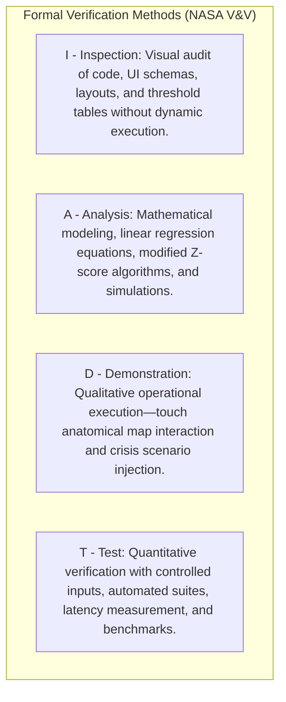

# 🎯 Acceptance Criteria and Verification & Validation (V&V) Framework
### ASTHA — NASA Space Apps Challenge 2026
**Regulatory Framework:** NASA-STD-3001 Vol 1 & 2 | NPR 7150.2 (NASA Software Engineering) | ISO/IEC/IEEE 29148

---

## 📌 1. Purpose and Flight Verification Philosophy

For spaceflight medical decision-support software to achieve operational acceptance by NASA and partner agencies (CSA, ESA, JAXA), **defining theoretical requirements is not sufficient**: every functional and non-functional requirement must be backed by verifiable **Acceptance Criteria (AC)** evaluated through standardized, auditable methods.

This directory formalizes the acceptance criteria for the **ASTHA** system, organized into two complementary domains:
1. **Clinical and Physiological Criteria (AC-CLIN):** Ensure that detection algorithms, medical alert thresholds, and countermeasures strictly adhere to human biological limits established in `NASA-STD-3001` and the `NASA R.I.D.G.E.` framework.
2. **Technical and Non-Functional Criteria (AC-TECH):** Ensure that the computing architecture can operate in the harsh deep-space environment: **100% offline (Zero-Ping)**, tolerant to cosmic radiation (**SEU**), low power draw (**$< 5\text{ W}$**), and serverless P2P mesh synchronization.

---

## 🔬 2. Official NASA Verification Methods (I / A / D / T)

Every acceptance criterion in ASTHA is classified under one of NASA's four formal verification methods (*NASA Systems Engineering Handbook*):

* **I (Inspection):** Verification of visual elements, source code structure, presence of ISA-Tab metadata, or high-contrast design for color-vision deficiency.
* **A (Analysis):** Evaluation of the mathematical formulation of statistical drift ($\text{MAD}$, regression slopes) and data dispersion.
* **D (Demonstration):** Live functional test performed before evaluators or crew (e.g., injecting a Solar Particle Event SPE and observing system response in $< 100\text{ ms}$).
* **T (Test):** Automated test suites injecting synthetic or real biosignals and measuring outputs with millisecond precision (CPU timings, network latencies, DTN bundles).

---

## 📑 3. Criteria Documentation Structure

Detailed criteria are structured across the following documents in this folder:

| Document | Primary Focus | Included Criteria |
| :--- | :--- | :--- |
| **[`CRITERIOS_FUNCIONALES_AC_CLINICOS.md`](CRITERIOS_FUNCIONALES_AC_CLINICOS.md)** | Clinical accuracy, NASA vital thresholds, SANS detection, Z-score, $CO_2$, CANS radiation, and checklists. | `AC-CLIN-01` through `AC-CLIN-07` |
| **[`CRITERIOS_NO_FUNCIONALES_AC_TECNICOS.md`](CRITERIOS_NO_FUNCIONALES_AC_TECNICOS.md)** | Edge performance, power draw ($< 5\text{ W}$), offline resilience, P2P mesh network, DTN, and SEU tolerance. | `AC-TECH-01` through `AC-TECH-06` |
| **[`MATRIZ_VERIFICACION_Y_VALIDACION_NASA.md`](MATRIZ_VERIFICACION_Y_VALIDACION_NASA.md)** | Cross-compliance matrix: SRS Requirement $\leftrightarrow$ Method (I/A/D/T) $\leftrightarrow$ Result. | Full system matrix |

---

## 📊 4. Summary Table of Key Acceptance Criteria

| Criterion ID | Short Title | Method | Threshold or Quantitative Target | Acceptable Tolerance |
| :--- | :--- | :---: | :--- | :--- |
| **AC-CLIN-01** | Tri-State Biosignal Classification | **T** | 100% match with NASA-STD-3001 ranges | 0 false negatives in critical ranges |
| **AC-CLIN-02** | Physiological Drift Detection | **A** | Median absolute deviation ($|M_i| \ge 2.5$) | Mathematical error $< 0.01\%$ |
| **AC-CLIN-03** | SANS Protocol Activation | **D, T** | $\text{SBP} \ge 140\text{ mmHg}$ in microgravity | LBNP deployment in $< 100\text{ ms}$ |
| **AC-CLIN-04** | Cabin $CO_2$ Correlation | **T** | Preventive trigger at $> 2.5\text{ mmHg}$ and critical at $> 3.0\text{ mmHg}$ | Temporal accuracy $\pm 1\text{ s}$ |
| **AC-CLIN-05** | Solar Particle Event (SPE) Alarm | **D** | CANS rate $> 100\ \mu\text{Sv/h}$ triggers Storm Shelter evacuation | Alarm latency $< 50\text{ ms}$ |
| **AC-CLIN-06** | Non-Medical Checklist Usability | **D** | Maximum 4 actionable steps per procedure | Plain language without medical jargon |
| **AC-CLIN-07** | Visual Accessibility and Color Blindness | **I** | Dual coding (color + shape/icon/pattern) | WCAG 2.1 AAA / NASA Ergonomics compliance |
| **AC-TECH-01** | 100% Offline Autonomy (Zero-Ping) | **T** | Zero external network dependencies at runtime | 0 calls to cloud servers |
| **AC-TECH-02** | Contingency Power Budget | **T** | Total idle power consumption $< 5\text{ W}$ | CPU usage $< 15\%$ of a single core |
| **AC-TECH-03** | User Interface Latency | **T** | Touch rendering time $< 100\text{ ms}$ | 60 fps in nominal mode / 0.2 fps in contingency |
| **AC-TECH-04** | P2P Mesh Synchronization | **T** | CRDT reconciliation across cabin terminals $< 3\text{ s}$ | 0 data loss during network partition |
| **AC-TECH-05** | DTN Bundling for Houston | **T** | SHA-256 signed RFC 5050 bundles for 44 min RTT | Minimum 30-day local queue retention |
| **AC-TECH-06** | Radiation Hardening (SEU) | **A, T** | Bit-flip detection and correction in flash records | 100% valid parity and CRC32 checksums |

---

*Core ASTHA requirements engineering document for the NASA Space Apps Challenge technical audit.*
