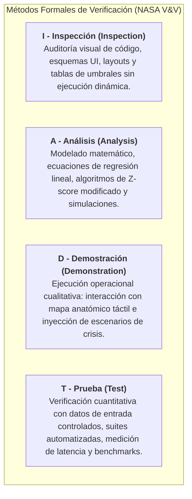

# 🎯 Criterios de Aceptación y Marco de Verificación y Validación (V&V)
### AstroVital — NASA Space Apps Challenge 2026
**Marco Normativo:** NASA-STD-3001 Vol 1 & 2 | NPR 7150.2 (NASA Software Engineering) | ISO/IEC/IEEE 29148

---

## 📌 1. Propósito y Filosofía de Verificación de Vuelo

Para que un software de soporte a la decisión médica de vuelo espacial sea aceptado operacionalmente por la NASA y las agencias asociadas (CSA, ESA, JAXA), **no basta con definir requisitos teóricos**: cada requisito funcional y no funcional debe contar con **Criterios de Aceptación (Acceptance Criteria - AC)** verificables mediante métodos estandarizados y auditables.

Este directorio formaliza los criterios de aceptación del sistema **AstroVital**, divididos en dos dominios complementarios:
1. **Criterios Clínicos y Fisiológicos (AC-CLIN):** Garantizan que los algoritmos de detección, los umbrales de alerta médica y las contramedidas respetan estrictamente los límites biológicos humanos establecidos en `NASA-STD-3001` y el marco `NASA R.I.D.G.E.`.
2. **Criterios Técnicos y No Funcionales (AC-TECH):** Garantizan que la arquitectura informática es capaz de operar en el entorno hostil del espacio profundo: **100% offline (Zero-Ping)**, con tolerancia a radiación cósmica (**SEU**), bajo consumo eléctrico (**$< 5\text{ W}$**) y con sincronización en malla P2P sin servidor central.

---

## 🔬 2. Métodos de Verificación Oficiales de la NASA (I / A / D / T)

Cada criterio de aceptación en AstroVital está clasificado bajo uno de los cuatro métodos formales de verificación de la NASA (*NASA Systems Engineering Handbook*):

* **I (Inspección):** Verificación de elementos visuales, estructura de código fuente, presencia de metadatos ISA-Tab o diseño de alto contraste para daltonismo.
* **A (Análisis):** Evaluación de la formulación matemática de deriva estadística ($\text{MAD}$, pendientes de regresión) y dispersión de datos.
* **D (Demostración):** Prueba funcional en vivo realizada ante evaluadores o tripulantes (ej. inyectar Tormenta Solar SPE y observar la respuesta del sistema en $< 100\text{ ms}$).
* **T (Prueba):** Suites de pruebas automatizadas que inyectan bioseñales sintéticas o reales y miden salidas con precisión milimétrica (tiempos de CPU, latencias de red, paquetes DTN).

---

## 📑 3. Estructura de Documentación de Criterios

Los criterios detallados se estructuran en los siguientes documentos dentro de esta carpeta:

| Documento | Enfoque Principal | Criterios Incluidos |
| :--- | :--- | :--- |
| **[`CRITERIOS_FUNCIONALES_AC_CLINICOS.md`](CRITERIOS_FUNCIONALES_AC_CLINICOS.md)** | Exactitud clínica, umbrales vitales NASA, detección de SANS, Z-score, $CO_2$, radiación CANS y checklists. | `AC-CLIN-01` al `AC-CLIN-07` |
| **[`CRITERIOS_NO_FUNCIONALES_AC_TECNICOS.md`](CRITERIOS_NO_FUNCIONALES_AC_TECNICOS.md)** | Rendimiento Edge, consumo eléctrico ($< 5\text{ W}$), resiliencia offline, red malla P2P, DTN y tolerancia SEU. | `AC-TECH-01` al `AC-TECH-06` |
| **[`MATRIZ_VERIFICACION_Y_VALIDACION_NASA.md`](MATRIZ_VERIFICACION_Y_VALIDACION_NASA.md)** | Matriz de cumplimiento cruzado ("Compliance Matrix"): Requisito SRS $\leftrightarrow$ Método (I/A/D/T) $\leftrightarrow$ Resultado. | Matriz completa del sistema |

---

## 📊 4. Cuadro Resumen de Criterios de Aceptación Clave

| ID Criterio | Título Breve | Método | Umbral o Meta Cuantitativa | Tolerancia Aceptable |
| :--- | :--- | :---: | :--- | :--- |
| **AC-CLIN-01** | Clasificación Tri-Estado de Bioseñales | **T** | 100% de coincidencia con rangos de NASA-STD-3001 | 0 falsos negativos en rangos críticos |
| **AC-CLIN-02** | Detección de Deriva Fisiológica | **A** | Desviación absoluta respecto a la mediana ($|M_i| \ge 2.5$) | Error matemático $< 0.01\%$ |
| **AC-CLIN-03** | Activación de Protocolo SANS | **D, T** | $\text{PAS} \ge 140\text{ mmHg}$ en microgravedad | Despliegue de LBNP en $< 100\text{ ms}$ |
| **AC-CLIN-04** | Correlación con $CO_2$ de Cabina | **T** | Disparo preventivo a $> 2.5\text{ mmHg}$ y crítico a $> 3.0\text{ mmHg}$ | Exactitud temporal $\pm 1\text{ s}$ |
| **AC-CLIN-05** | Alarma de Tormenta Solar (SPE) | **D** | Tasa CANS $> 100\ \mu\text{Sv/h}$ activa evacuación a Storm Shelter | Latencia de alarma $< 50\text{ ms}$ |
| **AC-CLIN-06** | Usabilidad de Checklists no Médicos | **D** | Máximo 4 pasos accionables por procedimiento | Lenguaje comprensible sin jerga médica |
| **AC-CLIN-07** | Accesibilidad Visual y Daltonismo | **I** | Doble codificación (color + forma/icono/patrón) | Cumplimiento WCAG 2.1 AAA / NASA Ergonomics |
| **AC-TECH-01** | Autonomía 100% Offline (Zero-Ping) | **T** | Cero dependencias de red externa en tiempo de ejecución | 0 llamadas a servidores en la nube |
| **AC-TECH-02** | Presupuesto de Potencia en Emergencia | **T** | Consumo eléctrico total en reposo $< 5\text{ W}$ | Uso de CPU $< 15\%$ en un solo núcleo |
| **AC-TECH-03** | Latencia de Interfaz de Usuario | **T** | Tiempo de renderizado táctil $< 100\text{ ms}$ | 60 fps en modo nominal / 0.2 fps en contingencia |
| **AC-TECH-04** | Sincronización P2P en Red Malla | **T** | Reconciliación CRDT entre terminales de cabina $< 3\text{ s}$ | 0 pérdida de datos ante partición de red |
| **AC-TECH-05** | Empaquetado DTN para Houston | **T** | Bundles RFC 5050 firmados con SHA-256 para 44 min RTT | Retención local mínima de 30 días en cola |
| **AC-TECH-06** | Blindaje ante Radiación (SEU) | **A, T** | Detección y corrección de bit-flips en registros flash | 100% de paridad y sumas CRC32 válidas |

---

*Documento central de ingeniería de requisitos de AstroVital para la auditoría técnica de NASA Space Apps Challenge.*
