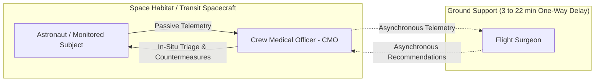
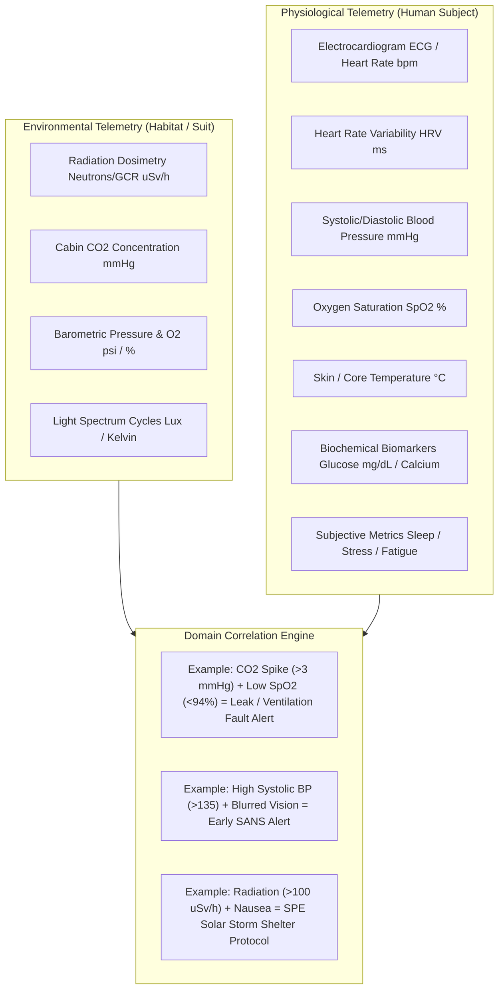

# PROBLEM DOMAIN SPECIFICATION AND OPERATIONAL CONTEXT
## BIOMEDICAL MONITORING AND CLINICAL AUTONOMY IN DEEP SPACE MISSIONS
### Baseline Document for Requirements Engineering (Aligned with ISO/IEC/IEEE 29148)

---

## 1. PROBLEM DOMAIN DESCRIPTION

### 1.1 Problem Statement
| Dimension | Description |
| :--- | :--- |
| **The problem of:** | Accelerated multisystemic degradation of human health and the lack of autonomous *in-situ* diagnostic and therapeutic capabilities. |
| **Affects:** | Astronaut crews on exploration missions beyond Low Earth Orbit (Artemis Lunar Program and crewed missions to Mars). |
| **The impact of which is:** | Permanent loss of visual acuity, acute cardiovascular events, severe bone demineralization, renal stone formation, cognitive impairment due to extreme fatigue, lethal risk from space radiation exposure, and potential catastrophic mission failure. |
| **A successful solution must:** | Enable early detection, clinical triage, environmental-physiological telemetry correlation, and execution of medical countermeasures under a regime of **absolute autonomy**, mitigating the operational isolation caused by Earth communication latency. |

### 1.2 Operational Context and the Communication Gap (The 22-Minute Latency Gap)
In missions aboard the International Space Station (LEO), the crew relies on real-time telemetry downlinks and instantaneous voice/video communication with the Flight Surgeon at Mission Control Center in Houston or Montreal.

On missions to Mars, orbital separation (up to 400 million kilometers) introduces an electromagnetic signal propagation delay of **3 to 22 minutes one-way** (up to 44 minutes for a complete question-and-response cycle).
* **Domain Consequence:** During a medical emergency or accelerated physiological drift, real-time consultation with Earth-based specialists is **physically unfeasible**.
* **Crew Reality:** Crew members are engineers, pilots, and scientists—not emergency medicine physicians or radiologists. Clinical decision-making must be guided and immediately actionable by non-specialists.

---

## 2. DOMAIN ACTORS AND STAKEHOLDER PROFILES

| Actor / Role | Domain Responsibility | Critical Domain Need |
| :--- | :--- | :--- |
| **Astronaut (Crew Member)** | Monitor personal health status, report subjective symptoms, and execute daily countermeasures (exercise, nutrition, sleep). | Requires immediate interpretation of health status without impenetrable medical jargon or false alarms. |
| **Crew Medical Officer (CMO)** | Crew member with basic medical training (non-specialist) assigned to manage onboard medical emergencies. | Requires step-by-step clinical decision support protocols to diagnose, assess severity, and treat the patient. |
| **Ground Flight Surgeon** | Aerospace medicine specialist physician at Houston/CSA overseeing mission medical operations. | Requires asynchronous consolidation of longitudinal trends and anomalous events to validate long-term treatment plans. |

---

## 3. BIOMEDICAL THREAT MODEL (THE NASA HAZARD & RISK FRAMEWORK)

The spaceflight environment subjects the human body to five interconnected hazards (official **NASA R.I.D.G.E.** Framework):

### 3.1 The 5 Environmental Hazards (NASA Hazards)
1. **Radiation (Space Radiation):**
   * Continuous exposure to Galactic Cosmic Rays (GCR) and unpredictable Solar Particle Events (SPE).
   * Secondary neutron radiation contributes approximately **30% of the absorbed biological dose** inside pressurized spacecraft structures.
   * *Impact:* Genotoxic damage, acute radiation syndrome, carcinogenesis, and early-onset cataracts.
2. **Isolation & Confinement:**
   * Loss of natural terrestrial circadian cues (artificial light/dark cycles or 16 orbital sunrises per day in LEO).
   * *Impact:* Circadian rhythm disruption, chronic insomnia, cognitive performance degradation, apathy, and psychosocial stress.
3. **Distance from Earth:**
   * Impossibility of emergency medical evacuation (*No MEDEVAC*) and strictly limited supply of pharmacological resources and medical hardware.
4. **Gravity Fields (Altered Gravity Fields: 0G, 1/6G Lunar, 3/8G Martian):**
   * Absence of terrestrial hydrostatic gradient: bodily fluids shift toward the thorax and head (~2 liters of cephalad fluid shift).
   * Biomechanical deconditioning: absence of axial mechanical loading on the musculoskeletal system.
5. **Hostile Closed Environments:**
   * Confined volume with closed-loop artificial atmosphere recirculation: localized $CO_2$ accumulation in stagnant pockets, toxic aerosols, irritating lunar/Martian regolith dust, and proliferation of resistant microbial biofilms.

### 3.2 NASA Priority Clinical Risks (HRP Clinical Matrix)
Specific pathological phenomena that must be continuously monitored and correlated:

* **SANS (Spaceflight Associated Neuro-ocular Syndrome):**
  * *Mechanism:* Cephalad fluid redistribution elevates intracranial and orbital venous pressure.
  * *Manifestation:* Globe flattening, choroidal folds, optic disc edema, and progressive irreversible hyperopic shift.
* **Bone Mineral Density Loss and Hypercalciuria:**
  * *Mechanism:* Osteoblastic deactivation and accelerated osteoclastic resorption driven by lack of gravitational loading.
  * *Loss Rate:* **1.0% to 1.5% bone mass per month** in weight-bearing bones (pelvis, femur, calcaneus).
  * *Secondary Complication:* Mobilized calcium enters blood and urine, causing **nephrolithiasis (obstructive renal stones)**—a highest-severity medical emergency in spaceflight.
* **Cardiovascular Atrophy and Dysautonomia:**
  * *Mechanism:* Reduction of left ventricular myocardial mass, decreased circulating plasma volume, and increased arterial stiffness.
  * *Manifestation:* Loss of Heart Rate Variability (depressed HRV), susceptibility to arrhythmias, and severe orthostatic collapse upon re-exposure to gravity.
* **Immune Dysregulation and Viral Reactivation:**
  * *Mechanism:* Combination of chronic confinement stress, elevated cortisol, and microgravity.
  * *Manifestation:* Asymptomatic or acute reactivation of latent herpesviruses (Epstein-Barr, Varicella-Zoster, Cytomegalovirus).
* **Deep Vein Thrombosis / Retrograde Jugular Venous Flow:**
  * *Mechanism:* Prolonged blood stasis in the head and neck venous circulation caused by microgravity.

---

## 4. DOMAIN INFORMATION FLOWS AND TELEMETRY CHANNELS

The domain analytics engine must correlate two complementary data streams:

### 4.1 Official Telemetry Sources and Typology

1. **Continuous Human Physiological Telemetry (CSA Bio-Monitor / Astroskin Style):**
   * Captured via bio-sensorized smart garments: continuous 3-lead ECG waveforms, respiratory inductance plethysmography, photoplethysmography ($SpO_2$), triaxial accelerometry, and peripheral skin temperature.
2. **Cabin Environmental Telemetry (ISS ECLSS / ISS-Mimic Style):**
   * Partial pressure of carbon dioxide ($ppCO_2$), total cabin pressure, $O_2$ percentage, ambient temperature, and airflow velocity across habitable modules.
3. **Space Radiation Telemetry (NASA MSL RAD and CSA CANS Style):**
   * Absorbed radiation dose rate ($\mu Gy/h$), dose equivalent rate ($\mu Sv/h$), charged particle flux, and real-time neutron spectrometry.

---

## 5. DOMAIN BOUNDARIES AND CLINICAL THRESHOLDS (NASA-STD-3001 GROUND TRUTH)

To define the business rules for physiological state evaluation, the authoritative reference standard is **NASA-STD-3001 (Space Flight Human-System Standard, Vol. 1 & 2)**:

| Biomedical / Environmental Indicator | Nominal Physiological Range | Caution Range (Yellow) | Critical Emergency Threshold (Red) | Domain Justification |
| :--- | :--- | :--- | :--- | :--- |
| **Resting Heart Rate (HR)** | 55 – 85 bpm | 86 – 105 bpm | $< 45\text{ bpm}$ or $> 110\text{ bpm}$ | Detection of reflex tachycardia, arrhythmias, or shock. |
| **Heart Rate Variability (HRV rMSSD)** | 35 – 70 ms | 20 – 34 ms | $< 20\text{ ms}$ sustained | Marker of acute autonomic stress, fatigue, and sympathetic decompensation. |
| **Systolic Blood Pressure** | 105 – 125 mmHg | 126 – 139 mmHg | $\ge 140\text{ mmHg}$ | Elevated pressures accelerate ocular congestion and SANS progression. |
| **Oxygen Saturation ($SpO_2$)** | 96% – 100% | 93% – 95% | $< 93\%$ | Indicates cabin hypoxic hypoxia or ventilatory depression. |
| **Cabin $CO_2$ Partial Pressure** | $< 2.0\text{ mmHg}$ | 2.0 – 3.0 mmHg | $> 3.0\text{ mmHg}$ | In microgravity, $CO_2$ concentrations $> 3\text{ mmHg}$ induce headaches and intracranial hypertension. |
| **Radiation Dosimetry** | $15 – 35\ \mu Sv/h$ | $36 – 80\ \mu Sv/h$ | $> 100\ \mu Sv/h$ | Suspected Solar Particle Event (SPE) threshold. |
| **Daily Sleep Duration** | 7.0 – 8.5 hrs | 5.5 – 6.9 hrs | $< 5.5\text{ hrs}$ for $\ge 2$ days | Increases psychomotor reaction time and operational human error. |
| **Fasting Blood Glucose** | 75 – 105 mg/dL | 106 – 125 mg/dL | $< 65$ or $> 140\text{ mg/dL}$ | Metabolic alterations secondary to in-flight metabolic stress. |

---

## 6. DOMAIN CONSTRAINTS AND OPERATING ENVIRONMENT

Any system operating within this domain is bound by the following non-negotiable constraints:

1. **Connectivity Constraint (Zero External Dependency):**
   * There is no access to cloud infrastructure, Earth-based servers, or remote databases. Every data model, decision heuristic, and medical knowledge base must reside locally on the spacecraft node.
2. **User Training Constraint (Non-Specialist Interface):**
   * The system cannot assume the user has critical-care physician training. Warnings must be translated into:
     * *What is occurring anatomically.*
     * *What the severity and estimated time-to-impact are.*
     * *What exact, sequential, and verifiable countermeasure actions are required.*
3. **Physical Medical Resource Constraint:**
   * Recommended interventions must be feasible using limited onboard hardware: Advanced Resistive Exercise Device (ARED), cycle ergometer/treadmill, Lower Body Negative Pressure (LBNP) suit, exploration medical kit pharmaceuticals, and isolation/storm shelter compartment.
4. **Fatigue and Cognitive Load Constraint:**
   * Data capture and inspection interfaces must not impose tedious clinical forms. Interaction must require minimal cognitive effort, featuring unambiguous color coding and intuitive spatial anatomical visualization.

---

## 7. SUCCESS CRITERIA AND PROBLEM RESOLUTION (ACCEPTANCE CRITERIA)

To consider the domain problem successfully addressed by an engineering design, the following observable conditions must be met:

* **AC-01 (Local Diagnostic Autonomy):** Ability to classify each astronaut's health status within a three-tier scheme (Nominal, Caution, Critical) without transmitting or receiving network packets from Earth.
* **AC-02 (Early Drift Detection):** Identification of subtle time-series trends (e.g., progressive drop in sleep duration + rising diastolic blood pressure) before the astronaut experiences an incapacitating symptom.
* **AC-03 (Physiological and Anatomical Traceability):** Unambiguous mapping between numerical biomarkers and affected organ systems (neuro-ocular, cardiovascular, musculoskeletal, renal, and cognitive systems).
* **AC-04 (Operational Countermeasure Guidance):** Generation of clear, actionable step-by-step instructions tied to each deviation from NASA-STD-3001.
* **AC-05 (Resilience to Extreme Environmental Events):** Immediate response to external habitat perturbations (injected radiation spikes or $CO_2$ enrichment) with physical contingency protocols.
