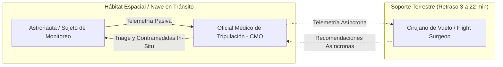
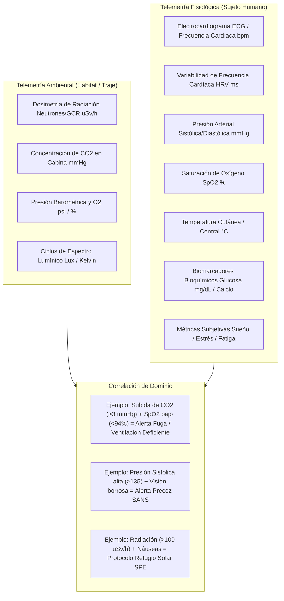

# ESPECIFICACIÓN DEL DOMINIO DEL PROBLEMA Y CONTEXTO OPERACIONAL
## MONITOREO BIOMÉDICO Y AUTONOMÍA CLÍNICA EN MISIONES DE ESPACIO PROFUNDO
### Documento Base para Ingeniería de Requisitos (Alineado a ISO/IEC/IEEE 29148)

---

## 1. DESCRIPCIÓN DEL DOMINIO DEL PROBLEMA

### 1.1 Declaración del Problema (Problem Statement)
| Dimensión | Descripción |
| :--- | :--- |
| **El problema de:** | La degradación multisistémica acelerada de la salud humana y la falta de capacidad diagnóstica/terapéutica autónoma *in-situ*. |
| **Afecta a:** | Tripulaciones de astronautas en misiones de exploración más allá de la órbita baja terrestre (Programa Artemis a la Luna y misiones tripuladas a Marte). |
| **Cuyo impacto es:** | Pérdida de agudeza visual permanente, eventos cardiovasculares agudos, desmineralización ósea severa, formación de cálculos renales, deterioro cognitivo por fatiga extrema, riesgo letal por exposición a radiación espacial, y potencial fracaso catastrófico de la misión. |
| **Una solución exitosa debe:** | Permitir la detección temprana, triage clínico, correlación de telemetría ambiental-fisiológica y ejecución de contramedidas médicas en un régimen de **autonomía absoluta**, mitigando el aislamiento operacional provocado por la latencia de comunicaciones con la Tierra. |

### 1.2 Contexto Operacional y la Brecha de Comunicación (The 22-Minute Latency Gap)
En misiones en la Estación Espacial Internacional (LEO), la tripulación dispone de enlace telemétrico en tiempo real y comunicación instantánea con el Cirujano de Vuelo (*Flight Surgeon*) del Centro de Control de Misión en Houston o Montreal. 

En misiones a Marte, la distancia orbital (hasta 400 millones de kilómetros) introduce un retraso de propagación electromagnética de **entre 3 y 22 minutos por sentido** (hasta 44 minutos para un ciclo de pregunta-respuesta).
* **Consecuencia de Dominio:** Ante una emergencia médica o una deriva fisiológica acelerada, la consulta con especialistas terrestres en tiempo real es **físicamente inviable**.
* **Realidad de la Tripulación:** Los miembros de la tripulación son ingenieros, pilotos y científicos, no médicos especialistas en emergencias ni radiólogos. La toma de decisiones clínicas debe ser guiada y comprensible para no expertos.

---

## 2. ACTORES DEL DOMINIO Y PERFILES DE INTERESADOS (STAKEHOLDERS)

| Actor / Rol | Responsabilidad en el Dominio | Necesidad Crítica de Dominio |
| :--- | :--- | :--- |
| **Astronauta (Crew Member)** | Monitorizar su propio estado, reportar síntomas subjetivos y ejecutar contramedidas diarias (ejercicio, nutrición, sueño). | Requiere interpretación inmediata de su estado de salud sin terminología médica incomprensible ni alarmas falsas. |
| **Oficial Médico de Tripulación (CMO - Crew Medical Officer)** | Tripulante con entrenamiento médico básico (no especialista) asignado para atender emergencias a bordo. | Requiere protocolos de soporte a decisiones clínicas paso a paso para diagnosticar, evaluar gravedad y tratar al paciente. |
| **Cirujano de Vuelo en Tierra (Flight Surgeon)** | Médico especializado en medicina aeroespacial en Houston/CSA que supervisa la misión. | Requiere consolidación asíncrona de tendencias y eventos anómalos para validar tratamientos a largo plazo. |

---

## 3. MODELO DE AMENAZAS BIOMÉDICAS (THE NASA HAZARD & RISK FRAMEWORK)

El entorno espacial somete al cuerpo humano a cinco peligros interconectados (Modelo oficial **NASA R.I.D.G.E.**):

### 3.1 Los 5 Peligros Ambientales (NASA Hazards)
1. **Radiation (Radiación Espacial):**
   * Exposición continua a Radiación Cósmica Galáctica (GCR) y Eventos de Partículas Solares imprevistos (SPE).
   * La radiación de neutrones secundarios aporta aproximadamente el **30% de la dosis biológica absorbida** en estructuras presurizadas.
   * *Impacto:* Daño genotóxico, síndrome agudo de radiación, carcinogénesis y cataratas tempranas.
2. **Isolation & Confinement (Aislamiento y Confinamiento):**
   * Pérdida de pistas circadianas naturales terrestres (ciclos de luz/oscuridad artificiales o 16 amaneceres diarios en LEO).
   * *Impacto:* Ruptura del ritmo circadiano, insomnio crónico, degradación del rendimiento cognitivo, apatía y estrés psicosocial.
3. **Distance from Earth (Distancia de la Tierra):**
   * Imposibilidad de evacuación de emergencia (*No MEDEVAC*) y suministro limitado de recursos farmacológicos y equipos médicos.
4. **Gravity Fields (Campos Gravitatorios Alterados: 0G, 1/6G lunar, 3/8G marciano):**
   * Ausencia de gradiente hidrostático terrestre: los líquidos corporales migran hacia el tórax y la cabeza (~2 litros de fluidos desplazados cefálicamente).
   * Descondicionamiento biomecánico: falta de carga axial sobre el sistema musculoesquelético.
5. **Hostile Closed Environments (Entornos Cerrados Hostiles):**
   * Espacio confinado con recirculación artificial de atmósfera: acumulación de $CO_2$ en bolsas estancadas, aerosoles tóxicos, polvo lunar/marciano irritante y proliferación de biopelículas microbianas resistentes.

### 3.2 Riesgos Clínicos Prioritarios de la NASA (HRP Clinical Matrix)
Los fenómenos patológicos concretos que deben ser monitorizados y correlacionados:

* **SANS (Spaceflight Associated Neuro-ocular Syndrome):**
  * *Mecanismo:* La redistribución cefálica de fluidos eleva la presión venosa intracraneal y orbitaria.
  * *Manifestación:* Aplanamiento del globo ocular, pliegues coroideos, edema de papila óptica e hipermetropía progresiva irreversible.
* **Pérdida de Densidad Mineral Ósea e Hipercalciuria:**
  * *Mecanismo:* Desactivación osteoblástica y reabsorción osteoclástica acelerada por falta de impacto gravitatorio.
  * *Tasa de pérdida:* **1.0% a 1.5% de masa ósea por mes** en huesos de soporte (pelvis, fémur, calcáneo).
  * *Complicación secundaria:* El calcio disuelto pasa a la sangre y orina, provocando **nefrolitiasis (cálculos renales obstructivos)**, emergencia médica de máxima gravedad en el espacio.
* **Atrofia Cardiovascular y Desautonomía:**
  * *Mecanismo:* Disminución de la masa miocárdica del ventrículo izquierdo, reducción del volumen plasmático circulante y rigidez vascular.
  * *Manifestación:* Pérdida de Variabilidad de la Frecuencia Cardíaca (HRV deprimida), propensión a arritmias y colapso ortostático severo al volver a interactuar con gravedad.
* **Desregulación Inmune y Reactivación Viral:**
  * *Mecanismo:* Combinación de estrés crónico por confinamiento, cortisol elevado y microgravedad.
  * *Manifestación:* Reactivación asintomática o aguda de virus del herpes latentes (Epstein-Barr, Varicela-Zóster, Citomegalovirus).
* **Trombosis Venosa Profunda / Flujo Retrógrado en Vena Yugular:**
  * *Mecanismo:* Estasis sanguínea prolongada en la circulación venosa de cabeza y cuello debido a la microgravedad.

---

## 4. FLUJOS DE INFORMACIÓN Y CANALES DE TELEMETRÍA DEL DOMINIO

El sistema analítico del dominio debe correlacionar dos corrientes de datos complementarias:

### 4.1 Fuentes y Tipología de Telemetría Oficiales

1. **Telemetría Fisiológica Humana Continua (Estilo CSA Bio-Monitor / Astroskin):**
   * Capturada mediante prendas inteligentes bio-sensorizadas: trazados de ECG continuo de 3 derivaciones, pletismografía por inductancia respiratoria, fotopletismografía ($SpO_2$), acelerometría triaxial y temperatura periférica.
2. **Telemetría Ambiental de Cabina (Estilo ISS ECLSS / ISS-Mimic):**
   * Presión parcial de dióxido de carbono ($ppCO_2$), presión total de cabina, porcentaje de $O_2$, temperatura y velocidad del flujo de aire en los módulos habitables.
3. **Telemetría de Radiación Espacial (Estilo NASA MSL RAD y CSA CANS):**
   * Tasa de dosis de radiación absorbida ($\mu Gy/h$), tasa de dosis equivalente ($\mu Sv/h$), flujo de partículas cargadas y espectrometría de neutrones en tiempo real.

---

## 5. LÍMITES DE DOMINIO Y UMBRALES CLÍNICOS (GROUND TRUTH NASA-STD-3001)

Para definir las reglas de negocio de evaluación de estados fisiológicos, la norma de referencia es el estándar técnico **NASA-STD-3001 (Space Flight Human-System Standard, Vol. 1 & 2)**:

| Indicador Biomédico / Ambiental | Rango Fisiológico Nominal | Rango de Precaución (Amarillo) | Umbral Crítico de Emergencia (Rojo) | Justificación de Dominio |
| :--- | :--- | :--- | :--- | :--- |
| **Frecuencia Cardíaca en Reposo (HR)** | 55 – 85 bpm | 86 – 105 bpm | $< 45\text{ bpm}$ o $> 110\text{ bpm}$ | Detección de taquicardia refleja, arritmias o shock. |
| **Variabilidad Cardíaca (HRV rMSSD)** | 35 – 70 ms | 20 – 34 ms | $< 20\text{ ms}$ sostenido | Marcador de estrés autonómico agudo, fatiga y descompensación simpática. |
| **Presión Arterial Sistólica** | 105 – 125 mmHg | 126 – 139 mmHg | $\ge 140\text{ mmHg}$ | Presiones elevadas aceleran la congestión ocular y el desarrollo de SANS. |
| **Saturación de Oxígeno ($SpO_2$)** | 96% – 100% | 93% – 95% | $< 93\%$ | Indica hipoxia hipóxica en cabina o depresión ventilatoria. |
| **Presión Parcial de $CO_2$ en Cabina** | $< 2.0\text{ mmHg}$ | 2.0 – 3.0 mmHg | $> 3.0\text{ mmHg}$ | En microgravedad, concentraciones de $CO_2 > 3\text{ mmHg}$ inducen cefaleas e hipertensión craneal. |
| **Dosimetría de Radiación** | $15 – 35\ \mu Sv/h$ | $36 – 80\ \mu Sv/h$ | $> 100\ \mu Sv/h$ | Umbral de sospecha de Evento de Partículas Solares (SPE). |
| **Duración del Sueño Diario** | 7.0 – 8.5 hrs | 5.5 – 6.9 hrs | $< 5.5\text{ hrs}$ por $\ge 2$ días | Aumenta el tiempo de reacción psicomotor y el error humano operacional. |
| **Glucemia en Ayunas** | 75 – 105 mg/dL | 106 – 125 mg/dL | $< 65$ o $> 140\text{ mg/dL}$ | Alteraciones metabólicas secundarias a estrés metabólico en vuelo. |

---

## 6. RESTRICCIONES DE DOMINIO Y ENTORNO DE OPERACIÓN

Cualquier sistema que opere en este dominio está sujeto a las siguientes restricciones no negociables:

1. **Restricción de Conectividad (Zero External Dependency):**
   * No existe acceso a la nube, servidores terrestres ni bases de datos remotas. Todo modelo de datos, heurística de decisión y conocimiento médico debe residir localmente en el nodo de la nave.
2. **Restricción de Entrenamiento del Usuario (Non-Specialist Interface):**
   * El sistema no puede asumir un nivel de médico intensivista en el usuario. Las advertencias deben traducirse en:
     * *Qué está ocurriendo anatómicamente.*
     * *Cuál es la severidad y tiempo estimado de impacto.*
     * *Cuáles son las acciones de contramedida exactas, secuenciales y verificables.*
3. **Restricción de Recursos Físicos Médicos:**
   * Las intervenciones sugeridas deben ser viables con los recursos limitados a bordo: dispositivo de ejercicio resistivo (ARED), cicloergómetro/cinta de correr, pantalones de presión negativa para la parte inferior del cuerpo (LBNP), fármacos de botiquín de exploración y cabina de aislamiento/refugio de tormentas.
4. **Restricción de Fatiga y Carga Cognitiva:**
   * La interfaz de captura y consulta no puede imponer formularios clínicos tediosos. La interacción debe ser de bajo esfuerzo cognitivo, con código de colores inequívoco y visualización anatómica espacial intuitiva.

---

## 7. CRITERIOS DE ÉXITO Y RESOLUCIÓN DEL PROBLEMA (ACCEPTANCE CRITERIA)

Para considerar que la problemática del dominio ha sido abordada con éxito por un diseño de ingeniería, deben cumplirse las siguientes condiciones observables:

* **AC-01 (Autonomía Diagnóstica Local):** Capacidad de categorizar el estado de salud de cada astronauta en un esquema tripartito (Nominal, Precaución, Crítico) sin paquetes de red enviados ni recibidos de la Tierra.
* **AC-02 (Detección de Deriva Precoz):** Identificación de tendencias sutiles en series temporales (ej. caída progresiva de horas de descanso + incremento de presión diastólica) antes de que el astronauta experimente un síntoma incapacitante.
* **AC-03 (Trazabilidad Fisiológica y Anatómica):** Asociación inequívoca entre los biomarcadores numéricos y los sistemas de órganos afectados (sistema neuro-ocular, cardiovascular, musculoesquelético, renal y cognitivo).
* **AC-04 (Guía de Contramedidas Operativas):** Generación de instrucciones claras y ejecutables asociadas a cada desviación de la norma NASA-STD-3001.
* **AC-05 (Resiliencia ante Eventos Ambientales Extremos):** Respuesta ante perturbaciones externas del hábitat (inyección de picos de radiación o enriquecimiento de $CO_2$) con protocolos inmediatos de contingencia física.
