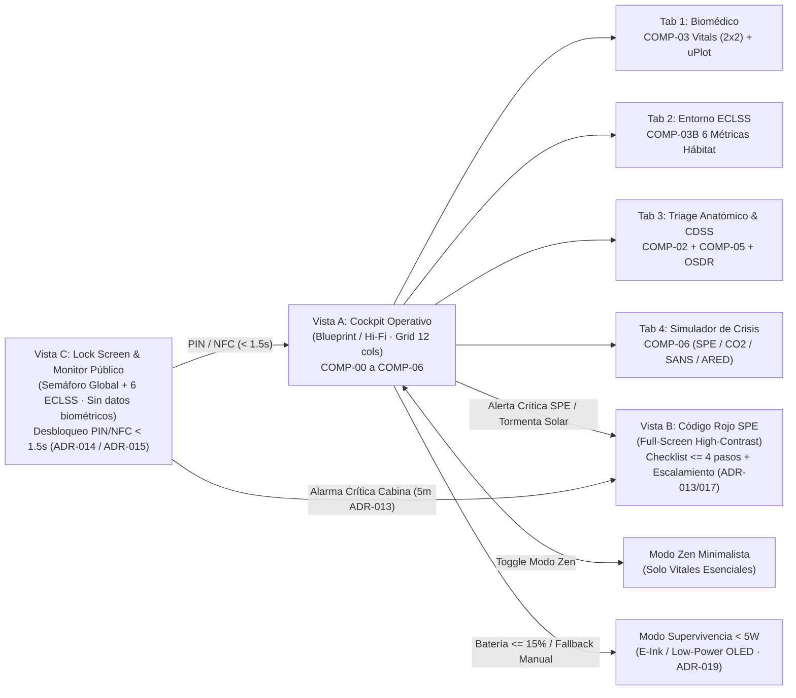

# 01 — Wireframes y Arquitectura de Pantalla

[<- Volver al Índice de Diseño UI/UX](./README.md) · [Guía de Estilo ->](./02-Guia-de-Estilo-y-Design-System.md) · [Prototipo Interactivo `wireframe.html`](../../wireframe.html)

---

## 1. Principios de Arquitectura Visual y Ergonomía Aeroespacial

La arquitectura de pantalla de **ASTHA** parte directamente del prototipo técnico [`wireframe.html`](../../wireframe.html) (**NASA Blueprint v2.5**), optimizado para **pantallas acopladas a mamparo (Bulkhead 1280+ px)** y **tablets rugerizadas en microgravedad (768–1024 px)** bajo el estándar **MIL-STD-1472H**, **NASA-STD-3001** y **WCAG 2.1 AAA**.

| Principio Normativo | Trazabilidad | Regla de Implementación en Pantalla |
| :--- | :--- | :--- |
| **Zona Táctil Segura en Microgravedad** | `RNF-USA-01` | Todo control interactivo (*checkboxes*, pestañas, *hotspots*, botones de tripulante y simulador) ocupa un área mínima de **$48 \times 48\text{ px}$** con separación mínima entre controles de **$12\text{ px}$** para evitar pulsaciones accidentales en flotación. |
| **Jerarquía de Escaneo Rápido** | `RNF-USA-02` | Lectura instantánea de **Signo Vital crítico + Tendencia (`uPlot`) + Acción Correctiva (`<= 4` pasos)** sin *scroll* vertical en estado nominal ni en emergencia. |
| **Lectura Pública vs. Privacidad Clínica** | [`ADR-014`](../SDD/08-Architecture-decisions.md#adr-014) | El monitor público de mamparo muestra exclusivamente el **semáforo global por tripulante** y los **6 parámetros ECLSS** del hábitat; ningún valor biométrico individual queda expuesto antes de autenticar. |
| **Desbloqueo de Emergencia** | [`ADR-015`](../SDD/08-Architecture-decisions.md#adr-015) | El acceso tras pantalla bloqueada o PIN/NFC se completa en **$< 1.5\text{ s}$** y conserva visibles los semáforos globales y las alertas ECLSS en todo momento. |
| **Divulgación Progresiva (4 Pestañas)** | [`ADR-017`](../SDD/08-Architecture-decisions.md#adr-017), `RF-EXP-01..03` | Los flujos no críticos (triage detallado, explorador NASA OSDR y simulador) se agrupan en 4 vistas progresivas para mantener limpio el *Cockpit* operativo. |

---

## 2. Mapa de Flujo entre Vistas (`wireframe.html` + `ADR-014/015/019`)



---

## 3. Wireframe Maestro: Vista A — *Cockpit* Operativo (Grid 12 Columnas)

Basado fielmente en [`wireframe.html`](../../wireframe.html) (componentes `COMP-00` a `COMP-06`):

```text
+=======================================================================================================+
| [COMP-00] HEADER · [o] ASTHA | NASA BLUEPRINT v2.5 | MIL-STD-1472H / WCAG AAA                         |
|           Switcher Vistas: [1. Wireframe Blueprint] [2. Prototipo Hi-Fi] [3. Crisis Código Rojo]      |
|           Quick-Status: pO2 21.2 kPa | ppCO2 0.35 kPa | Rad 0.42 mSv/d | Latencia LAN 12 ms | Sync OK |
+=======================================================================================================+
| [COMP-01] SELECTOR DE TRIPULANTE & TIMELINE DE MISIÓN (Grid 12 cols · h: 72px)                        |
| [C01 Jared Isaacman OK] [C02 Hayley Arceneaux WARN] [C03 Dra. Sian Proctor OK] [C04 C. Sembroski OK]   |
| Misión Artemis/Mars-Sim: [ L-44 ][ L-15 ][ FD-01 ][ FD-15* ][ FD-30 ][ R+1 ] · Gap >= 12px · 48x48px  |
+===================================+===================================================================+
| [COMP-02] ANATOMÍA INTERACTIVA    | [COMP-03] MONITOREO BIOMÉDICO (Grid 2x2 · 4 tarjetas)             |
| (4 cols / 33% · SVG + Three.js)   | +-------------------------------+-------------------------------+ |
|                                   | | [CARD 1] Frecuencia Cardíaca  | [CARD 2] Carga Radiación      | |
|     ( ) OJOS / SANS  [H1: 48px]   | |   68 BPM          [✓ Nominal] | |   0.42 mSv/día    [✓ Nominal] | |
|    /   \                          | +-------------------------------+-------------------------------+ |
|   |  +  | TORAX / FC [H2: 48px]   | | [CARD 3] Presión Intracr./SANS| [CARD 4] Densidad Ósea (DEXA) | |
|    \   /                          | |   19.4 mmHg     [▲ Precaución]| |   98.2 % (-1.8%)  [✓ Nominal] | |
|   ( )-( ) CALCIO / RIÑÓN [H3]     | +-------------------------------+-------------------------------+ |
|    |   |                          | [COMP-03B] TELEMETRÍA ENTORNO ECLSS (6 Métricas · Grid 6 cols)    | |
|   ( ) ( ) FÉMUR / ARED  [H4:48px] | [pO2: 21.2 kPa] [ppCO2: 0.35 kPa] [Pres: 101.3 kPa]               |
|                                   | [Temp: 22.4 C]  [Hum: 46%]        [Rad Ext: 0.42 mSv/d]           |
| *Colapsable en < 1024px (Bar)     |                                                                   |
|                                   +---------------------------------+---------------------------------+
|                                   | [COMP-04] TENDENCIA TEMPORAL    | [COMP-05] CHECKLIST CDSS        |
|                                   | (7 cols · 58% · uPlot Canvas)   | (5 cols · 42% · Max 4 pasos)    |
|                                   | Curva Biomarcador vs Umbral     | PROTOCOLO: MITIGACIÓN SANS/ARED |
|                                   | L-44 ---> FD-15 ---> R+1        | [ ] 1. Validar Gafas Compresión |
|                                   | Baseline Tierra [---] + Umbral  | [ ] 2. Activar LBNP 25 min      |
|                                   |                                 | [ ] 3. Registrar Síntomas EVA   |
|                                   |                                 | Bloque Cirujano de Vuelo (CMO)  |
+===================================+=================================+=================================+
| [COMP-06] BARRA SIMULADOR DE CRISIS & INYECCIÓN DE FALLAS (h: 64px · Gap >= 12px · Botones >= 48px)   |
|  [!] Simular Tormenta Solar (SPE) | [!] Pico CO2 Cabin | [!] Alarma SANS | [✓] Resetear Nominal        |
+=======================================================================================================+
```

### Inventario de Componentes de Wireframe (`COMP-00` a `COMP-06`)

| ID | Nombre en `wireframe.html` | Proposición de Grid | Responsabilidad Funcional | Trazabilidad |
| :--- | :--- | :--- | :--- | :--- |
| `COMP-00` | Barra Controladora / Header + Quick-Status | `12 cols` (`sticky top-0`) | Identidad **ASTHA**, *View Switcher* (`blueprint`, `hifi`, `crisis`), reloj de misión y resumen rápido ECLSS (`pO2`, `ppCO2`, radiación, estado LAN/Sync). | `RNF-USA-02`, [`ADR-014`](../SDD/08-Architecture-decisions.md#adr-014) |
| `COMP-01` | Selector de Tripulante & Timeline | `12 cols` (`h: 72px`) | Cambio inmediato entre tripulantes (`C01`–`C04`) con semáforo individual (`✓`, `▲`, `✕`) y línea temporal de misión (`L-44` a `R+1`). | `RF-BIO-01`, [`ADR-014`](../SDD/08-Architecture-decisions.md#adr-014) |
| `COMP-02` | Visor Anatómico Interactivo | `4 cols` (33%) | Geometría SVG / malla Three.js bajo demanda (`maxPixelRatio: 1.5`, `0 FPS` en reposo) con 4 *hotspots* HTML superpuestos de $48 \times 48\text{ px}$ (`OJOS/SANS`, `TÓRAX/FC`, `RIÑÓN/CALCIO`, `FÉMUR/ARED`). | [`ADR-004`](../SDD/08-Architecture-decisions.md#adr-004), `RF-BIO-03` |
| `COMP-03` | Grid Signos Vitales (4 Tarjetas) | `8 cols` (`grid-cols-2`) | Indicadores biométricos con tipografía `tabular-nums`, doble codificación color+icono y *chip* de deriva respecto al *baseline* pre-vuelo sin teñir la tarjeta de amarillo. | `RNF-USA-03`, `RF-BIO-02` |
| `COMP-03B` | Panel Entorno ECLSS (6 Métricas) | `8 cols` (`grid-cols-3` / `6`) | Lectura continua de `pO2`, `ppCO2`, Presión Total, Temperatura, Humedad Relativa y Radiación Externa del módulo. | `RF-ECL-01`, `RF-ECL-02` |
| `COMP-04` | Gráfica Temporal (`uPlot`) | `7 cols` de sub-grid (58%) | Serie temporal de alta densidad (*canvas* `uPlot`, cero DOM pesado) comparando la tendencia actual frente al *baseline* pre-vuelo y banda límite NASA-STD-3001. | [`ADR-003`](../SDD/08-Architecture-decisions.md#adr-003), `RF-BIO-04` |
| `COMP-05` | Checklist CDSS / Contramedidas | `5 cols` de sub-grid (42%) | Protocolo interactivo limitado estrictamente a **$\le 4$ pasos accionables**, casillas $48 \times 48\text{ px}$ y bloque colapsable para el *Flight Surgeon* / CMO. | [`ADR-017`](../SDD/08-Architecture-decisions.md#adr-017), `RF-CDS-01` |
| `COMP-06` | Barra Simulador de Crisis | `12 cols` (`h: 64px`) | Inyector determinista de escenarios (*Tormenta Solar SPE*, *Pico ppCO2*, *Alarma SANS*, *Reset Nominal*) para validación y entrenamiento a bordo. | `RF-SIM-01`, `RF-SIM-02` |

---

## 4. Wireframe Vista B: Alarma Crítica — Código Rojo (SPE / Tormenta Solar)

Implementa directamente la vista `crisis` de [`wireframe.html`](../../wireframe.html) junto con la política de escalamiento de [`ADR-013`](../SDD/08-Architecture-decisions.md#adr-013) y el tope cognitivo de [`ADR-017`](../SDD/08-Architecture-decisions.md#adr-017):

```text
+=======================================================================================================+
| [!] CÓDIGO ROJO: EVENTO DE PARTÍCULAS SOLARES (SPE) — ESCUDO DE RADIACIÓN ACTIVO      [SILENCIAR 960Hz]|
| Borde pulsante #ef4444 (3px) · Texto crítico #fca5a5 (contraste 10.61:1 AAA) · Escalamiento: T+00:12  |
+=======================================================================================================+
| NIVEL DE EXPOSICIÓN AGUDA: 185 mSv/h (UMBRAL CRÍTICO) · TIEMPO A REFUGIO BLINDADO RECOMENDADO: < 4 MIN|
+---------------------------------------------------+---------------------------------------------------+
| PROTOCOLO INMEDIATO (MAX 4 PASOS · ADR-017)       | ESTADO DE RESGUARDO POR TRIPULANTE (ADR-013)      |
|                                                   |                                                   |
| [ ] 1. TRASLADAR TRIPULACIÓN A MÓDULO BLINDADO    |  C01 Jared Isaacman     [✕ SIN CONFIRMAR]       |
|        (Bolsas de agua / Polietileno > 20 g/cm2)  |  C02 Hayley Arceneaux   [✓ EN REFUGIO SPE]        |
|                                                   |  C03 Dra. Sian Proctor  [✓ EN REFUGIO SPE]        |
| [ ] 2. SUSPENDER ACTIVIDADES EVA Y SELLAR ESCOT.  |  C04 Chris Sembroski    [▲ EN TRÁNSITO]           |
|                                                   |                                                   |
| [ ] 3. VERIFICAR DOSÍMETROS PERSONALES Y CABINA   | ESCALAMIENTO AUTOMÁTICO (ADR-013):                |
|                                                   |  [0-10s] Tono Local 960Hz -> [2m] Alerta CMO ->   |
| [ ] 4. CONFIRMAR RESGUARDO AL CIRUJANO (CMO)      |  [5m] Difusión Global de Cabina                   |
+---------------------------------------------------+---------------------------------------------------+
|                               [ CONFIRMAR RESGUARDO COMPLETADO (48x48+) ]                             |
+=======================================================================================================+
```

---

## 5. Wireframe Vista C: Lock Screen & Modo Público de Cabina (`ADR-014` / `ADR-015`)

Diseñada para estaciones compartidas en módulos habitables donde cualquier astronauta debe validar la seguridad ambiental sin violar el secreto médico de sus compañeros:

```text
+=======================================================================================================+
| ASTHA CABIN MONITOR · MODO PÚBLICO / BLOQUEO DE SEGURIDAD (ADR-014)              [14:32 UTC · FD-15] |
+=======================================================================================================+
| ESTADO GLOBAL DE TRIPULACIÓN (SIN VALORES CLÍNICOS EXPUESTOS)                                         |
|  [C01 ✓ NOMINAL]     [C02 ▲ PRECAUCIÓN]     [C03 ✓ NOMINAL]     [C04 ✓ NOMINAL]                       |
+---------------------------------------------------+---------------------------------------------------+
| PARÁMETROS AMBIENTALES ECLSS DEL HÁBITAT          | DESBLOQUEO CLÍNICO RÁPIDO (< 1.5 s · ADR-015)     |
|  pO2:  21.2 kPa [✓]   |  ppCO2: 0.35 kPa [✓]      |                                                   |
|  Pres: 101.3 kPa [✓]  |  Temp:  22.4 C [✓]        |   [  1  ]   [  2  ]   [  3  ]   (Botones >= 48px) |
|  Hum:  46 % [✓]       |  Rad:   0.42 mSv/d [✓]    |   [  4  ]   [  5  ]   [  6  ]   Gap = 12 px       |
|                                                   |   [  7  ]   [  8  ]   [  9  ]                     |
|  *Alarma crítica redirige automáticamente a       |   [ NFC ]   [  0  ]   [ OK  ]   (WebAuthn / PIN)  |
|   Vista B sin requerir PIN si escala a 5m.        |                                                   |
+---------------------------------------------------+---------------------------------------------------+
```

---

## 6. Comportamiento *Responsive* por Breakpoint

| Breakpoint | Dispositivo Objetivo | Distribución del Grid | Adaptaciones Ergonómicas |
| :--- | :--- | :--- | :--- |
| **`>= 1280 px`** | Consola de Mamparo (*Bulkhead Display*) | `12 columnas` completas (`COMP-02` `4 cols` + `COMP-03/04/05` `8 cols`) | Todo visible en el primer *viewport* (`100vh`) sin desplazamiento vertical en operación nominal. |
| **`768 px – 1279 px`** | Tablet Rugerizada (iPad / Surface en soporte) | `8 columnas` apiladas | `COMP-02` pasa a variante `compact` (barra superior de *hotspots* $48 \times 48\text{ px}$); `COMP-04` (`uPlot`) y `COMP-05` (*checklist*) ocupan ancho completo sucesivo. |
| **`< 768 px`** | Dispositivo portátil de respaldo / E-Ink | `4 columnas` (*single-column flow*) | Se activa por defecto **Modo Supervivencia (`ADR-019`)** o **Modo Zen**, priorizando semáforo, valor único crítico y lista de $\le 4$ acciones. |
