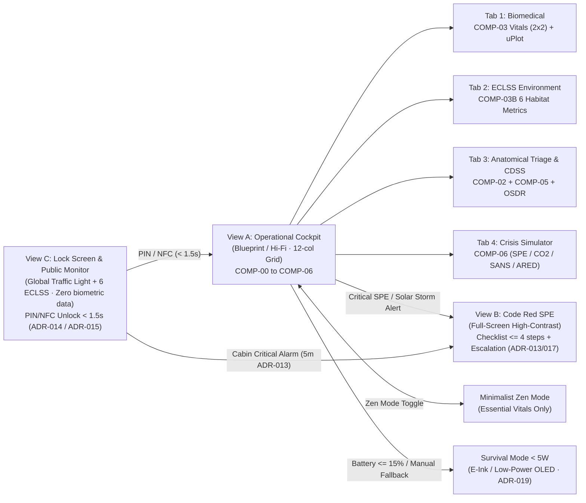

# 01 — Wireframes & Screen Architecture

[<- Back to UI/UX Design Index](./README.md) · [Style Guide ->](./02-Guia-de-Estilo-y-Design-System.md) · [Interactive Prototype `wireframe.html`](../../wireframe.html)

---

## 1. Visual Architecture & Aerospace Ergonomics Principles

The screen architecture of **ASTHA** is derived directly from the technical prototype [`wireframe.html`](../../wireframe.html) (**NASA Blueprint v2.5**), optimized for **bulkhead-mounted displays (1280+ px)** and **ruggedized microgravity tablets (768–1024 px)** under **MIL-STD-1472H**, **NASA-STD-3001**, and **WCAG 2.1 AAA**.

| Regulatory Principle | Traceability | On-Screen Implementation Rule |
| :--- | :--- | :--- |
| **Microgravity Safe Touch Zone** | `RNF-USA-01` | Every interactive control (checkboxes, tabs, hotspots, crew buttons, and simulator triggers) occupies a minimum area of **$48 \times 48\text{ px}$** with a minimum inter-control gap of **$12\text{ px}$** to prevent accidental taps while floating. |
| **Rapid Scan Hierarchy** | `RNF-USA-02` | Instantaneous readability of **Critical Vital Sign + Trend (`uPlot`) + Corrective Action (`<= 4` steps)** with zero vertical scrolling in both nominal and emergency states. |
| **Public Readability vs. Clinical Privacy** | [`ADR-014`](../SDD/08-Architecture-decisions.md#adr-014) | The public bulkhead monitor displays exclusively the **global traffic light per crew member** and the **6 habitat ECLSS parameters**; no individual biometric value is exposed prior to authentication. |
| **Emergency Unlock** | [`ADR-015`](../SDD/08-Architecture-decisions.md#adr-015) | Access past the lock screen or PIN/NFC completes in **$< 1.5\text{ s}$** and keeps global traffic lights and ECLSS alerts visible at all times. |
| **Progressive Disclosure (4 Tabs)** | [`ADR-017`](../SDD/08-Architecture-decisions.md#adr-017), `RF-EXP-01..03` | Non-critical workflows (detailed triage, NASA OSDR explorer, and simulator) are grouped into 4 progressive views to keep the operational *Cockpit* uncluttered. |

---

## 2. View Flow Map (`wireframe.html` + `ADR-014/015/019`)



---

## 3. Master Wireframe: View A — Operational *Cockpit* (12-Column Grid)

Faithfully modeled after [`wireframe.html`](../../wireframe.html) (components `COMP-00` to `COMP-06`):

```text
+=======================================================================================================+
| [COMP-00] HEADER · [o] ASTHA | NASA BLUEPRINT v2.5 | MIL-STD-1472H / WCAG AAA                         |
|           View Switcher: [1. Blueprint Wireframe] [2. Hi-Fi Prototype] [3. Code Red Crisis]           |
|           Quick-Status: pO2 21.2 kPa | ppCO2 0.35 kPa | Rad 0.42 mSv/d | LAN Latency 12 ms | Sync OK|
+=======================================================================================================+
| [COMP-01] CREW SELECTOR & MISSION TIMELINE (12-col Grid · h: 72px)                                    |
| [C01 Jared Isaacman OK] [C02 Hayley Arceneaux WARN] [C03 Dr. Sian Proctor OK] [C04 C. Sembroski OK]   |
| Artemis/Mars-Sim Mission: [ L-44 ][ L-15 ][ FD-01 ][ FD-15* ][ FD-30 ][ R+1 ] · Gap >= 12px · 48x48px |
+===================================+===================================================================+
| [COMP-02] INTERACTIVE ANATOMY     | [COMP-03] BIOMEDICAL MONITORING (2x2 Grid · 4 cards)                |
| (4 cols / 33% · SVG + Three.js)   | +-------------------------------+-------------------------------+ |
|                                   | | [CARD 1] Heart Rate           | | [CARD 2] Radiation Load       | |
|     ( ) EYES / SANS  [H1: 48px]   | |   68 BPM          [✓ Nominal] | |   0.42 mSv/day    [✓ Nominal] | |
|    /   \                          | +-------------------------------+-------------------------------+ |
|   |  +  | THORAX/HR  [H2: 48px]   | | [CARD 3] Intracranial P./SANS | | [CARD 4] Bone Density (DEXA)  | |
|    \   /                          | |   19.4 mmHg     [▲ Caution]   | |   98.2 % (-1.8%)  [✓ Nominal] | |
|   ( )-( ) CALCIUM / KIDNEY [H3]   | +-------------------------------+-------------------------------+ |
|    |   |                          | [COMP-03B] ECLSS ENVIRONMENT TELEMETRY (6 Metrics · 6-col Grid)   |
|   ( ) ( ) FEMUR / ARED  [H4:48px] | [pO2: 21.2 kPa] [ppCO2: 0.35 kPa] [Press: 101.3 kPa]              |
|                                   | [Temp: 22.4 C]  [Hum: 46%]        [Ext Rad: 0.42 mSv/d]           |
| *Collapsible < 1024px (Bar)       |                                                                   |
|                                   +---------------------------------+---------------------------------+
|                                   | [COMP-04] TEMPORAL TREND        | [COMP-05] CDSS CHECKLIST        |
|                                   | (7 cols · 58% · uPlot Canvas)   | (5 cols · 42% · Max 4 steps)    |
|                                   | Biomarker Curve vs Threshold    | PROTOCOL: SANS/ARED MITIGATION  |
|                                   | L-44 ---> FD-15 ---> R+1        | [ ] 1. Verify Compression Gogg. |
|                                   | Earth Baseline [---] + Thresh.  | [ ] 2. Engage LBNP 25 min       |
|                                   |                                 | [ ] 3. Log EVA Symptoms         |
|                                   |                                 | Flight Surgeon Block (CMO)      |
+===================================+=================================+=================================+
| [COMP-06] CRISIS SIMULATOR & FAULT INJECTION BAR (h: 64px · Gap >= 12px · Buttons >= 48px)            |
|  [!] Simulate Solar Storm (SPE) | [!] Cabin CO2 Spike | [!] SANS Alarm | [✓] Reset Nominal            |
+=======================================================================================================+
```

### Wireframe Component Inventory (`COMP-00` to `COMP-06`)

| ID | Name in `wireframe.html` | Grid Proportion | Functional Responsibility | Traceability |
| :--- | :--- | :--- | :--- | :--- |
| `COMP-00` | Control Bar / Header + Quick-Status | `12 cols` (`sticky top-0`) | **ASTHA** identity, *View Switcher* (`blueprint`, `hifi`, `crisis`), mission clock, and quick ECLSS summary (`pO2`, `ppCO2`, radiation, LAN/Sync status). | `RNF-USA-02`, [`ADR-014`](../SDD/08-Architecture-decisions.md#adr-014) |
| `COMP-01` | Crew Selector & Timeline | `12 cols` (`h: 72px`) | Immediate switching across crew members (`C01`–`C04`) with individual traffic light (`✓`, `▲`, `✕`) and mission timeline (`L-44` to `R+1`). | `RF-BIO-01`, [`ADR-014`](../SDD/08-Architecture-decisions.md#adr-014) |
| `COMP-02` | Interactive Anatomical Viewer | `4 cols` (33%) | SVG geometry / on-demand Three.js mesh (`maxPixelRatio: 1.5`, `0 FPS` at rest) with 4 overlaid HTML *hotspots* of $48 \times 48\text{ px}$ (`EYES/SANS`, `THORAX/HR`, `KIDNEY/CALCIUM`, `FEMUR/ARED`). | [`ADR-004`](../SDD/08-Architecture-decisions.md#adr-004), `RF-BIO-03` |
| `COMP-03` | Vital Signs Grid (4 Cards) | `8 cols` (`grid-cols-2`) | Biometric indicators with `tabular-nums` typography, color+icon dual coding, and a drift *chip* relative to pre-flight *baseline* without tinting the card yellow. | `RNF-USA-03`, `RF-BIO-02` |
| `COMP-03B` | ECLSS Environment Panel (6 Metrics) | `8 cols` (`grid-cols-3` / `6`) | Continuous readout of `pO2`, `ppCO2`, Total Pressure, Temperature, Relative Humidity, and External Module Radiation. | `RF-ECL-01`, `RF-ECL-02` |
| `COMP-04` | Time-Series Chart (`uPlot`) | `7 cols` of sub-grid (58%) | High-density time series (*canvas* `uPlot`, zero heavy DOM) comparing the current trend against the pre-flight *baseline* and the NASA-STD-3001 limit band. | [`ADR-003`](../SDD/08-Architecture-decisions.md#adr-003), `RF-BIO-04` |
| `COMP-05` | CDSS / Countermeasure Checklist | `5 cols` of sub-grid (42%) | Interactive protocol strictly capped at **$\le 4$ actionable steps**, $48 \times 48\text{ px}$ checkboxes, and collapsible block for the *Flight Surgeon* / CMO. | [`ADR-017`](../SDD/08-Architecture-decisions.md#adr-017), `RF-CDS-01` |
| `COMP-06` | Crisis Simulator Bar | `12 cols` (`h: 64px`) | Deterministic scenario injector (*Solar Particle Event SPE*, *ppCO2 Spike*, *SANS Alarm*, *Nominal Reset*) for onboard validation and crew training. | `RF-SIM-01`, `RF-SIM-02` |

---

## 4. Wireframe View B: Critical Alarm — Code Red (SPE / Solar Storm)

Directly implements the `crisis` view from [`wireframe.html`](../../wireframe.html) along with the escalation policy of [`ADR-013`](../SDD/08-Architecture-decisions.md#adr-013) and the cognitive cap of [`ADR-017`](../SDD/08-Architecture-decisions.md#adr-017):

```text
+=======================================================================================================+
| [!] CODE RED: SOLAR PARTICLE EVENT (SPE) — RADIATION SHIELDING ACTIVE                 [MUTE 960Hz]    |
| Pulsing border #ef4444 (3px) · Critical text #fca5a5 (10.61:1 AAA contrast) · Escalation: T+00:12     |
+=======================================================================================================+
| ACUTE EXPOSURE LEVEL: 185 mSv/h (CRITICAL THRESHOLD) · RECOMMENDED TIME TO SHIELDED SHELTER: < 4 MIN  |
+---------------------------------------------------+---------------------------------------------------+
| IMMEDIATE PROTOCOL (MAX 4 STEPS · ADR-017)        | SHELTER STATUS BY CREW MEMBER (ADR-013)           |
|                                                   |                                                   |
| [ ] 1. RELOCATE CREW TO SHIELDED MODULE           |  C01 Jared Isaacman     [✕ UNCONFIRMED]           |
|        (Water bags / Polyethylene > 20 g/cm2)     |  C02 Hayley Arceneaux   [✓ IN SPE SHELTER]        |
|                                                   |  C03 Dr. Sian Proctor   [✓ IN SPE SHELTER]        |
| [ ] 2. SUSPEND EVA ACTIVITIES & SEAL HATCHES      |  C04 Chris Sembroski    [▲ IN TRANSIT]            |
|                                                   |                                                   |
| [ ] 3. VERIFY PERSONAL & CABIN DOSIMETERS         | AUTOMATIC ESCALATION (ADR-013):                   |
|                                                   |  [0-10s] Local 960Hz Tone -> [2m] CMO Alert ->    |
| [ ] 4. CONFIRM SHELTERING TO FLIGHT SURGEON (CMO) |  [5m] Global Cabin Broadcast                      |
+---------------------------------------------------+---------------------------------------------------+
|                               [ CONFIRM SHELTERING COMPLETED (48x48+) ]                               |
+=======================================================================================================+
```

---

## 5. Wireframe View C: Lock Screen & Cabin Public Mode (`ADR-014` / `ADR-015`)

Designed for shared workstations in habitable modules where any astronaut must verify environmental safety without violating crewmates' medical privacy:

```text
+=======================================================================================================+
| ASTHA CABIN MONITOR · PUBLIC MODE / SECURITY LOCK (ADR-014)                      [14:32 UTC · FD-15] |
+=======================================================================================================+
| CREW GLOBAL STATUS (NO CLINICAL VALUES EXPOSED)                                                       |
|  [C01 ✓ NOMINAL]     [C02 ▲ CAUTION]     [C03 ✓ NOMINAL]     [C04 ✓ NOMINAL]                          |
+---------------------------------------------------+---------------------------------------------------+
| HABITAT ECLSS ENVIRONMENTAL PARAMETERS            | RAPID CLINICAL UNLOCK (< 1.5 s · ADR-015)         |
|  pO2:  21.2 kPa [✓]   |  ppCO2: 0.35 kPa [✓]      |                                                   |
|  Press: 101.3 kPa [✓] |  Temp:  22.4 C [✓]        |   [  1  ]   [  2  ]   [  3  ]   (Buttons >= 48px) |
|  Hum:  46 % [✓]       |  Rad:   0.42 mSv/d [✓]    |   [  4  ]   [  5  ]   [  6  ]   Gap = 12 px       |
|                                                   |   [  7  ]   [  8  ]   [  9  ]                     |
|  *Critical alarm automatically redirects to       |   [ NFC ]   [  0  ]   [ OK  ]   (WebAuthn / PIN)  |
|   View B without requiring PIN if escalated to 5m.|                                                   |
+---------------------------------------------------+---------------------------------------------------+
```

---

## 6. Responsive Behavior by Breakpoint

| Breakpoint | Target Device | Grid Layout | Ergonomic Adaptations |
| :--- | :--- | :--- | :--- |
| **`>= 1280 px`** | Bulkhead Console (*Bulkhead Display*) | Full `12 columns` (`COMP-02` `4 cols` + `COMP-03/04/05` `8 cols`) | Everything visible in the initial *viewport* (`100vh`) with zero vertical scroll under nominal operation. |
| **`768 px – 1279 px`** | Ruggedized Tablet (Mounted iPad / Surface) | Stacked `8 columns` | `COMP-02` switches to `compact` variant (collapsible top bar of $48 \times 48\text{ px}$ *hotspots*); `COMP-04` (`uPlot`) and `COMP-05` (*checklist*) span successive full widths. |
| **`< 768 px`** | Handheld Backup / E-Ink Device | `4 columns` (*single-column flow*) | Defaults to **Survival Mode (`ADR-019`)** or **Zen Mode**, prioritizing the traffic light, single critical value, and $\le 4$-action list. |
