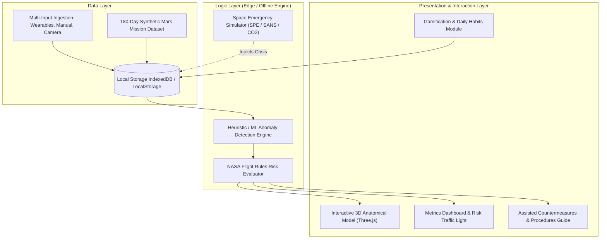

# MASTER DEVELOPMENT GUIDE: HEALTH MONITORING SOFTWARE FOR ASTRONAUTS
### NASA Space Apps Challenge | Comprehensive Specification and Construction Document

---

## 1. EXECUTIVE SUMMARY AND CHALLENGE FACT SHEET

* **Official Challenge Title:** *Create Health Monitoring Software for Astronauts on Space Missions*
* **Category and Level:** Intermediate (`Intermediate`) | Official Color: `#FF580A`
* **Official URL:** [Space Apps Challenge: Health Monitoring Software](https://www.spaceappschallenge.org/2026/challenges/health-monitoring-software/?tab=resources)
* **Official NASA Video:** [YouTube Challenge Overview](https://www.youtube.com/watch?v=RERG3gEmdC8)
* **Community Repository:** [NASA SpaceApps GitHub](https://github.com/nasa/spaceapps)

### Problem Statement
Long-duration space missions (such as the Artemis program to the Moon and future crewed voyages to Mars) expose astronauts to extreme hostile environments. Distance from Earth imposes a communication delay of up to **22 minutes one-way (44 minutes round-trip)**, preventing flight surgeons in Houston or Montreal from advising on emergencies in real time. **Astronauts must diagnose, monitor, and treat their own medical conditions with complete autonomy.**

The objective is to build a **visual, interactive, and autonomous software tool (Edge/Offline)** that collects health indicators, visualizes anatomical status through an interactive human model, detects early anomalies, guides step-by-step treatments, and gamifies healthy habits.

---

## 2. STRATEGIC MAPPING TO EVALUATION TRACKS

| Mentors / Judges Track | Project Application | Key Differentiating Factor |
| :--- | :--- | :--- |
| **Track 1: Data Pipelines, Machine Learning & Advanced Analytics** | Anomaly detection algorithm on vital signs (HRV, SpO2, blood pressure, cumulative radiation). Local client-side inference (Edge AI). | Early detection of pathological trends prior to acute symptoms. |
| **Track 2: Functional Applications, Operational Tools & GIS** | 100% offline Clinical Decision Support System (CDSS) (autonomous PWA / WebApp). Habitat mapping (station, lunar base, rover). | Operates in "Mars-Zero-Ping" mode without requiring an Internet connection. |
| **Track 3: Games, Gamification & Strategic Simulation** | Interactive 3D avatar with Three.js, streak/reward system for ARED exercise routines, and **Space Crisis Simulator**. | Emergency injection button (solar storm, CO2 leak, SANS episode). |
| **Track 4: Digital Storytelling, Sensory Accessibility & Pitch** | High-contrast space tactical UI (dark Glassmorphism), accessible design for non-physicians, visual guides, and Mars mission storytelling. | Pitch focused on saving crew lives using NASA-validated metrics. |

---

## 3. OFFICIAL SPACE BIOMEDICAL FOUNDATION (NASA HRP & CSA)

### A. The 5 Hazards of Human Spaceflight (NASA R.I.D.G.E. Model)
Official source: [NASA HRP Hazards](https://www.nasa.gov/hrp/hazards/)

1. **R - Radiation (Space Radiation):**
   * Sources: Galactic Cosmic Radiation (GCR) and Solar Particle Events (SPE).
   * Critical CSA Factor: Secondary neutrons contribute **30% of the biological dose aboard the space station**. Official instrument: **CANS** (*Canadian Active Neutron Spectrometer*).
   * Consequences: DNA damage, early cataracts, cancer, and acute radiation syndrome.
2. **I - Isolation & Confinement:**
   * Consequences: Circadian rhythm disruption (16 sunrises/sunsets per day in LEO), chronic fatigue, stress, cognitive decline, and interpersonal friction.
3. **D - Distance from Earth:**
   * Unavoidable radio delay. No emergency medical evacuation capability. All diagnosis must be executed *in-situ*.
4. **G - Gravity Fields (Altered Gravity: 0G, 1/6G on the Moon, 3/8G on Mars):**
   * Fluid redistribution toward the thorax and head (*puffy face / bird legs syndrome*).
   * Accelerated bone mass loss: **1.0% to 1.5% bone mineral density per month** in weight-bearing bones (femur, pelvis, vertebrae), causing hypercalcemia and **kidney stone** formation.
   * Cardiac muscle and skeletal muscle atrophy (slow-twitch type I fibers).
   * Severe orthostatic intolerance upon re-exposure to gravity.
5. **E - Hostile / Closed Environments:**
   * $CO_2$ accumulation in microgravity (stagnant air pockets cause lethargy and headaches).
   * Altered microbiome: Increased bacterial virulence in microgravity and reactivation of latent viruses (Epstein-Barr, Herpes Zoster).

### B. NASA Priority Clinical Risks (HRP Matrix)
Official source: [NASA HRP Risks](https://www.nasa.gov/hrp/risks/)

* **SANS (Spaceflight Associated Neuro-ocular Syndrome):** Cranial fluid shift that flattens the ocular globe, folds the choroid, and produces optic disc edema with permanent visual loss.
* **Internal Jugular Vein Venous Thrombosis:** Venous stasis and retrograde flow documented on the ISS due to lack of hydrostatic gravity.
* **Cardiac Arrhythmias and Dysautonomia:** Decreased vagal tone and altered Heart Rate Variability (HRV).
* **Malnutrition and Micronutrient Degradation:** Vitamin degradation in space food packages stored for years.

---

## 4. SOFTWARE FUNCTIONAL SPECIFICATION



### 1. Data Inputs (Multi-Input)
* **Rapid Manual Ingestion:** Touch form optimized for gloved or touchscreen operation (Blood pressure, SpO2, Heart rate, Glucose in $mg/dL$, Temperature in $^{\circ}C$, Sleep hours, Subjective mood scale 1-10).
* **Sensor / Wearable Ingestion (Bio-Monitor):** Continuous telemetry simulation modeled on the *Astroskin* smart garment.
* **Visual / Camera Ingestion:** Pupillary reflex test or skin rash scan via webcam.

### 2. 3D Human Anatomical Model
* Interactive representation with front/back views.
* Clickable regions:
  * **Eyes / Head:** Intracranial pressure, SANS, cognitive status, and visual acuity.
  * **Thorax / Heart:** Heart rate, HRV, blood pressure, arrhythmias.
  * **Lumbar Region / Kidneys:** Renal lithiasis (kidney stone) risk from bone calcium excretion.
  * **Muscles and Bones (Legs/Femur):** Muscle mass and bone density loss.
  * **General System / Blood:** Cumulative radiation dosimetry, glucose, hydration.
* Color coding on the model:
  * 🟢 **Green:** Nominal physiology.
  * 🟡 **Yellow:** Physiological drift requiring mild countermeasure.
  * 🔴 **Red:** Critical anomaly with mandatory intervention protocol.

### 3. Countermeasures Engine and Step-by-Step Guide (For Non-Physicians)
* When the software detects an anomaly, it does not simply display *"Alert: Hypercalcemia"*, but provides:
  1. **What it means:** *"Your bones are releasing calcium into the bloodstream due to lack of gravitational loading, increasing the risk of kidney stones."*
  2. **Immediate guided action:** *"Increase water intake to 3.2 L/day and schedule 45 extra minutes on the ARED resistive exercise device."*
  3. **How to verify:** On-screen step-by-step visual instructions to measure urine electrolytes or perform a guided renal ultrasound.

### 4. Gamification System
* Experience bar and badges for:
  * Completing the mandatory 150 daily minutes of exercise (ARED / T2 treadmill).
  * Logging the morning sleep and mood report on time.
  * Maintaining optimal hydration levels.
* Psychological impact: Combats apathy and boredom during prolonged confinement.

### 5. Mission Crisis Simulator (Pitch Demo Killer)
Allows judges to trigger predefined scenarios to observe the software in action:
* **Scenario A: Solar Storm (Solar Particle Event - SPE):** The radiation sensor triggers the neutron alert. The system guides the astronaut to the shielded zone (*Storm Shelter*) and prescribes antioxidants.
* **Scenario B: Acute SANS Syndrome:** The astronaut reports morning blurred vision. The system activates the visual test protocol, digital ophthalmoscope inspection, and Lower Body Negative Pressure (LBNP) suit prescription.
* **Scenario C: Cabin $CO_2$ Micro-Leak:** Elevated respiratory rate and crew headaches are detected. The system orders LiOH/CDRA scrubber verification.

---

## 5. BIOMEDICAL THRESHOLDS AND EVALUATION ALGORITHMS

```typescript
// Physiological ranges: SRS §6.1 is the single source of truth (values reproduced here, must not diverge)
export interface VitalSigns {
  heartRate: number;         // bpm (Nominal: 55 - 85; Caution: 86 - 105 or 45 - 54; Critical: < 45 or > 110)
  hrv: number;               // ms rMSSD (Nominal: 35 - 70; Caution: 20 - 34; Critical: < 20 for >= 2 days)
  systolicBP: number;        // mmHg (Nominal: 105 - 125; Caution: 126 - 139; Critical: >= 140)
  diastolicBP: number;       // mmHg (Nominal: 65 - 84; Caution: 85 - 89; Critical: >= 90)
  spO2: number;              // % (Nominal: 96 - 100; Caution: 93 - 95; Critical: < 93)
  bloodGlucose: number;      // mg/dL fasting (Nominal: 75 - 105; Caution: 106 - 125 or 65 - 74; Critical: < 65 or > 140)
  bodyTemperature: number;   // °C (Nominal: 36.2 - 37.3; Caution: 37.4 - 37.9; Critical: >= 38.0)
  sleepHours: number;        // h (Nominal: 7.0 - 8.5; Caution: 5.5 - 6.9; Critical: < 5.5 for >= 2 days)
  radiationDoseRate: number; // µSv/h (Nominal: 15 - 35; Caution: 36 - 80, gap 81 - 100 also Caution; Critical: > 100)
  moodScore: number;         // 1 - 10 (Nominal: 7 - 10; Caution: 4 - 6; Critical: 1 - 3)
}

export type HealthStatus = 'NOMINAL' | 'WARNING' | 'CRITICAL';

export interface DiagnosticAssessment {
  organSystem: 'NEURO_OCULAR' | 'CARDIOVASCULAR' | 'MUSCULOSKELETAL' | 'RENAL' | 'PSYCHOLOGICAL' | 'RADIATION';
  status: HealthStatus;
  finding: string;
  countermeasure: string;
  urgencyLevel: 'LOW' | 'MEDIUM' | 'HIGH' | 'EMERGENCY';
}
```

### Autonomous Clinical Triage Algorithm (Evaluation Pseudo-Logic)

```javascript
function evaluateAstronautHealth(vitals) {
  const alerts = [];

  // 1. Radiation Evaluation (Inspired by CANS - CSA)
  if (vitals.radiationDoseRate > 100) {
    alerts.push({
      organSystem: 'RADIATION',
      status: 'CRITICAL',
      finding: 'Elevated radiation dose rate detected (possible Solar Particle Event SPE).',
      countermeasure: 'Evacuate immediately to the shielded core module (Storm Shelter). Administer antioxidant/radioprotective countermeasure.',
      urgencyLevel: 'EMERGENCY'
    });
  }

  // 2. Fatigue and Circadian Rhythm Evaluation
  if (vitals.sleepHours < 5.5 && vitals.hrv < 25) {
    alerts.push({
      organSystem: 'PSYCHOLOGICAL',
      status: 'WARNING',
      finding: 'Severe circadian desynchronization and autonomic stress (depressed HRV).',
      countermeasure: 'Adjust cabin LED lighting to blue-enriched spectrum upon waking and red during rest. Schedule a 45-min nap and Mindfulness session.',
      urgencyLevel: 'MEDIUM'
    });
  }

  // 3. Suspected SANS (Neuro-ocular)
  if (vitals.systolicBP > 135 && vitals.sleepHours < 6) {
    alerts.push({
      organSystem: 'NEURO_OCULAR',
      status: 'WARNING',
      finding: 'Cephalic hypertensive drift detected. Risk of optic disc venous congestion and SANS.',
      countermeasure: 'Perform on-screen Snellen visual acuity exam and a 60-min session in the Lower Body Negative Pressure (LBNP) device.',
      urgencyLevel: 'HIGH'
    });
  }

  // 4. Oxygenation and Hypercapnia
  if (vitals.spO2 < 94) {
    alerts.push({
      organSystem: 'CARDIOVASCULAR',
      status: 'CRITICAL',
      finding: 'Peripheral saturation below flight margins (SpO2 < 94%). Suspected hypoxia or CO2 pocket.',
      countermeasure: 'Don supplemental O2 mask, verify cabin fan recirculation, and check ambient carbon dioxide level.',
      urgencyLevel: 'EMERGENCY'
    });
  }

  return alerts;
}
```

---

## 6. RECOMMENDED BOILERPLATE CODE AND STRUCTURE

### Suggested Project Structure (React + Vite + Tailwind + Three.js)

```text
health-monitoring-app/
├── public/
│   ├── models/
│   │   └── human_body.glb       # 3D anatomical model (Stylized low-poly)
│   └── data/
│       └── mars_telemetry.json  # 180-day simulated telemetry
├── src/
│   ├── components/
│   │   ├── 3d/
│   │   │   └── BodyViewer.jsx   # Three.js viewer with interactive hotspots
│   │   ├── dashboard/
│   │   │   ├── MetricCard.jsx   # Vital signs card with status traffic light
│   │   │   ├── TrendsChart.jsx  # Historical charts with Recharts
│   │   │   └── VitalsInput.jsx  # Quick manual or camera input form
│   │   ├── gamification/
│   │   │   └── HabitTracker.jsx # Points and daily streaks system
│   │   ├── procedures/
│   │   │   └── ActionGuide.jsx  # Step-by-step countermeasures guide
│   │   └── simulation/
│   │       └── CrisisEngine.jsx # Event injector (Solar storm, SANS, Leak)
│   ├── engine/
│   │   ├── medicalRules.js      # NASA HRP clinical flight rules
│   │   └── anomalyDetector.js   # Detection and prediction algorithm
│   ├── App.jsx
│   └── index.css
├── package.json
└── README.md
```

### Sample Synthetic Dataset for Immediate Loading (`mars_telemetry.json`)

```json
[
  {
    "missionDay": 45,
    "timestamp": "2026-11-14T08:00:00Z",
    "astronautId": "ASTRO-01",
    "name": "Dr. Elena Vance",
    "vitals": {
      "heartRate": 68,
      "hrv": 48,
      "systolicBP": 118,
      "diastolicBP": 78,
      "spO2": 98.5,
      "bloodGlucose": 88,
      "bodyTemperature": 36.6,
      "sleepHours": 7.4,
      "radiationDoseRate": 22.4,
      "moodScore": 8
    },
    "status": "NOMINAL"
  },
  {
    "missionDay": 46,
    "timestamp": "2026-11-15T08:00:00Z",
    "astronautId": "ASTRO-01",
    "name": "Dr. Elena Vance",
    "vitals": {
      "heartRate": 92,
      "hrv": 19,
      "systolicBP": 142,
      "diastolicBP": 92,
      "spO2": 93.1,
      "bloodGlucose": 115,
      "bodyTemperature": 37.8,
      "sleepHours": 4.1,
      "radiationDoseRate": 145.8,
      "moodScore": 3
    },
    "status": "CRITICAL",
    "alertTrigger": "SPE_SOLAR_PARTICLE_EVENT"
  }
]
```

---

## 7. PRESENTATION AND WINNING PITCH STRATEGY

### Pitch Structure (High-Impact 3 Minutes)
1. **0:00 - 0:30 | The Hook (The Problem):**
   * *"On the journey to Mars, Houston is 22 minutes away. If an astronaut develops acute SANS, an arrhythmia, or a solar storm strikes the spacecraft, there is no 911 call and no live telemedicine. The crew is on their own."*
2. **0:30 - 1:15 | The Solution:**
   * Present the software: *"We built a 100% Offline Autonomous Clinical Decision and Biomedical Monitoring System. It combines the NASA HRP risk model and CSA neutron radiation detection with an interactive 3D anatomical model."*
3. **1:15 - 2:15 | Live Demo (Action):**
   * Display the 3D avatar.
   * Click on the heart and eyes.
   * Press the *"Simulate Solar Storm"* button: the UI shifts color, raises a real-time CANS radiation alert, and guides the astronaut with clear, jargon-free instructions.
   * Show the gamification module designed to prevent the 1.5% monthly bone loss.
4. **2:15 - 2:45 | Scientific and Technological Validation:**
   * Highlight the 5 hazards (R.I.D.G.E.), compatibility with *Astroskin* garments, and Edge inference (zero dependency on external servers).
5. **2:45 - 3:00 | Closing:**
   * *"This software will not only protect Mars pioneers; its low-resource algorithms and autonomous diagnostics will enable high-precision healthcare in remote communities on Earth."*

---

## 8. FINAL HACKATHON DELIVERY CHECKLIST

- [ ] **Public GitHub Repository:** Clean codebase, `README.md` with screenshots, and installation documentation.
- [ ] **Functional Web Deployment (Live Demo):** Hosted on Vercel, Netlify, or GitHub Pages with verified operation.
- [ ] **30-to-60-Second Demo Video:** Smooth screen recording showing interaction with the 3D body, the crisis simulator, and the interface.
- [ ] **Citations to Official Sources:** Links to NASA HRP and the Canadian Space Agency integrated in the software's "About / References" tab.
