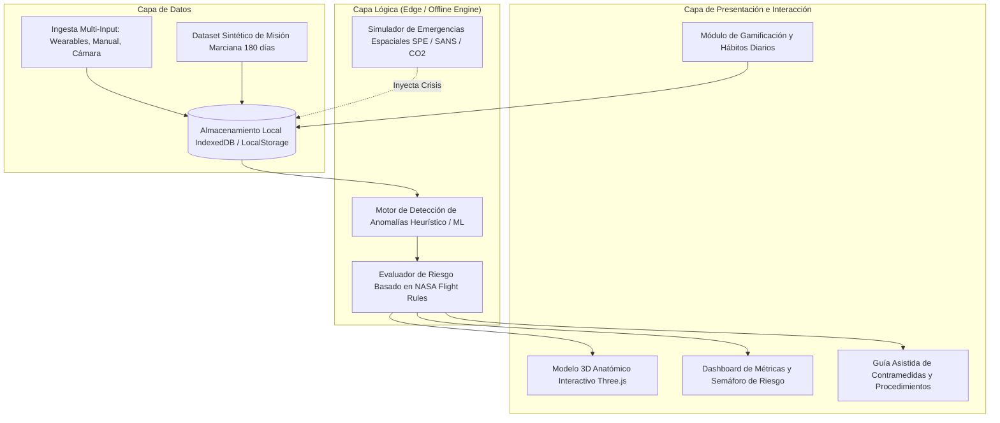

# GUÍA MAESTRA DE DESARROLLO: HEALTH MONITORING SOFTWARE FOR ASTRONAUTS
### NASA Space Apps Challenge | Documento Integral de Especificación y Construcción

---

## 1. RESUMEN EJECUTIVO Y FICHA TÉCNICA DEL DESAFÍO

* **Título Oficial del Reto:** *Create Health Monitoring Software for Astronauts on Space Missions*
* **Categoría y Nivel:** Intermedio (`Intermediate`) | Color oficial: `#FF580A`
* **URL Oficial:** [Space Apps Challenge: Health Monitoring Software](https://www.spaceappschallenge.org/2026/challenges/health-monitoring-software/?tab=resources)
* **Video Oficial de la NASA:** [YouTube Challenge Overview](https://www.youtube.com/watch?v=RERG3gEmdC8)
* **Repositorio Comunitario:** [NASA SpaceApps GitHub](https://github.com/nasa/spaceapps)

### Declaración del Problema
Las misiones espaciales de larga duración (como el programa Artemis a la Luna y los futuros viajes tripulados a Marte) someten a los astronautas a entornos hostiles extremos. La distancia a la Tierra impone un retraso de comunicación de hasta **22 minutos por sentido (44 minutos ida y vuelta)**, lo que impide que los médicos de vuelo en Houston o Montreal asesoren emergencias en tiempo real. **Los astronautas deben diagnosticar, vigilar y tratar sus propias condiciones médicas con total autonomía.**

El objetivo es construir una **herramienta de software visual, interactiva y autónoma (Edge/Offline)** que recopile indicadores de salud, visualice el estado anatómico mediante un modelo humano interactivo, detecte anomalías tempranas, guíe tratamientos paso a paso y gamifique los hábitos saludables.

---

## 2. MAPEO ESTRATÉGICO CON LOS BLOQUES DE EVALUACIÓN

| Bloque de Mentores / Jueces | Aplicación en el Proyecto | Factor Clave para Destacar |
| :--- | :--- | :--- |
| **Bloque 1: Pipelines de Datos, Machine Learning y Análisis Avanzado** | Algoritmo de detección de anomalías en signos vitales (HRV, SpO2, presión, radiación acumulada). Inferencia local en cliente (Edge AI). | Detección precoz de tendencias patológicas antes de síntomas agudos. |
| **Bloque 2: Aplicaciones Funcionales, Herramientas Operativas y GIS** | Sistema de Soporte a Decisiones Clínicas (CDSS) 100% offline (PWA / WebApp autónoma). Mapeo de hábitats (estación, base lunar, rover). | Funciona en modo "Mars-Zero-Ping" sin requerir conexión a internet. |
| **Bloque 3: Videojuegos, Gamificación y Simulación Estratégica** | Avatar 3D interactivo con Three.js, sistema de rachas/recompensas por rutinas de ejercicio ARED y **Simulador de Crisis Espaciales**. | Botón de inyección de emergencias (tormenta solar, fuga de CO2, episodio SANS). |
| **Bloque 4: Narrativa Digital, Accesibilidad Sensorial, Pitch** | UI táctica espacial de alto contraste (Glassmorphism oscuro), diseño accesible para no médicos, guías visuales y storytelling de misión a Marte. | Pitch enfocado en salvar la vida de la tripulación con métricas validadas por NASA. |

---

## 3. FUNDAMENTO BIOMÉDICO Y ESPACIAL OFICIAL (NASA HRP Y CSA)

### A. Los 5 Peligros del Espacio Humano (Modelo NASA R.I.D.G.E.)
Fuente oficial: [NASA HRP Hazards](https://www.nasa.gov/hrp/hazards/)

1. **R - Radiation (Radiación Espacial):**
   * Fuentes: Radiación Cósmica Galáctica (GCR) y Eventos de Partículas Solares (SPE).
   * Factor Crítico CSA: Los neutrones secundarios aportan el **30% de la dosis biológica en la estación espacial**. Instrumento oficial: **CANS** (*Canadian Active Neutron Spectrometer*).
   * Consecuencias: Daño al ADN, cataratas tempranas, cáncer y síndrome agudo de radiación.
2. **I - Isolation & Confinement (Aislamiento y Confinamiento):**
   * Consecuencias: Ruptura de ritmos circadianos (16 amaneceres/puestas de sol al día en órbita baja), fatiga crónica, estrés, deterioro cognitivo y fricción interpersonal.
3. **D - Distance from Earth (Distancia de la Tierra):**
   * Retraso de radio ineludible. Sin posibilidad de evacuación médica urgente. Todo diagnóstico debe ser ejecutado *in-situ*.
4. **G - Gravity Fields (Gravedad Alterada: 0G, 1/6G en la Luna, 3/8G en Marte):**
   * Redistribución de líquidos hacia el tórax y la cabeza (*puffy face / bird legs syndrome*).
   * Pérdida de masa ósea acelerada: **1.0% a 1.5% de densidad mineral ósea al mes** en huesos de carga (fémur, pelvis, vértebras), generando hipercalcemia y formación de **cálculos renales**.
   * Atrofia del músculo cardíaco y muscular esquelético (fibras tipo I de contracción lenta).
   * Intolerancia ortostática grave al volver a sentir gravedad.
5. **E - Hostile / Closed Environments (Entornos Hostiles y Cerrados):**
   * Acumulación de $CO_2$ en microgravedad (las bolsas de aire estancado causan letargo y cefaleas).
   * Microbioma alterado: Incremento de la virulencia bacteriana en microgravedad y reactivación de virus latentes (Epstein-Barr, Herpes Zóster).

### B. Los Riesgos Clínicos Prioritarios de la NASA (HRP Matrix)
Fuente oficial: [NASA HRP Risks](https://www.nasa.gov/hrp/risks/)

* **SANS (Spaceflight Associated Neuro-ocular Syndrome):** Desplazamiento de fluidos craneales que aplana el globo ocular, pliega la coroides y genera edema en la papila óptica con pérdida visual permanente.
* **Trombosis Venosa de la Vena Yugular Interna:** Estasis venosa y flujo retrógrado documentado en la ISS por falta de gravedad hidrostática.
* **Arritmias Cardíacas y Disautonomía:** Disminución del tono vagal y alteración de la Variabilidad de la Frecuencia Cardíaca (HRV).
* **Desnutrición y Degradación de Micronutrientes:** Degradación de vitaminas en paquetes de comida espacial almacenados por años.

---

## 4. ESPECIFICACIÓN FUNCIONAL DEL SOFTWARE



### 1. Entradas de Datos (Multi-Input)
* **Ingesta Manual Rápida:** Formulario táctil optimizado para condiciones de guantes o pantalla táctil (Presión arterial, SpO2, Frecuencia cardíaca, Glucosa en $mg/dL$, Temperatura en $^{\circ}C$, Horas de sueño, Escala subjetiva de ánimo 1-10).
* **Ingesta de Sensores / Wearables (Bio-Monitor):** Simulación de telemetría continua estilo prenda inteligente *Astroskin*.
* **Ingesta Visual / Cámara:** Prueba de reflejo pupilar o escaneo de erupciones dérmicas mediante cámara web.

### 2. Modelo Anatómico 3D Humano
* Representación interactiva con vista frontal/posterior.
* Regiones clickables:
  * **Ojos / Cabeza:** Presión intracraneal, SANS, estado cognitivo y agudeza visual.
  * **Tórax / Corazón:** Frecuencia cardíaca, HRV, presión arterial, arritmias.
  * **Zona Lumbar / Riñones:** Riesgo de litiasis renal (cálculos) por excreción de calcio óseo.
  * **Músculos y Huesos (Piernas/Fémur):** Pérdida de masa muscular y densidad ósea.
  * **Sistema General / Sangre:** Dosimetría de radiación acumulada, glucosa, hidratación.
* Código de color en el modelo:
  * 🟢 **Verde:** Fisiología nominal.
  * 🟡 **Amarillo:** Deriva fisiológica que requiere contramedida leve.
  * 🔴 **Rojo:** Anomalía crítica con protocolo de intervención mandatorio.

### 3. Motor de Contramedidas y Guía Paso a Paso (Para no médicos)
* Si el software detecta una anomalía, no dice simplemente *"Alerta: Hipercalcemia"*, sino que proporciona:
  1. **Qué significa:** *"Tus huesos están liberando calcio a la sangre por falta de carga gravitacional, aumentando el riesgo de piedras en los riñones"*.
  2. **Acción inmediata guiada:** *"Aumenta tu ingesta de agua a 3.2 L/día y programa 45 min extra en el dispositivo de ejercicio de resistencia ARED"*.
  3. **Cómo verificar:** Instrucciones visuales paso a paso para medir electrolitos en orina o hacer ecografía renal guiada por pantalla.

### 4. Sistema de Gamificación
* Barra de experiencia y medallas por:
  * Completar los 150 minutos diarios de ejercicio obligatorio (ARED / cinta T2).
  * Registrar a tiempo el informe matutino de sueño y estado anímico.
  * Mantener niveles óptimos de hidratación.
* Impacto psicológico: Combate la apatía y el aburrimiento del confinamiento prolongado.

### 5. Simulador de Crisis de Misión (Demo Killer para el Pitch)
Permite al jurado activar escenarios predefinidos para ver el software actuar:
* **Escenario A: Tormenta Solar (Solar Particle Event - SPE):** El sensor de radiación dispara la alerta de neutrones. El sistema guía al astronauta a la zona blindada (*Storm Shelter*) y prescribe antioxidantes.
* **Escenario B: Síndrome SANS Agudo:** El astronauta reporta visión borrosa matutina. El sistema activa el protocolo de prueba visual, revisión con oftalmoscopio digital y prescripción de pantalones de presión negativa (LBNP).
* **Escenario C: Microfuga de $CO_2$ en Cabina:** Se detecta elevación de frecuencia respiratoria y cefalea en la tripulación. El sistema ordena verificación de filtros LiOH/CDRA.

---

## 5. UMBRALES BIOMÉDICOS Y ALGORITMOS DE EVALUACIÓN

```typescript
// Definición de rangos fisiológicos adaptados a vuelos espaciales
export interface VitalSigns {
  heartRate: number;         // bpm (Nominal: 55 - 95 bpm)
  hrv: number;               // ms (Variabilidad rMSSD: > 35 ms nominal, < 20 ms estrés agudo)
  systolicBP: number;        // mmHg (Nominal: 100 - 130 mmHg)
  diastolicBP: number;       // mmHg (Nominal: 65 - 85 mmHg)
  spO2: number;              // % (Nominal: 96% - 100%, < 93% hipoxia en cabina)
  bloodGlucose: number;      // mg/dL (Nominal ayuno: 70 - 105 mg/dL)
  bodyTemperature: number;   // °C (Nominal: 36.2 - 37.3 °C)
  sleepHours: number;        // Horas (Nominal: 7 - 9 hrs, < 5 hrs riesgo cognitivo)
  radiationDoseRate: number; // uSv/h (Nominal LEO: 15-30 uSv/h, SPE Alerta: > 100 uSv/h)
  moodScore: number;         // 1 - 10 (1-3 depresión/aislamiento, 4-6 regular, 7-10 óptimo)
}

export type HealthStatus = 'NOMINAL' | 'WARNING' | 'CRITICAL';

export interface DiagnosticAssessment {
  organSystem: 'NEURO_OCULAR' | 'CARDIOVASCULAR' | 'MUSCULOSKELETAL' | 'RENAL' | 'PSYCHOLOGICAL' | 'RADIATION';
  status: HealthStatus;
  finding: string;
  countermeasure: string;
  urgencyLevel: 'LOW' | 'MEDIUM' | 'HIGH' | 'EMERGENCY';
}
```

### Algoritmo de Triage Clínico Autónomo (Pseudo-lógica de Evaluación)

```javascript
function evaluateAstronautHealth(vitals) {
  const alerts = [];

  // 1. Evaluación de Radiación (Inspirado en CANS - CSA)
  if (vitals.radiationDoseRate > 100) {
    alerts.push({
      organSystem: 'RADIATION',
      status: 'CRITICAL',
      finding: 'Dosis elevada de radiación detectada (posible Evento de Partículas Solares SPE).',
      countermeasure: 'Evacuar de inmediato al módulo central blindado (Storm Shelter). Administrar contramedida antioxidante/radioprotectora.',
      urgencyLevel: 'EMERGENCY'
    });
  }

  // 2. Evaluación de Fatiga y Ritmo Circadiano
  if (vitals.sleepHours < 5.5 && vitals.hrv < 25) {
    alerts.push({
      organSystem: 'PSYCHOLOGICAL',
      status: 'WARNING',
      finding: 'Desincronización circadiana severa y estrés autonómico (HRV deprimido).',
      countermeasure: 'Ajustar iluminación LED de cabina a espectro azul-enriquecido al despertar y rojo al descansar. Programar siesta de 45 min y sesión de Mindfulness.',
      urgencyLevel: 'MEDIUM'
    });
  }

  // 3. Sospecha de SANS (Neuro-ocular)
  if (vitals.systolicBP > 135 && vitals.sleepHours < 6) {
    alerts.push({
      organSystem: 'NEURO_OCULAR',
      status: 'WARNING',
      finding: 'Deriva hipertensiva cefálica detectada. Riesgo de congestión venosa papilar y SANS.',
      countermeasure: 'Realizar examen de agudeza visual de Snellen en pantalla y sesión de 60 min en dispositivo de presión negativa de cuerpo inferior (LBNP).',
      urgencyLevel: 'HIGH'
    });
  }

  // 4. Oxigenación e Hipercapnia
  if (vitals.spO2 < 94) {
    alerts.push({
      organSystem: 'CARDIOVASCULAR',
      status: 'CRITICAL',
      finding: 'Saturación periférica por debajo de márgenes de vuelo (SpO2 < 94%). Sospecha de hipoxia o bolsón de CO2.',
      countermeasure: 'Colocar máscara de O2 suplementaria, verificar recirculación de ventilador de cabina y revisar nivel de dióxido de carbono ambiental.',
      urgencyLevel: 'EMERGENCY'
    });
  }

  return alerts;
}
```

---

## 6. ESTRUCTURA Y CÓDIGO BOILERPLATE RECOMENDADO

### Estructura de Proyecto Sugerida (React + Vite + Tailwind + Three.js)

```text
health-monitoring-app/
├── public/
│   ├── models/
│   │   └── human_body.glb       # Modelo 3D anatómico (Low-poly estilizado)
│   └── data/
│       └── mars_telemetry.json  # Telemetría de 180 días simulados
├── src/
│   ├── components/
│   │   ├── 3d/
│   │   │   └── BodyViewer.jsx   # Visor Three.js con puntos de calor interactivos
│   │   ├── dashboard/
│   │   │   ├── MetricCard.jsx   # Tarjeta de signos vitales con semáforo
│   │   │   ├── TrendsChart.jsx  # Gráficas históricas con Recharts
│   │   │   └── VitalsInput.jsx  # Formulario rápido manual o por cámara
│   │   ├── gamification/
│   │   │   └── HabitTracker.jsx # Sistema de puntos y rachas diarias
│   │   ├── procedures/
│   │   │   └── ActionGuide.jsx  # Guía paso a paso de contramedidas
│   │   └── simulation/
│   │       └── CrisisEngine.jsx # Inyector de eventos (Tormenta solar, SANS, Fuga)
│   ├── engine/
│   │   ├── medicalRules.js      # Reglas clínicas de vuelo NASA HRP
│   │   └── anomalyDetector.js   # Algoritmo de detección y predicción
│   ├── App.jsx
│   └── index.css
├── package.json
└── README.md
```

### Dataset Sintético de Muestra para Cargar Inmediatamente (`mars_telemetry.json`)

```json
[
  {
    "missionDay": 45,
    "timestamp": "2026-11-14T08:00:00Z",
    "astronautId": "ASTRO-01",
    "name": "Dra. Elena Vance",
    "vitals": {
      "heartRate": 68,
      "hrv": 48,
      "systolicBP": 118,
      "diastolicBP": 78,
      "spO2": 98.5,
      "bloodGlucose": 88,
      "bodyTemperature": 36.6,
      "sleepHours": 7.4,
      "radiationDoseRate": 22.4,
      "moodScore": 8
    },
    "status": "NOMINAL"
  },
  {
    "missionDay": 46,
    "timestamp": "2026-11-15T08:00:00Z",
    "astronautId": "ASTRO-01",
    "name": "Dra. Elena Vance",
    "vitals": {
      "heartRate": 92,
      "hrv": 19,
      "systolicBP": 142,
      "diastolicBP": 92,
      "spO2": 93.1,
      "bloodGlucose": 115,
      "bodyTemperature": 37.8,
      "sleepHours": 4.1,
      "radiationDoseRate": 145.8,
      "moodScore": 3
    },
    "status": "CRITICAL",
    "alertTrigger": "SPE_SOLAR_PARTICLE_EVENT"
  }
]
```

---

## 7. ESTRATEGIA DE PRESENTACIÓN Y PITCH PARA GANAR

### Estructura del Pitch (3 minutos de alto impacto)
1. **0:00 - 0:30 | El Gancho (The Problem):**
   * *"En el viaje a Marte, Houston está a 22 minutos de distancia. Si un astronauta desarrolla un cuadro agudo de SANS, arritmia o una tormenta solar golpea la nave, no hay llamada al 911 ni telemedicina en vivo. La tripulación está sola."*
2. **0:30 - 1:15 | La Solución:**
   * Presentar el software: *"Creamos un Sistema Autónomo de Decisión Clínica y Monitoreo Biomédico 100% Offline. Combina el modelo de riesgos NASA HRP y la detección de radiación neutrónica de la CSA con un modelo 3D anatómico interactivo."*
3. **1:15 - 2:15 | La Demostración en Vivo (Acción):**
   * Mostrar el avatar 3D.
   * Hacer click en el corazón y en los ojos.
   * Activar el botón *"Simular Tormenta Solar"*: la UI cambia de color, alerta de radiación CANS en tiempo real y guía al astronauta con instrucciones claras sin tecnicismos.
   * Mostrar el módulo de gamificación para evitar la pérdida ósea del 1.5% mensual.
4. **2:15 - 2:45 | Validación Científica y Tecnológica:**
   * Mención de los 5 peligros (R.I.D.G.E.), compatibilidad con prendas *Astroskin* e inferencia Edge (cero dependencia de servidores externos).
5. **2:45 - 3:00 | Cierre:**
   * *"Este software no solo protegerá a los pioneros de Marte; sus algoritmos de bajo recurso y diagnóstico autónomo permitirán llevar salud de alta precisión a comunidades remotas en la Tierra."*

---

## 8. CHECKLIST FINAL DE ENTREGA DE HACKATHON

- [ ] **Repositorio GitHub Público:** Con código limpio, archivo `README.md` con capturas de pantalla y documentación de instalación.
- [ ] **Despliegue Web Funcional (Demo en Vivo):** Alojado en Vercel, Netlify o GitHub Pages con funcionamiento garantizado.
- [ ] **Video Demo de 30 a 60 Segundos:** Grabación fluida de la pantalla mostrando la interacción con el cuerpo 3D, el simulador de crisis y la interfaz.
- [ ] **Citas a Fuentes Oficiales:** Enlaces a NASA HRP y Canadian Space Agency integrados en la pestaña "About / References" del software.
