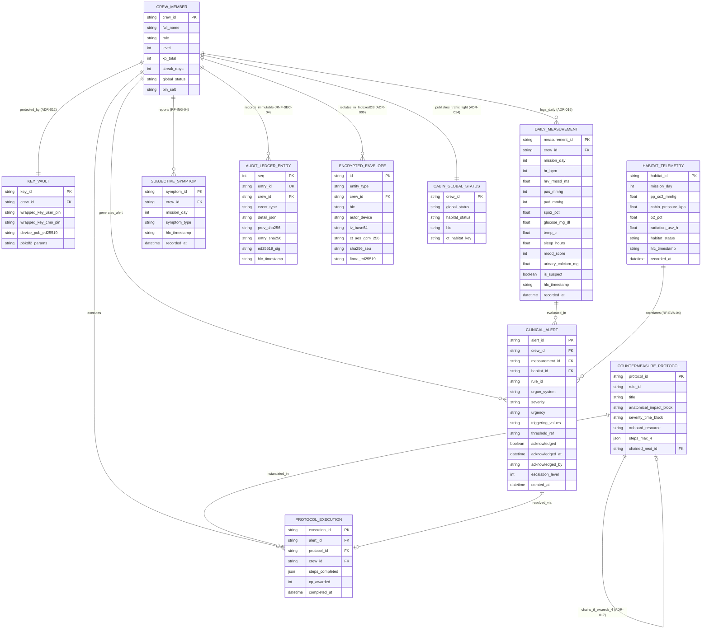
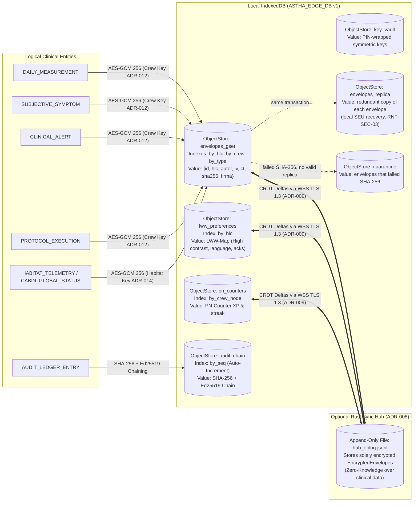

# 🗺️ Data Model: Entity-Relationship Diagram (ERD)
### ASTHA — Autonomous Space Telemetry & Health Analytics | NASA Space Apps Challenge 2026
**Authority:** SRS §5.1 · **ADRs:** [ADR-006](../SDD/08-Architecture-decisions.md#adr-006), [ADR-008](../SDD/08-Architecture-decisions.md#adr-008), [ADR-009](../SDD/08-Architecture-decisions.md#adr-009), [ADR-012](../SDD/08-Architecture-decisions.md#adr-012), [ADR-014](../SDD/08-Architecture-decisions.md#adr-014), [ADR-016](../SDD/08-Architecture-decisions.md#adr-016), [ADR-017](../SDD/08-Architecture-decisions.md#adr-017)

---

## 1. Logical Entity-Relationship Diagram (Clinical, Security, and Sync Domains)

Models the logical entities of the biomedical record, the **NASA-STD-3001** regulatory catalogs, the $\le 4$-step countermeasure engine (`ADR-017`), the immutable audit ledger (`RNF-SEC-04`), and the cryptographic/CRDT envelope (`ADR-006`, `ADR-009`).

---

## 2. Physical Mapping: IndexedDB (Browser) & Op-Log (Sync Hub)

In accordance with **[ADR-006](../SDD/08-Architecture-decisions.md#adr-006)**, **[ADR-008](../SDD/08-Architecture-decisions.md#adr-008)**, and **[SRS §5.2](../SRS%20%E2%80%93%20Software%20de%20Monitoreo%20de%20Salud%20para%20Astronautas.md)**, logical entities are not stored in plaintext SQL tables, but rather encapsulated in IndexedDB *Object Stores* encrypted via `window.crypto.subtle` and replicated on the Sync Hub:

---

## 3. Referential Integrity Rules & Constraints

1. **Clinical Immutability (`RNF-SEC-04`, `ADR-009`):** There are no `UPDATE` or `DELETE` operations on `DAILY_MEASUREMENT`, `SUBJECTIVE_SYMPTOM`, `CLINICAL_ALERT`, or `AUDIT_LEDGER_ENTRY`. Any correction or alert acknowledgment generates a new event stamped with its logical clock `hlc`.
2. **Radiation Bit-Flip Protection (`RNF-SEC-03`):** `sha256` covers the canonical form of `{id, hlc, autor, keyRef, iv, ct}` and `firma` signs that digest, so a single flipped bit in any field is detected deterministically. Each envelope is written together with a copy in `envelopes_replica` and re-read after the write (write-verify). On read, the digest and signature are checked before decryption. If verification fails and the local replica is valid, the replica is restored and the damaged copy is kept in `quarantine`. If no valid copy exists, the envelope is quarantined and a clean replica is requested from the `Sync Hub` (`hub_oplog.jsonl`) or peers. `LWW` preferences and `PN` counters live as encrypted CRDT operations inside `envelopes_gset` instead of plaintext stores.
3. **RBAC Cryptographic Isolation (`RNF-SEC-02`, `ADR-012`):** Clinical data in `DAILY_MEASUREMENT` and `CLINICAL_ALERT` is encrypted with the crew member's exclusive `crewDataKey` (`KEY_VAULT`), wrapped with both their PIN and the CMO's PIN. The `Sync Hub` and `CABIN_GLOBAL_STATUS` (public bulkhead displays) **do not possess** `crewDataKey`.
4. **Daily Cardinality (`ADR-016`):** Under nominal operational conditions, `DAILY_MEASUREMENT` maintains 1 consolidated record per `(crew_id, mission_day)` across 180 days ($4 \times 180 = 720$ baseline records), plus ad-hoc simulator injections (`RF-SIM-01..05`).
5. **Step Limit (`ADR-017`):** Every record in `COUNTERMEASURE_PROTOCOL.steps_max_4` must satisfy `length(steps) <= 4`. Complex procedures use `chained_next_id` to link successive protocols.
