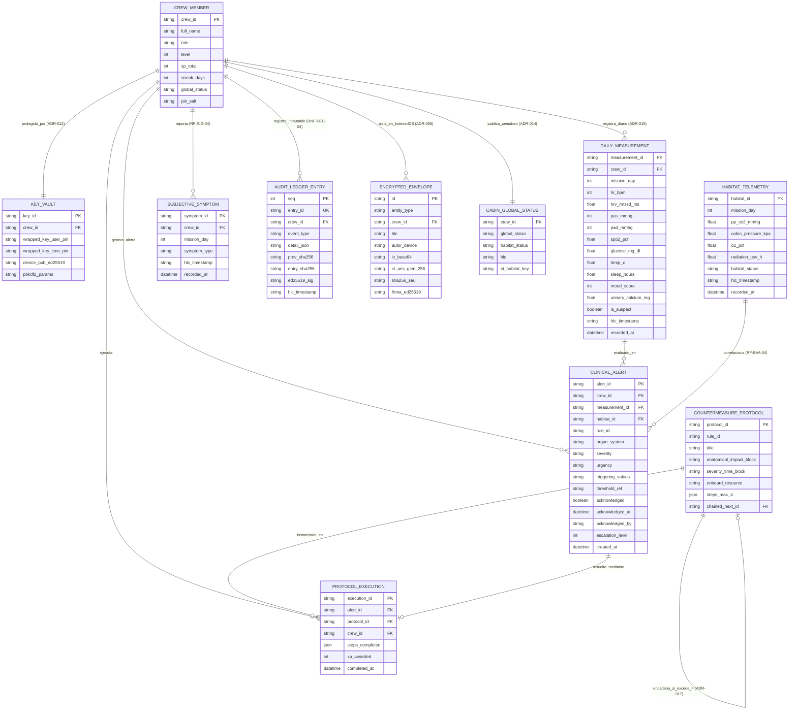
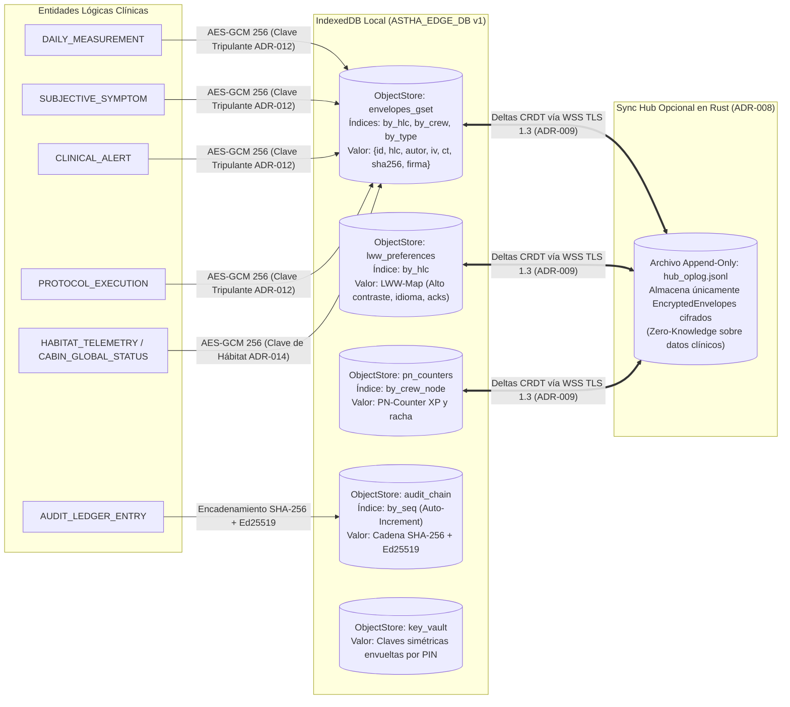

# 🗺️ Modelo de Datos: Diagrama Entidad-Relación (ERD)
### ASTHA — Autonomous Space Telemetry & Health Analytics | NASA Space Apps Challenge 2026
**Autoridad:** SRS §5.1 · **ADRs:** [ADR-006](../SDD/08-Architecture-decisions.md#adr-006), [ADR-008](../SDD/08-Architecture-decisions.md#adr-008), [ADR-009](../SDD/08-Architecture-decisions.md#adr-009), [ADR-012](../SDD/08-Architecture-decisions.md#adr-012), [ADR-014](../SDD/08-Architecture-decisions.md#adr-014), [ADR-016](../SDD/08-Architecture-decisions.md#adr-016), [ADR-017](../SDD/08-Architecture-decisions.md#adr-017)

---

## 1. Diagrama Entidad-Relación Lógico (Dominio Clínico, Seguridad y Sync)

Modela las entidades lógicas del expediente biomédico, los catálogos normativos **NASA-STD-3001**, el motor de contramedidas de $\le 4$ pasos (`ADR-017`), la bitácora inmutable (`RNF-SEC-04`) y el envoltorio criptográfico/CRDT (`ADR-006`, `ADR-009`).

---

## 2. Mapeo Físico: IndexedDB (Navegador) y Op-Log (Sync Hub)

Conforme a **[ADR-006](../SDD/08-Architecture-decisions.md#adr-006)**, **[ADR-008](../SDD/08-Architecture-decisions.md#adr-008)** y **[SRS §5.2](../SRS%20%E2%80%93%20Software%20de%20Monitoreo%20de%20Salud%20para%20Astronautas.md)**, las entidades lógicas no se almacenan en tablas SQL en claro, sino encapsuladas en *Object Stores* de IndexedDB cifrados con `window.crypto.subtle` y replicadas en el Sync Hub:

---

## 3. Reglas de Integridad Referencial y Restricciones

1. **Inmutabilidad Clínica (`RNF-SEC-04`, `ADR-009`):** No existen operaciones `UPDATE` o `DELETE` sobre `DAILY_MEASUREMENT`, `SUBJECTIVE_SYMPTOM`, `CLINICAL_ALERT` ni `AUDIT_LEDGER_ENTRY`. Toda corrección o reconocimiento de alerta genera un nuevo evento con su reloj lógico `hlc`.
2. **Protección contra Bit-Flips por Radiación (`RNF-SEC-03`):** Todo `ENCRYPTED_ENVELOPE` recalcula y verifica `sha256_seu` antes del descifrado. Si falla la verificación, el sobre corrupto es puesto en cuarentena y se solicita réplica limpia al `Sync Hub` (`hub_oplog.jsonl`) o pares.
3. **Aislamiento Criptográfico RBAC (`RNF-SEC-02`, `ADR-012`):** Los datos clínicos de `DAILY_MEASUREMENT` y `CLINICAL_ALERT` se cifran con la `crewDataKey` exclusiva del tripulante (`KEY_VAULT`), envuelta con su PIN y con el PIN del CMO. El `Sync Hub` y las `CABIN_GLOBAL_STATUS` (pantallas públicas) **no poseen** `crewDataKey`.
4. **Cardinalidad Diaria (`ADR-016`):** En condiciones operacionales nominales, `DAILY_MEASUREMENT` mantiene 1 registro consolidado por `(crew_id, mission_day)` durante 180 días ($4 \times 180 = 720$ registros base), más inyecciones puntuales del simulador (`RF-SIM-01..05`).
5. **Límite de Pasos (`ADR-017`):** Todo registro en `COUNTERMEASURE_PROTOCOL.steps_max_4` debe satisfacer `length(steps) <= 4`. Procedimientos complejos utilizan `chained_next_id` para enlazar protocolos sucesivos.
