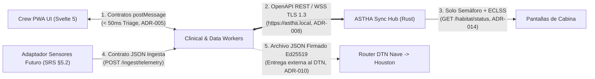

# 🔌 Diseño de APIs y Contratos de Comunicación — ASTHA
### Autonomous Space Telemetry & Health Analytics | NASA Space Apps Challenge 2026
**Especificación Formal:** [openapi.yaml](openapi.yaml) (OpenAPI 3.1.0) · **ADRs:** [002](../SDD/08-Architecture-decisions.md#adr-002), [005](../SDD/08-Architecture-decisions.md#adr-005), [007](../SDD/08-Architecture-decisions.md#adr-007), [008](../SDD/08-Architecture-decisions.md#adr-008), [009](../SDD/08-Architecture-decisions.md#adr-009), [010](../SDD/08-Architecture-decisions.md#adr-010), [014](../SDD/08-Architecture-decisions.md#adr-014)

---

## 1. Mapa de Fronteras e Interfaces del Sistema

Conforme a **[ADR-002](../SDD/08-Architecture-decisions.md#adr-002)** y **[ADR-008](../SDD/08-Architecture-decisions.md#adr-008)**, ASTHA no consume ninguna API en la nube. Todas las interfaces de red operan dentro de la **LAN aislada de la nave (`https://astha.local`)** o mediante contratos locales en memoria (`postMessage` / archivo firmado):



---

## 2. API REST & WebSocket del Sync Hub (`https://astha.local:8443/api/v1`)

La especificación completa importable en Swagger/OpenAPI se encuentra en **[openapi.yaml](openapi.yaml)**.

### 2.1 Resumen de Endpoints (LAN Cerrada TLS 1.3 con CA Interna `ADR-007`)

| Método | Ruta | Propósito | Seguridad y Privacidad (`ADR-012` / `ADR-014`) | Trazabilidad |
| :--- | :--- | :--- | :--- | :--- |
| **`GET`** | `/health` | Comprobar disponibilidad del Sync Hub, versión del bundle PWA y secuencia del Op-Log | Certificado CA interna de la nave (`ADR-007`) | `RNF-NET-03` |
| **`POST`** | `/sync/handshake` | Intercambiar `VersionVector` del dispositivo y validar firma `Ed25519` | Dispositivo previamente inscrito en Tierra (`ADR-020`) | `RNF-NET-02`, `ADR-009` |
| **`GET`** | `/sync/deltas` | Obtener lista de sobres `EncryptedEnvelope` faltantes desde un vector dado | **Zero-Knowledge:** el Hub solo sirve ciphertext AES-GCM (`ADR-006`) | `ADR-008`, `ADR-009` |
| **`POST`** | `/sync/deltas` | Enviar nuevos sobres cifrados generados en modo desconectado al Op-Log | Verificación de firma `Ed25519` y hash `SHA-256` por registro | `RNF-SEC-03`, `RNF-SEC-04` |
| **`GET`** | `/habitat/status` | Consultar telemetría ambiental (`ppCO2`, `O2`, radiación) y semáforo global por tripulante | **Sin valores clínicos privados** (cumple Privacy Act / HIPAA `ADR-014`) | `RF-DSH-04`, `ADR-014` |
| **`POST`** | `/ingest/telemetry` | Contrato de adaptador futuro para recibir tramas JSON de sensores físicos (Astroskin / ECLSS) | Validación estricta de límites (`RF-ING-05`: marca dudosos sin descartar) | `SRS §5.2`, `RF-ING-01..02` |

### 2.2 Canal en Tiempo Real WebSocket (`wss://astha.local:8443/ws/sync`)
* **Keep-Alive pasivo (`RNF-POW-01`):** El Hub envía *ping frames* a nivel de protocolo WebSocket para mantener el canal sin despertar JS en los dispositivos clientes.
* **Mensajes transmitidos:**
  1. `DELTA_PUSH`: Difusión inmediata de un nuevo `EncryptedEnvelope` firmado entre tabletas y consola del CMO.
  2. `ALARM_ESCALATION` (**`ADR-013`**): Replicación de alarma crítica no reconocida tras **2 minutos** hacia la consola del CMO y tras **5 minutos** hacia las pantallas públicas de cabina (solo semáforo global `ADR-014`).

---

## 3. Contratos Internos entre Web Workers (`postMessage`, `ADR-005`)

Dado que el `Clinical Engine Worker` tiene prohibido por arquitectura usar `fetch` o `WebSocket`, la comunicación interna sigue este contrato de mensajes tipados en TypeScript:

### 3.1 UI / Data Worker $\to$ `Clinical Engine Worker`

```json
{
  "type": "EVALUATE_DAILY_RECORD",
  "requestId": "req-048-c001",
  "payload": {
    "crewId": "C001",
    "measurement": { "missionDay": 48, "hr": 114, "hrvRmssd": 18.2, "pas": 142, "pad": 92, "spo2": 93.1, "glucose": 98, "tempC": 37.1, "sleepHours": 4.8, "mood": 4 },
    "habitat": { "ppCo2Mmhg": 3.4, "cabinPressureKpa": 101.2, "o2Percent": 21.0, "radiationUSvH": 28.5 },
    "symptoms": ["blurredVision", "headache"],
    "baseline14Days": { "hr": [62, 64, 63], "pas": [116, 118, 115] }
  }
}
```

### 3.2 `Clinical Engine Worker` $\to$ UI Svelte 5 (`< 50 ms`, `RNF-PER-01`)

```json
{
  "type": "TRIAGE_RESULT",
  "requestId": "req-048-c001",
  "latencyMs": 4.2,
  "globalStatus": "CRITICAL",
  "alerts": [
    {
      "ruleId": "R-ENV-02",
      "organSystem": "neuro-ocular",
      "severity": "CRITICAL",
      "triggeringValues": "ppCO2=3.4 mmHg, symptom=headache",
      "thresholdRef": "NASA-STD-3001 ppCO2 > 3.0 mmHg",
      "countermeasure": {
        "protocolId": "PROTO-CO2-HEADACHE",
        "steps": [
          "1. Verificar flujo de ventilación en compartimento actual.",
          "2. Inspeccionar indicador de cartucho LiOH / depurador CDRA.",
          "3. Trasladar al tripulante a módulo con ppCO2 < 2.0 mmHg.",
          "4. Repetir medición de SpO2 y cefalea tras 15 minutos."
        ]
      }
    }
  ],
  "drifts": [
    { "ruleId": "D-02", "indicator": "hr_bpm", "modifiedZScore": 3.12, "earlyWarning": true }
  ]
}
```

---

## 4. Contrato de Exportación Firmada para Tierra (`ADR-010`, `RNF-NET-04`)

ASTHA finaliza la cadena de red generando localmente un archivo descargable `astha_export_signed.json` que el CMO entrega al router/transpondedor DTN externo de la nave:
* **Endpoint de previsualización/validación local:** Definido en `openapi.yaml` bajo el esquema `SignedDsnExport`.
* **Integridad y privacidad:** Incluye `ed25519Signature` del dispositivo del CMO y flag `isAnonymized: true` si la exportación se destina a análisis estadístico no clínico (`ADR-012`).
