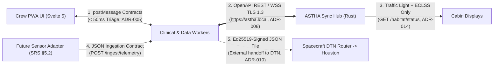
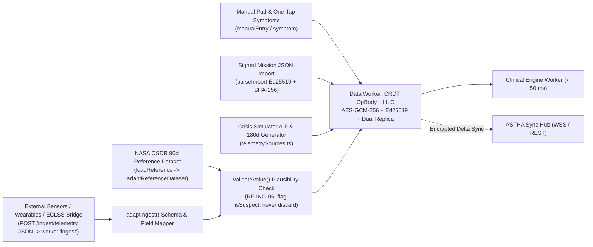

# 🔌 API Design & Communication Contracts — ASTHA
### Autonomous Space Telemetry & Health Analytics | NASA Space Apps Challenge 2026
**Formal Specification:** [openapi.yaml](openapi.yaml) (OpenAPI 3.1.0) · **ADRs:** [002](../SDD/08-Architecture-decisions.md#adr-002), [005](../SDD/08-Architecture-decisions.md#adr-005), [007](../SDD/08-Architecture-decisions.md#adr-007), [008](../SDD/08-Architecture-decisions.md#adr-008), [009](../SDD/08-Architecture-decisions.md#adr-009), [010](../SDD/08-Architecture-decisions.md#adr-010), [014](../SDD/08-Architecture-decisions.md#adr-014)

---

## 1. System Boundary & Interface Map

In accordance with **[ADR-002](../SDD/08-Architecture-decisions.md#adr-002)** and **[ADR-008](../SDD/08-Architecture-decisions.md#adr-008)**, ASTHA consumes zero cloud APIs. All network interfaces operate within the **spacecraft's isolated LAN (`https://astha.local`)** or through in-memory local contracts (`postMessage` / signed file):



---

## 2. Sync Hub REST & WebSocket API (`https://astha.local:8443/api/v1`)

The complete specification importable into Swagger/OpenAPI is located in **[openapi.yaml](openapi.yaml)**.

### 2.1 Endpoint Summary (Closed LAN TLS 1.3 with Internal CA `ADR-007`)

| Method | Path | Purpose | Security & Privacy (`ADR-012` / `ADR-014`) | Traceability |
| :--- | :--- | :--- | :--- | :--- |
| **`GET`** | `/health` | Check Sync Hub availability, PWA bundle version, and Op-Log sequence | Spacecraft internal CA certificate (`ADR-007`) | `RNF-NET-03` |
| **`POST`** | `/sync/handshake` | Exchange device `VersionVector` and validate `Ed25519` signature | Device pre-enrolled on Earth (`ADR-020`) | `RNF-NET-02`, `ADR-009` |
| **`GET`** | `/sync/deltas` | Retrieve list of missing `EncryptedEnvelope` envelopes from a given vector | **Zero-Knowledge:** Hub only serves AES-GCM ciphertext (`ADR-006`) | `ADR-008`, `ADR-009` |
| **`POST`** | `/sync/deltas` | Submit new encrypted envelopes generated offline to the Op-Log | Per-record `Ed25519` signature and `SHA-256` hash verification | `RNF-SEC-03`, `RNF-SEC-04` |
| **`GET`** | `/habitat/status` | Query environmental telemetry (`ppCO2`, `O2`, radiation) and global traffic light per crew member | **No private clinical values** (Privacy Act / HIPAA compliant `ADR-014`) | `RF-DSH-04`, `ADR-014` |
| **`POST`** | `/ingest/telemetry` | Future adapter contract for receiving JSON frames from physical sensors (Astroskin / ECLSS) | Strict boundary validation (`RF-ING-05`: flags suspect values without discarding) | `SRS §5.2`, `RF-ING-01..02` |

### 2.2 Real-Time WebSocket Channel (`wss://astha.local:8443/ws/sync`)
* **Passive Keep-Alive (`RNF-POW-01`):** The Hub sends WebSocket protocol-level *ping frames* to maintain the channel without waking JS on client devices.
* **Transmitted Messages:**
  1. `DELTA_PUSH`: Immediate broadcast of a newly signed `EncryptedEnvelope` across tablets and the CMO console.
  2. `ALARM_ESCALATION` (**`ADR-013`**): Replication of an unacknowledged critical alarm after **2 minutes** to the CMO console and after **5 minutes** to public cabin displays (global traffic light only `ADR-014`).
* **Session rules (implemented in [`sync-hub/`](../../sync-hub/README.md)):**
  1. `HANDSHAKE` first: `{deviceId, versionVector, timestampUtc, ed25519Signature}` signed over the canonical JSON of the first three fields with the enrolled device key (`ADR-020`). An invalid handshake closes the socket with code `4401`. The hub answers with the envelopes the client lacks (`DELTA_PUSH`, ascending HLC) and then its own `HANDSHAKE`, so the client sends what the hub lacks before any live push.
  2. `REPLICA_REQUEST {ids}`: returns those envelopes (local SEU recovery, `RNF-SEC-03`).
  3. **Extension** `CABIN_STATUS {status: CabinGlobalStatus}`: the zero-knowledge hub cannot derive `GET /habitat/status` from encrypted envelopes, so an authenticated device publishes the public snapshot. The hub applies a strict allow-list and rejects any extra field, so no clinical value reaches a public display (`ADR-014`).
  4. **Extension** `REJECTED {rejections: [{id, reason}]}`: per-envelope rejection reasons (SHA-256 / Ed25519 / unknown device).

---

## 3. Internal Contracts Between Web Workers (`postMessage`, `ADR-005`)

Because the `Clinical Engine Worker` is architecturally prohibited from using `fetch` or `WebSocket`, internal communication follows this TypeScript-typed message contract:

### 3.1 UI / Data Worker $\to$ `Clinical Engine Worker`

```json
{
  "type": "EVALUATE_DAILY_RECORD",
  "requestId": "req-048-c001",
  "payload": {
    "crewId": "C001",
    "measurement": { "missionDay": 48, "hr": 114, "hrvRmssd": 18.2, "pas": 142, "pad": 92, "spo2": 93.1, "glucose": 98, "tempC": 37.1, "sleepHours": 4.8, "mood": 4 },
    "habitat": { "ppCo2Mmhg": 3.4, "cabinPressureKpa": 101.2, "o2Percent": 21.0, "radiationUSvH": 28.5 },
    "symptoms": ["blurredVision", "headache"],
    "baseline14Days": { "hr": [62, 64, 63], "pas": [116, 118, 115] }
  }
}
```

### 3.2 `Clinical Engine Worker` $\to$ Svelte 5 UI (`< 50 ms`, `RNF-PER-01`)

```json
{
  "type": "TRIAGE_RESULT",
  "requestId": "req-048-c001",
  "latencyMs": 4.2,
  "globalStatus": "CRITICAL",
  "alerts": [
    {
      "ruleId": "R-ENV-02",
      "organSystem": "neuro-ocular",
      "severity": "CRITICAL",
      "triggeringValues": "ppCO2=3.4 mmHg, symptom=headache",
      "thresholdRef": "NASA-STD-3001 ppCO2 > 3.0 mmHg",
      "countermeasure": {
        "protocolId": "PROTO-CO2-HEADACHE",
        "steps": [
          "1. Verify ventilation flow in current compartment.",
          "2. Inspect LiOH cartridge indicator / CDRA scrubber.",
          "3. Relocate crew member to a module with ppCO2 < 2.0 mmHg.",
          "4. Repeat SpO2 and headache assessment after 15 minutes."
        ]
      }
    }
  ],
  "drifts": [
    { "ruleId": "D-02", "indicator": "hr_bpm", "modifiedZScore": 3.12, "earlyWarning": true }
  ]
}
```

---

## 4. Signed Export Contract for Earth Downlink (`ADR-010`, `RNF-NET-04`)

ASTHA concludes its network chain by locally generating a downloadable `astha_export_signed.json` file that the CMO hands off to the spacecraft's external DTN router/transponder:
* **Local preview/validation endpoint:** Defined in `openapi.yaml` under the `SignedDsnExport` schema.
* **Integrity & privacy:** Includes `ed25519Signature` from the CMO's device and the `isAnonymized: true` flag if the export is intended for non-clinical statistical analysis (`ADR-012`).

---

## 5. Multi-Input Data Capture & Ingestion Boundary

ASTHA decouples **where data comes from** (manual entry, wearable bio-suits, ECLSS buses, research datasets, or crisis simulations) from the **clinical evaluation core** (`astha-pwa/src/engine/`). Every input stream is normalized at the ingestion boundary into typed CRDT operations (`measurement`, `habitat`, `symptom`) before reaching IndexedDB encryption, Sync Hub replication, and triage evaluation.



### 5.1 Supported Input Channels (Implemented)

| Input Source | Entry Point | Validation & Mapping | Persistence & Sync |
| :--- | :--- | :--- | :--- |
| **Manual Crew Vitals & Symptoms** | UI `EntrySymptomPad.svelte` -> `workerBridge.manualEntry()` / `toggleSymptom()` | 9 crew fields (`hr`, `hrv`, `sbp`, `dbp`, `spo2`, `glucose`, `temp`, `sleep`, `mood`) via `validateValue()`; 5 subjective symptoms (`blurred_vision`, `headache`, `nausea`, `back_pain`, `orthostatic_dizziness`) | Encrypted CRDT op in IndexedDB + Sync Hub delta |
| **External Telemetry Adapter (Any Sensor / Bridge)** | Worker `{ type: 'ingest', body }` matching OpenAPI `POST /ingest/telemetry` (`adaptIngest()`) | Strictly validates `crewId`, `measurement` (`hr`, `hrvRmssd`, `pas`, `pad`, `spo2`, `glucose`, `tempC`, `sleepHours`, `mood`, optional `urinaryCalciumMgDay`), `habitat` (`ppCo2Mmhg`, `cabinPressureKpa`, `o2Percent`, `radiationUSvH`), and optional `symptoms`; rejects invalid schema contracts without partial writes; flags out-of-range readings `isSuspect` (`RF-ING-05`) | Normalized into `measurement`, `habitat`, and `symptom` CRDT ops; encrypted, signed, and synced identically to manual entries |
| **NASA OSDR 90-Day Reference Dataset** | Simulator (`loadReferenceDataset()`, CMO only) -> `adaptReferenceDataset()` | Maps bundled `reference_telemetry_90d.json` (`ASTRO-01..04`) onto `C001..C004` + daily habitat radiation mean through `validateValue()` | Encrypted CRDT ops tagged `dataset.reference` |
| **Signed JSON Mission Package** | Simulator (`Import signed history (.json)` -> `parseImport()`) | Verifies `exportSchemaVersion`, `payloadSha256`, and `ed25519Signature` before accepting any measurement | Replayed as `measurement` ops (`source: 'import'`) per authorized `crewId` |
| **Crisis Simulator & 180-Day Synthetic Baseline** | `generateDataset()` + `scenarioOps()` (`A`–`F` scenarios) | Deterministic PRNG baseline (180 days × 4 crew) plus discrete physiological/environmental crisis injections | Persisted as `sim` CRDT ops (resettable without mutating audit log history) |

### 5.2 Integrating Any Hardware or External Data Feed

Because ASTHA enforces `ADR-016` (daily physiological records) and runs offline inside the browser's hardened sandbox without direct Web Bluetooth / serial hardware drivers, connecting **any** new wearable, medical device, CSV/JSON exporter, or spacecraft ECLSS gateway only requires translating its readings into the `POST /ingest/telemetry` JSON contract defined in [`openapi.yaml`](openapi.yaml) and dispatching `{ type: 'ingest', body }` to the Data Worker (`astha-pwa/src/storage/ingestAdapter.ts`). No changes to clinical rules, CRDT storage, encryption, or Sync Hub replication are needed.

### 5.3 Live Inspection in the PWA (`DevicesTelemetryModal`)

To keep the cockpit uncluttered while giving full observability over connected nodes and external telemetry feeds:
- **Header Sync Pill (`HabitatStrip.svelte`) / Tab 4 (`SimulatorView.svelte`):** Clicking the live sync pill (`Sync OK · N` / `No Hub` / `Autonomous`) or **Inspect Devices & Test Telemetry Input** opens [`DevicesTelemetryModal.svelte`](../../astha-pwa/src/ui/components/DevicesTelemetryModal.svelte).
- **Connected Devices & Hub State:** The Data Worker fetches `GET /api/v1/health` on connection or manual refresh (event-driven, zero polling) and merges `enrolledDeviceIds`, `autoEnroll`, and `oplogSequence` with peer node IDs observed in CRDT envelopes (`peerNodes`).
- **Interactive Telemetry Connection Tester:** Includes a collapsible **"Test External Telemetry Feed (JSON Ingest)"** section pre-filled with a `POST /ingest/telemetry` sample frame that dispatches `{ type: 'ingest', body }` directly into `adaptIngest()` + `validateValue()` and records the result in the audit ledger.
