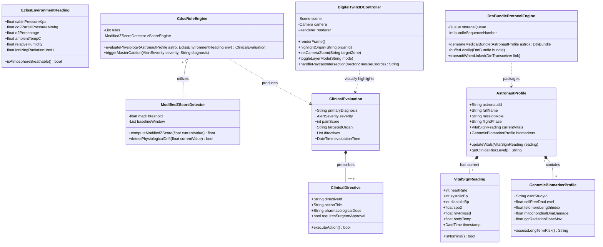
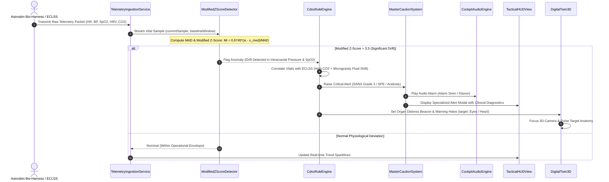
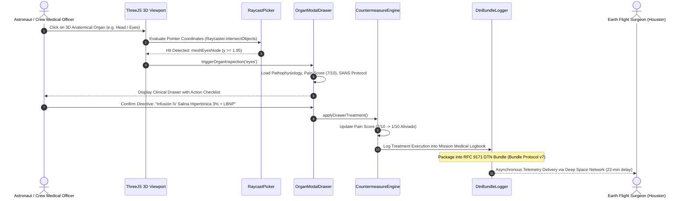
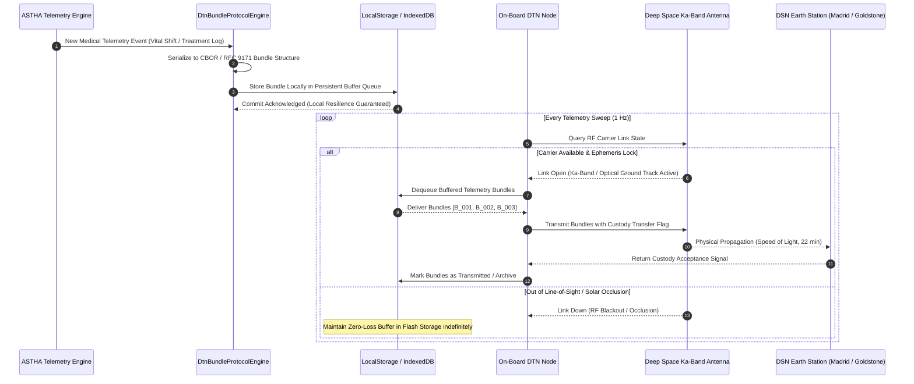
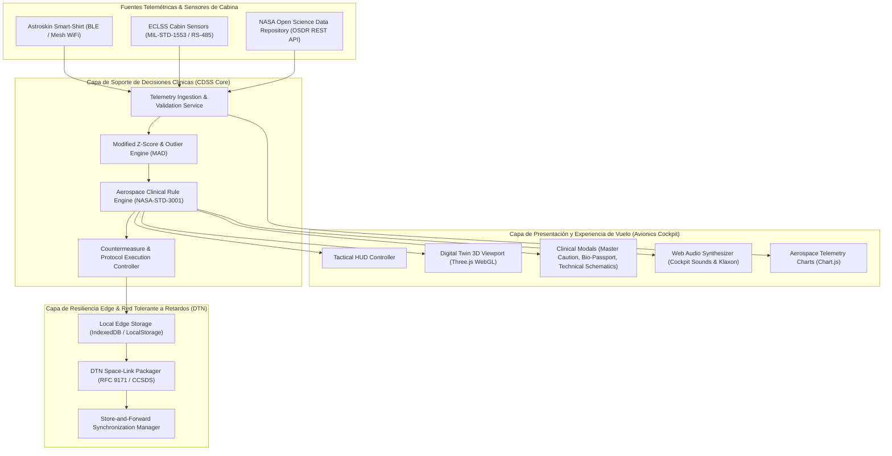
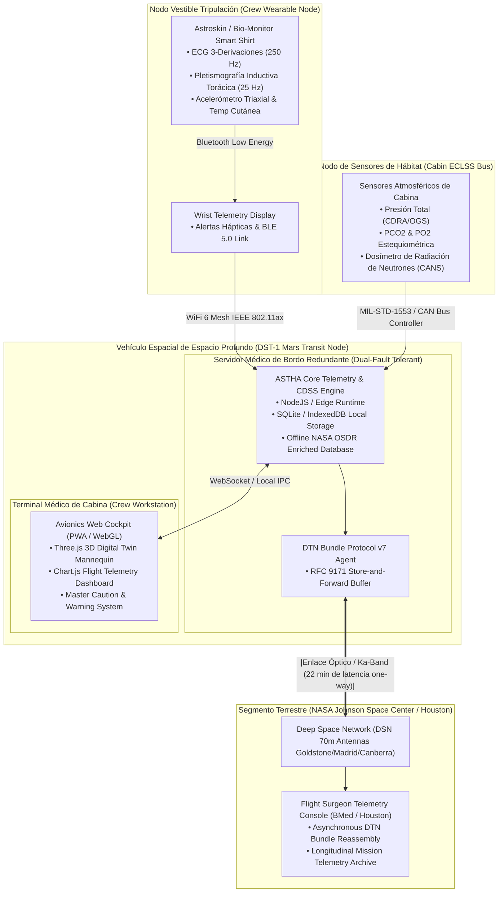

# 🛰️ SDD – Software Design Description (Diseño Detallado del Software)
## ASTHA: Autonomous Space Telemetry & Health Analytics
### NASA Space Apps Challenge 2026 | Human Spaceflight Biomedical Engineering

---

| **Metadato** | **Especificación Oficial de Ingeniería** |
| :--- | :--- |
| **Identificador del Documento** | `NASA-ASTHA-SDD-2026-REV-2.0` |
| **Estándar de Ingeniería** | **NASA-STD-8739.8** (Software Engineering Requirements) / **IEEE Std 1016-2009** |
| **Estándares Médicos de Referencia** | **NASA-STD-3001** (Vol 1: Crew Health; Vol 2: Habitat Ergonomics & ECLSS) |
| **Clasificación de Seguridad de Software** | **Class B – Non-Core Avionics / Mission Critical Crew Safety Supporting Software** |
| **Arquitectura de Referencia** | *Hexagonal Edge Architecture (Ports & Adapters) + Store-and-Forward DTN* |
| **Misión Operativa de Referencia** | Tránsito Interplanetario a Marte (*Deep Space Transport DST-1*) / 400M km / Latencia 22 min |
| **Estado de Verificación** | **Fase 2: Diseño Detallado Aprobado (Baseline)** |

---

> 💡 **Colección Modular Disponible:**  
> Este documento técnico contiene la especificación consolidada. Para una exploración modular por áreas especializadas con diagramas UML dedicados, consulte el directorio [**docs/SDD/**](SDD/README.md) y sus 7 módulos:
> * [**SDD-01:** Arquitectura Global del Sistema](SDD/01-Arquitectura-Global-del-Sistema.md)
> * [**SDD-02:** Diagrama de Clases UML](SDD/02-Diagrama-de-Clases-UML.md)
> * [**SDD-03:** Diagramas de Secuencia UML (3 Escenarios)](SDD/03-Diagramas-de-Secuencia-UML.md)
> * [**SDD-04:** Diagrama de Componentes UML](SDD/04-Diagrama-de-Componentes-UML.md)
> * [**SDD-05:** Diagrama de Despliegue UML (Topología DST-1)](SDD/05-Diagrama-de-Despliegue-UML.md)
> * [**SDD-06:** Diseño de Datos y Contratos de Interfaz (JSON Schema)](SDD/06-Diseno-de-Datos-y-Contratos-de-Interfaz.md)
> * [**SDD-07:** Matriz de Trazabilidad Requisitos a Diseño (RTM)](SDD/07-Matriz-de-Trazabilidad-SRS-a-SDD.md)

---

## 📑 Tabla de Contenidos
1. [Introducción y Alcance del Sistema](#1-introducción-y-alcance-del-sistema)
2. [Visión General de la Arquitectura de Software](#2-visión-general-de-la-arquitectura-de-software)
3. [Diagrama de Clases UML (Class Diagram)](#3-diagrama-de-clases-uml-class-diagram)
4. [Diagramas de Secuencia UML (Sequence Diagrams)](#4-diagramas-de-secuencia-uml-sequence-diagrams)
   - *Escenario A: Ingesta en Tiempo Real, Detección de Deriva (Modified Z-Score) y Master Caution*
   - *Escenario B: Triage Fisiológico Interactivo en 3D y Ejecución de Contramedidas*
   - *Escenario C: Empaquetamiento y Sincronización Asíncrona Resiliente DTN*
5. [Diagrama de Componentes UML (Component Diagram)](#5-diagrama-de-componentes-uml-component-diagram)
6. [Diagrama de Despliegue UML (Deployment Diagram)](#6-diagrama-de-despliegue-uml-deployment-diagram)
7. [Diseño de Datos y Contratos de Interfaz (Data & Interface Design)](#7-diseño-de-datos-y-contratos-de-interfaz)
8. [Matriz de Trazabilidad de Requisitos a Diseño (RTM: SRS ➔ SDD)](#8-matriz-de-trazabilidad-de-requisitos-a-diseño-rtm-srs--sdd)

---

## 1. Introducción y Alcance del Sistema

### 1.1 Propósito
Este documento de **Diseño Detallado de Software (SDD)** especifica la descomposición estructural, el diseño orientado a objetos, el flujo dinámico de eventos, los componentes y la topología de despliegue para el sistema **ASTHA (Autonomous Space Telemetry & Health Analytics)**, en estricto cumplimiento con la norma **NASA-STD-8739.8** y el estándar internacional **IEEE Std 1016-2009**.

### 1.2 Alcance del Sistema
ASTHA es una plataforma médica de soporte a la decisión clínica (*Clinical Decision Support System - CDSS*) y telemetría autónoma de borde (*Edge Computing*), diseñada para salvaguardar la vida de la tripulación en misiones hacia el espacio profundo donde la asistencia médica terrestre en tiempo real es imposible debido a la latencia relativista de comunicación (hasta **22 minutos por sentido** / 44 minutos de retardo de ida y vuelta hacia Marte).

El sistema opera bajo los siguientes mandatos operativos:
1. **Autonomía Operativa Nivel 4 (NASA ExMC):** Capacidad diagnóstica y terapéutica guiada sin intervención de control de misión en Tierra.
2. **Determinismo Fisiológico:** Detección predictiva de anomalías antes de eventos catastróficos mediante el algoritmo de desviación robusta **Modified Z-Score (MAD)**.
3. **Resiliencia de Conectividad Cero:** Persistencia local y transmisión asíncrona mediante el protocolo de paquetes tolerantes a demoras e interrupciones (**DTN Bundle Protocol RFC 9171**).

---

## 2. Visión General de la Arquitectura de Software

La arquitectura de ASTHA implementa el patrón **Hexagonal (Ports & Adapters)** combinado con un **Modelo Reactivo Orientado a Eventos en el Borde (Event-Driven Edge Processing)**.

```
+------------------------------------------------------------------------------------+
|                                    UI & AVIONICS COCKPIT LAYER                     |
|   Tactical HUD  |  Three.js 3D Viewport  |  Chart.js Telemetry  |  Audio Alarms    |
+------------------------------------------------------------------------------------+
                                       │ ▲ (Events & Reactive State)
                                       ▼ │
+------------------------------------------------------------------------------------+
|                         APPLICATION & CDSS CORE (DOMAIN SERVICES)                  |
|   Rule Engine (NASA-STD-3001)  |  Modified Z-Score (MAD)  |  Countermeasure Engine |
+------------------------------------------------------------------------------------+
                                       │ ▲ (Clean Interfaces / Ports)
                                       ▼ │
+------------------------------------------------------------------------------------+
|                          INFRASTRUCTURE & ADAPTERS (EDGE & HARDWARE)               |
|   Astroskin BLE Adapter  |  ECLSS 1553 Driver  |  IndexedDB Store  |  DTN RFC 9171 |
+------------------------------------------------------------------------------------+
```

### 2.1 Principios Arquitectónicos Clave
* **Borde Primero (Edge First):** El 100% de la lógica de evaluación diagnóstica corre localmente en el runtime de la nave. Cero dependencias de servidores en la nube o servicios externos.
* **Separación de Responsabilidades:** El motor de renderizado 3D (Three.js WebGL) está desacoplado del motor de cálculo fisiológico. El estado fluye en un solo sentido (*Unidirectional Data Flow*).
* **Tolerancia a Fallos Dual-Fault Tolerant:** Si un sensor falla o emite ruido telemétrico, el filtro de mediana absoluta (MAD) aísla el valor atípico sin disparar falsas alarmas que saturen cognitivamente al astronauta.

---

## 3. Diagrama de Clases UML (Class Diagram)

El diagrama de clases modela las entidades del dominio fisiológico y ambiental, los evaluadores clínicos del CDSS, la capa de persistencia DTN y los controladores de visualización biomédica.



### 3.1 Detalle de Responsabilidades de Clases Principales
* **`AstronautProfile`**: Representa el expediente médico longitudinal del tripulante. Gestiona el mapeo entre biometría en tiempo real y el fondo genómico de referencia (**NASA OSDR OSD-574**).
* **`VitalSignReading`**: Objeto inmutable que almacena la lectura instantánea de signos vitales capturados por los biosensores de la camiseta inteligente Astroskin (Bio-Monitor).
* **`CdssRuleEngine`**: Orquestador central del soporte a la decisión clínica. Cruza la telemetría vital humana con los parámetros ambientales del hábitat (**NASA-STD-3001 Vol 2**).
* **`ModifiedZScoreDetector`**: Implementación determinista del algoritmo de detección de anomalías basado en la **Desviación Absoluta de la Mediana ($MAD$)**:
  $$M_i = rac{0.6745 \cdot (x_i - 	ilde{x})}{MAD}$$
  Evita falsos positivos por picos aislados de ruido telemétrico.
* **`DigitalTwin3DController`**: Abstracción del subsistema de renderizado WebGL (Three.js) que proyecta el gemelo digital biomecánico y administra el raycasting interactivo sobre órganos internos.
* **`DtnBundleProtocolEngine`**: Implementación de la norma **RFC 9171 / CCSDS 734.2-B-1** para empaquetado asíncrono *Store-and-Forward*, garantizando entrega a Tierra una vez reestablecido el enlace DSN.

---

## 4. Diagramas de Secuencia UML (Sequence Diagrams)

### 4.1 Escenario A: Ingesta en Tiempo Real, Detección de Deriva (Modified Z-Score) y Master Caution

Este diagrama ilustra el flujo crítico cuando un astronauta sufre una deriva fisiológica (por ejemplo, hipertensión intracraneal y pérdida de variabilidad cardíaca por tormenta solar o acumulación de $	ext{CO}_2$ en microgravedad).



---

### 4.2 Escenario B: Triage Fisiológico Interactivo en 3D y Ejecución de Contramedidas

Describe la interacción directa cuando el oficial médico de la tripulación o el astronauta inspecciona un órgano comprometido mediante raycasting en el modelo 3D y aplica un protocolo médico guiado.



---

### 4.3 Escenario C: Empaquetamiento y Sincronización Asíncrona Resiliente DTN

Modela el protocolo *Store-and-Forward* para la bitácora médica de vuelo bajo interrupciones o blackouts de telecomunicaciones orbitales.



---

## 5. Diagrama de Componentes UML (Component Diagram)

Muestra la descomposición modular de alto nivel de ASTHA, destacando los puertos y adaptadores de ingesta, el núcleo de soporte de decisiones, la persistencia local y la interfaz de cabina.



---

## 6. Diagrama de Despliegue UML (Deployment Diagram)

Representa la topología de ejecución distribuida entre los sensores corporales del astronauta, la red de a bordo de la nave espacial (*Deep Space Transport DST-1*), el enlace de espacio profundo y el centro de control en la Tierra.



---

## 7. Diseño de Datos y Contratos de Interfaz

### 7.1 Esquema de Telemetría Biomédica Unificada (JSON Schema)
```json
{
  "$schema": "http://json-schema.org/draft-07/schema#",
  "title": "ASTHA_Unified_Telemetry_Packet",
  "type": "object",
  "properties": {
    "packetId": { "type": "string", "format": "uuid" },
    "metTimestamp": { "type": "string", "example": "048:14:28:10" },
    "astronaut": {
      "type": "object",
      "properties": {
        "id": { "type": "string", "enum": ["C001", "C002", "C003", "C004"] },
        "name": { "type": "string" },
        "heartRateBpm": { "type": "integer", "minimum": 30, "maximum": 220 },
        "systolicPressureMmhg": { "type": "integer", "minimum": 60, "maximum": 260 },
        "diastolicPressureMmhg": { "type": "integer", "minimum": 40, "maximum": 160 },
        "spo2Percentage": { "type": "number", "minimum": 70.0, "maximum": 100.0 },
        "hrvRmssdMs": { "type": "number", "minimum": 5.0, "maximum": 150.0 },
        "skinTempCelsius": { "type": "number", "minimum": 34.0, "maximum": 42.0 }
      },
      "required": ["id", "heartRateBpm", "systolicPressureMmhg", "spo2Percentage", "hrvRmssdMs"]
    },
    "habitatEclss": {
      "type": "object",
      "properties": {
        "cabinPressureKpa": { "type": "number", "minimum": 50.0, "maximum": 110.0 },
        "co2PartialPressureMmhg": { "type": "number", "minimum": 0.0, "maximum": 15.0 },
        "o2Percentage": { "type": "number", "minimum": 15.0, "maximum": 30.0 },
        "radiationDoseRateUsvH": { "type": "number", "minimum": 0.0 }
      },
      "required": ["cabinPressureKpa", "co2PartialPressureMmhg", "o2Percentage"]
    },
    "cdssState": {
      "type": "object",
      "properties": {
        "driftDetected": { "type": "boolean" },
        "madScore": { "type": "number" },
        "masterCautionActive": { "type": "boolean" },
        "activeProtocol": { "type": "string" }
      }
    }
  },
  "required": ["packetId", "metTimestamp", "astronaut", "habitatEclss", "cdssState"]
}
```

### 7.2 Estructura del Paquete DTN (RFC 9171 / CCSDS Bundle)
```
+-------------------------------------------------------------------------+
|                  PRIMARY BUNDLE HEADER (RFC 9171)                       |
| Bundle Processing Flags | Destination EID: dtn://jsc.nasa.gov/bmed      |
| Source EID: dtn://dst1.mars/astha | Creation Timestamp: MET 048:14:28:10 |
| Lifetime: 604,800 s (7 días)      | Payload Length: 4,096 bytes         |
+-------------------------------------------------------------------------+
|                    BUNDLE PAYLOAD BLOCK (CBOR Encoded)                  |
|  - Encrypted Medical Telemetry Vector (AES-256-GCM)                    |
|  - Vital Sign Baseline Moving Averages (10-minute Epoch)                |
|  - Countermeasure Interventions Administered by Crew                    |
|  - NASA OSDR Genomic Mutation Divergence Delta                         |
+-------------------------------------------------------------------------+
```

---

## 8. Matriz de Trazabilidad de Requisitos a Diseño (RTM: SRS ➔ SDD)

Esta matriz vincula formalmente los Requisitos Funcionales y No Funcionales especificados en el documento **SRS (Fase 1)** contra los componentes y clases arquitectónicas diseñadas en este **SDD (Fase 2)**.

| ID Requisito SRS | Descripción del Requisito Funcional | Clase / Módulo de Diseño SDD | Mecanismo de Verificación en Diseño |
| :--- | :--- | :--- | :--- |
| **RF-01** | Ingesta telemétrica de signos vitales (HR, BP, SpO2, HRV, Temp) | `TelemetryIngestionService`, `VitalSignReading` | Diagrama de Clases & Secuencia Escenario A |
| **RF-02** | Detección de deriva fisiológica y filtrado de anomalías sin falsas alarmas | `ModifiedZScoreDetector` | Algoritmo MAD (Capa CDSS) |
| **RF-03** | Gemelo Digital 3D interactivo con capas anatómicas y raycasting | `DigitalTwin3DController`, `RaycastPicker` | Diagrama de Componentes (Three.js WebGL) |
| **RF-04** | Alarma centralizada Master Caution & Warning visual y sonora | `MasterCautionSystem`, `CockpitAudioEngine` | Diagrama de Secuencia Escenario A |
| **RF-05** | Prescripción y checklist de contramedidas paso a paso | `ClinicalDirective`, `CountermeasureEngine` | Diagrama de Secuencia Escenario B |
| **RF-06** | Correlación ambiental de soporte vital (ECLSS NASA-STD-3001) | `EclssEnvironmentReading`, `CdssRuleEngine` | Diagrama de Componentes & Clases |
| **RF-07** | Integración genómica con NASA OSDR (OSD-574 Inspiration4) | `GenomicBiomarkerProfile`, `OSDR_API` Gateway | Diagrama de Clases & Datos |
| **RF-08** | Almacenamiento local persistente y transmisión asíncrona DTN | `DtnBundleProtocolEngine`, `LocalStore` | Diagrama de Secuencia Escenario C & Despliegue |
| **RNF-01** | Autonomía 100% Edge en la nave (Cero dependencia de servidores en la nube) | `Edge_Medical_Server` (DST-1 Node) | Diagrama de Despliegue |
| **RNF-02** | Latencia de renderizado 3D $\le 16.6	ext{ ms}$ (60 FPS estables) | `DigitalTwin3DController` (Three.js procedural) | Capa de Presentación |
| **RNF-03** | Resiliencia temporal ante retardo de comunicación de hasta 22 minutos | `DTN_Daemon` (RFC 9171 Store-and-Forward) | Diagrama de Despliegue & Secuencia C |

---

### Conclusión y Firma de Diseño
El presente **Diseño Detallado de Software (SDD)** valida formalmente la transición de la **Fase 1 (Requerimientos / SRS)** a la **Fase 2 (Diseño Arquitectónico / SDD)** del sistema **ASTHA**. 
Proporciona la base técnica integral requerida por la **NASA Space Apps Challenge** para auditoría de código, verificación de confiabilidad de software crítico de soporte de vida y evaluación por jueces aeroespaciales.
