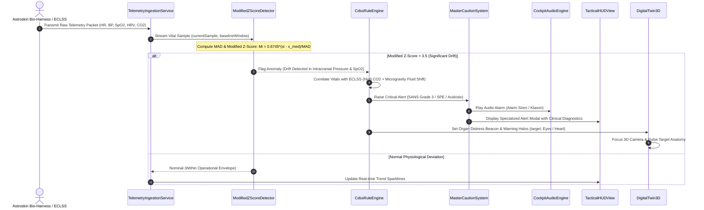
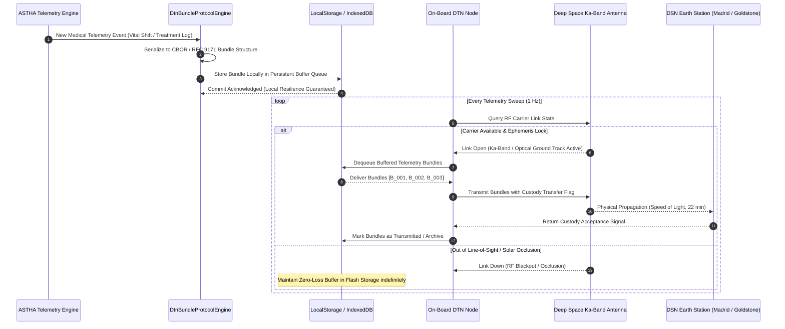
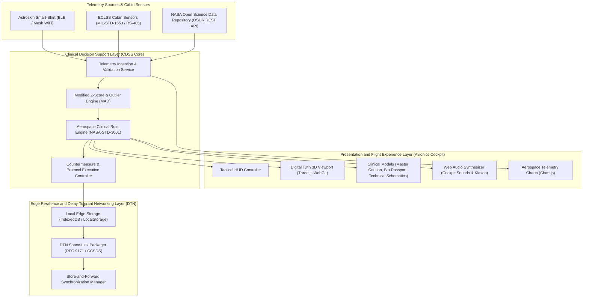
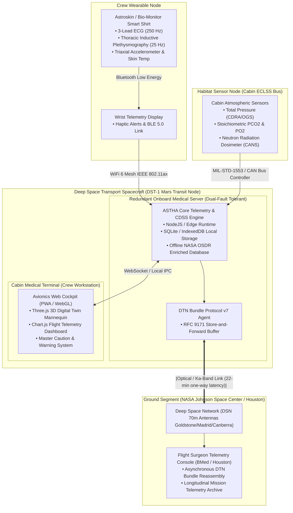

# 🛰️ SDD – Software Design Description
## ASTHA: Autonomous Space Telemetry & Health Analytics
### NASA Space Apps Challenge 2026 | Human Spaceflight Biomedical Engineering

---

| **Metadata** | **Official Engineering Specification** |
| :--- | :--- |
| **Document Identifier** | `NASA-ASTHA-SDD-2026-REV-3.0` *(Consolidated Archive — See `docs/SDD/` for Canonical Baseline)* |
| **Engineering Standard** | **NASA-STD-8739.8** (Software Engineering Requirements) / **IEEE Std 1016-2009** |
| **Reference Medical Standards** | **NASA-STD-3001** (Vol 1: Crew Health; Vol 2: Habitat Ergonomics & ECLSS) |
| **Software Safety Classification** | **Class B – Non-Core Avionics / Mission Critical Crew Safety Supporting Software** |
| **Reference Architecture** | *Hexagonal Event-Driven Web Workers (Svelte 5 + uPlot + On-Demand Three.js) + IndexedDB WebCrypto + Sync Hub LAN* |
| **Reference Operational Mission** | Interplanetary Mars Transit (*Deep Space Transport DST-1*) / Isolated Zero-WAN LAN |
| **Verification Status** | **Phase 2: Approved Detailed Design (Baseline v3.0.0 — Zero SRS/ADR Drift)** |

---

> ⚠️ **DOCUMENT AUTHORITY NOTICE (`ADR-001`):**  
> The **current canonical specification (v3.0.0 — Zero Drift with SRS and ADRs 001–020)** resides in the modular directory [**docs/SDD/**](SDD/README.md). This monolithic file is preserved solely as a preliminary historical reference; in the event of any discrepancy, the modular collection prevails:
> * [**SDD-01:** Global System Architecture (Workers, <5W/3% CPU Budgets, Z-Score MAD)](SDD/01-Arquitectura-Global-del-Sistema.md)
> * [**SDD-02:** UML Class Diagram (SRS §5.1 Entities, WebCrypto AES-GCM, CRDT)](SDD/02-Diagrama-de-Clases-UML.md)
> * [**SDD-03:** UML Sequence Diagrams (ADR-013 Escalation, On-Demand 3D, Signed JSON)](SDD/03-Diagramas-de-Secuencia-UML.md)
> * [**SDD-04:** UML Component Diagram (Svelte 5, uPlot, 2 Workers, Sync Hub)](SDD/04-Diagrama-de-Componentes-UML.md)
> * [**SDD-05:** UML Deployment Diagram (Isolated C4-L4 LAN, Internal CA, Cabin ADR-014)](SDD/05-Diagrama-de-Despliegue-UML.md)
> * [**SDD-06:** Data Design and Interface Contracts (SRS Schemas, CRDT, AAA Tokens)](SDD/06-Diseno-de-Datos-y-Contratos-de-Interfaz.md)
> * [**SDD-07:** Complete SRS-to-SDD Traceability Matrix (42 RF + 19 RNF + 10 R-* + 3 D-*)](SDD/07-Matriz-de-Trazabilidad-SRS-a-SDD.md)
> * [**SDD-08:** Architecture Decision Record (ADR-001 to ADR-020)](SDD/08-Architecture-decisions.md)

---

## 📑 Table of Contents
1. [Introduction and System Scope](#1-introduction-and-system-scope)
2. [Software Architecture Overview](#2-software-architecture-overview)
3. [UML Class Diagram](#3-uml-class-diagram)
4. [UML Sequence Diagrams](#4-uml-sequence-diagrams)
   - *Scenario A: Real-Time Ingestion, Drift Detection (Modified Z-Score), and Master Caution*
   - *Scenario B: Interactive 3D Physiological Triage and Countermeasure Execution*
   - *Scenario C: Resilient DTN Packaging and Asynchronous Synchronization*
5. [UML Component Diagram](#5-uml-component-diagram)
6. [UML Deployment Diagram](#6-uml-deployment-diagram)
7. [Data Design and Interface Contracts](#7-data-design-and-interface-contracts)
8. [Requirements-to-Design Traceability Matrix (RTM: SRS to SDD)](#8-requirements-to-design-traceability-matrix-rtm-srs-to-sdd)

---

## 1. Introduction and System Scope

### 1.1 Purpose
This **Software Design Description (SDD)** specifies the structural decomposition, object-oriented design, dynamic event flows, components, and deployment topology for the **ASTHA (Autonomous Space Telemetry & Health Analytics)** system, in strict compliance with **NASA-STD-8739.8** and international standard **IEEE Std 1016-2009**.

### 1.2 System Scope
ASTHA is an autonomous edge-computing medical **Clinical Decision Support System (CDSS)** and telemetry analytics platform engineered to safeguard crew lives during deep-space exploration missions where real-time Earth-based medical assistance is physically impossible due to relativistic communication latency (up to **22 minutes one-way** / 44 minutes round-trip delay to Mars).

The system operates under the following operational mandates:
1. **Level 4 Operational Autonomy (NASA ExMC):** Guided diagnostic and therapeutic capability without Mission Control intervention from Earth.
2. **Physiological Determinism:** Predictive anomaly detection prior to catastrophic events using the robust **Modified Z-Score (MAD)** deviation algorithm.
3. **Zero-Connectivity Resilience:** Local persistence and asynchronous transmission via Delay/Disruption Tolerant Networking (**DTN Bundle Protocol RFC 9171**).

---

## 2. Software Architecture Overview

The ASTHA architecture implements the **Hexagonal (Ports & Adapters)** pattern combined with an **Event-Driven Edge Processing Reactive Model**.

```
+------------------------------------------------------------------------------------+
|                                    UI & AVIONICS COCKPIT LAYER                     |
|   Tactical HUD  |  Three.js 3D Viewport  |  Chart.js Telemetry  |  Audio Alarms    |
+------------------------------------------------------------------------------------+
                                       │ ▲ (Events & Reactive State)
                                       ▼ │
+------------------------------------------------------------------------------------+
|                         APPLICATION & CDSS CORE (DOMAIN SERVICES)                  |
|   Rule Engine (NASA-STD-3001)  |  Modified Z-Score (MAD)  |  Countermeasure Engine |
+------------------------------------------------------------------------------------+
                                       │ ▲ (Clean Interfaces / Ports)
                                       ▼ │
+------------------------------------------------------------------------------------+
|                          INFRASTRUCTURE & ADAPTERS (EDGE & HARDWARE)               |
|   Astroskin BLE Adapter  |  ECLSS 1553 Driver  |  IndexedDB Store  |  DTN RFC 9171 |
+------------------------------------------------------------------------------------+
```

### 2.1 Key Architectural Principles
* **Edge First:** 100% of diagnostic evaluation logic executes locally within the spacecraft runtime. Zero dependencies on cloud servers or external services.
* **Separation of Concerns:** The 3D rendering engine (Three.js WebGL) is decoupled from the physiological computation engine. State flows unidirectionally (*Unidirectional Data Flow*).
* **Dual-Fault Tolerant Reliability:** If a sensor degrades or emits telemetry noise, the Median Absolute Deviation (MAD) filter isolates the outlier without triggering false alarms that cognitively overload the astronaut.

---

## 3. UML Class Diagram

The class diagram models the physiological and environmental domain entities, the CDSS clinical evaluators, the DTN persistence layer, and the biomedical visualization controllers.


### 3.1 Core Class Responsibilities
* **`AstronautProfile`**: Represents the crew member's longitudinal medical record. Manages mapping between real-time biometrics and reference genomic background (**NASA OSDR OSD-574**).
* **`VitalSignReading`**: Immutable object storing instantaneous vital-sign readings captured by the Astroskin (Bio-Monitor) smart garment biosensors.
* **`CdssRuleEngine`**: Central clinical decision support orchestrator. Cross-correlates human vital telemetry against habitat environmental parameters (**NASA-STD-3001 Vol 2**).
* **`ModifiedZScoreDetector`**: Deterministic implementation of the anomaly detection algorithm based on the **Median Absolute Deviation ($MAD$)**:
  $$M_i = \frac{0.6745 \cdot (x_i - \tilde{x})}{MAD}$$
  Prevents false positives caused by isolated telemetry noise spikes.
* **`DigitalTwin3DController`**: Abstraction of the WebGL rendering subsystem (Three.js) that renders the biomechanical digital twin and manages interactive raycasting over internal organs.
* **`DtnBundleProtocolEngine`**: Implementation of **RFC 9171 / CCSDS 734.2-B-1** for asynchronous *Store-and-Forward* bundling, ensuring guaranteed delivery to Earth once a DSN link is re-established.

---

## 4. UML Sequence Diagrams

### 4.1 Scenario A: Real-Time Ingestion, Drift Detection (Modified Z-Score), and Master Caution

This diagram illustrates the critical workflow when an astronaut experiences physiological drift (for example, intracranial hypertension and loss of heart rate variability triggered by a solar storm or $\text{CO}_2$ buildup in microgravity).



---

### 4.2 Scenario B: Interactive 3D Physiological Triage and Countermeasure Execution

Models direct interaction when the Crew Medical Officer or astronaut inspects a compromised organ via raycasting on the 3D model and executes a guided medical protocol.


---

### 4.3 Scenario C: Resilient DTN Packaging and Asynchronous Synchronization

Models the *Store-and-Forward* protocol for the flight medical logbook during orbital communications blackouts or planetary occultations.



---

## 5. UML Component Diagram

Illustrates ASTHA's high-level modular decomposition, highlighting ingestion ports and adapters, the decision-support core, local persistence, and the cockpit interface.



---

## 6. UML Deployment Diagram

Represents the distributed execution topology spanning astronaut body-worn sensors, the spacecraft onboard network (*Deep Space Transport DST-1*), the deep-space link, and the Earth control center.



---

## 7. Data Design and Interface Contracts

### 7.1 Unified Biomedical Telemetry Schema (JSON Schema)
```json
{
  "$schema": "http://json-schema.org/draft-07/schema#",
  "title": "ASTHA_Unified_Telemetry_Packet",
  "type": "object",
  "properties": {
    "packetId": { "type": "string", "format": "uuid" },
    "metTimestamp": { "type": "string", "example": "048:14:28:10" },
    "astronaut": {
      "type": "object",
      "properties": {
        "id": { "type": "string", "enum": ["C001", "C002", "C003", "C004"] },
        "name": { "type": "string" },
        "heartRateBpm": { "type": "integer", "minimum": 30, "maximum": 220 },
        "systolicPressureMmhg": { "type": "integer", "minimum": 60, "maximum": 260 },
        "diastolicPressureMmhg": { "type": "integer", "minimum": 40, "maximum": 160 },
        "spo2Percentage": { "type": "number", "minimum": 70.0, "maximum": 100.0 },
        "hrvRmssdMs": { "type": "number", "minimum": 5.0, "maximum": 150.0 },
        "skinTempCelsius": { "type": "number", "minimum": 34.0, "maximum": 42.0 }
      },
      "required": ["id", "heartRateBpm", "systolicPressureMmhg", "spo2Percentage", "hrvRmssdMs"]
    },
    "habitatEclss": {
      "type": "object",
      "properties": {
        "cabinPressureKpa": { "type": "number", "minimum": 50.0, "maximum": 110.0 },
        "co2PartialPressureMmhg": { "type": "number", "minimum": 0.0, "maximum": 15.0 },
        "o2Percentage": { "type": "number", "minimum": 15.0, "maximum": 30.0 },
        "radiationDoseRateUsvH": { "type": "number", "minimum": 0.0 }
      },
      "required": ["cabinPressureKpa", "co2PartialPressureMmhg", "o2Percentage"]
    },
    "cdssState": {
      "type": "object",
      "properties": {
        "driftDetected": { "type": "boolean" },
        "madScore": { "type": "number" },
        "masterCautionActive": { "type": "boolean" },
        "activeProtocol": { "type": "string" }
      }
    }
  },
  "required": ["packetId", "metTimestamp", "astronaut", "habitatEclss", "cdssState"]
}
```

### 7.2 DTN Bundle Packet Structure (RFC 9171 / CCSDS Bundle)
```
+-------------------------------------------------------------------------+
|                  PRIMARY BUNDLE HEADER (RFC 9171)                       |
| Bundle Processing Flags | Destination EID: dtn://jsc.nasa.gov/bmed      |
| Source EID: dtn://dst1.mars/astha | Creation Timestamp: MET 048:14:28:10 |
| Lifetime: 604,800 s (7 days)      | Payload Length: 4,096 bytes         |
+-------------------------------------------------------------------------+
|                    BUNDLE PAYLOAD BLOCK (CBOR Encoded)                  |
|  - Encrypted Medical Telemetry Vector (AES-256-GCM)                    |
|  - Vital Sign Baseline Moving Averages (10-minute Epoch)                |
|  - Countermeasure Interventions Administered by Crew                    |
|  - NASA OSDR Genomic Mutation Divergence Delta                         |
+-------------------------------------------------------------------------+
```

---

## 8. Requirements-to-Design Traceability Matrix (RTM: SRS to SDD)

This matrix formally traces the Functional and Non-Functional Requirements specified in the **SRS (Phase 1)** to the architectural components and classes designed in this **SDD (Phase 2)**.

| SRS Requirement ID | Functional Requirement Description | SDD Design Class / Module | Design Verification Mechanism |
| :--- | :--- | :--- | :--- |
| **RF-01** | Vital signs telemetry ingestion (HR, BP, SpO2, HRV, Temp) | `TelemetryIngestionService`, `VitalSignReading` | Class Diagram & Sequence Scenario A |
| **RF-02** | Physiological drift detection and anomaly filtering without false alarms | `ModifiedZScoreDetector` | MAD Algorithm (CDSS Layer) |
| **RF-03** | Interactive 3D Digital Twin with anatomical layers and raycasting | `DigitalTwin3DController`, `RaycastPicker` | Component Diagram (Three.js WebGL) |
| **RF-04** | Centralized visual and audible Master Caution & Warning alarm | `MasterCautionSystem`, `CockpitAudioEngine` | Sequence Scenario A |
| **RF-05** | Step-by-step countermeasure prescription and checklist | `ClinicalDirective`, `CountermeasureEngine` | Sequence Scenario B |
| **RF-06** | Life-support environmental correlation (ECLSS NASA-STD-3001) | `EclssEnvironmentReading`, `CdssRuleEngine` | Component & Class Diagrams |
| **RF-07** | Genomic integration with NASA OSDR (OSD-574 Inspiration4) | `GenomicBiomarkerProfile`, `OSDR_API` Gateway | Class & Data Design |
| **RF-08** | Local persistent storage and asynchronous DTN transmission | `DtnBundleProtocolEngine`, `LocalStore` | Sequence Scenario C & Deployment |
| **RNF-01** | 100% onboard Edge autonomy (Zero dependency on cloud servers) | `Edge_Medical_Server` (DST-1 Node) | Deployment Diagram |
| **RNF-02** | 3D rendering latency $\le 16.6\text{ ms}$ (steady 60 FPS) | `DigitalTwin3DController` (procedural Three.js) | Presentation Layer |
| **RNF-03** | Temporal resilience to communication delays up to 22 minutes | `DTN_Daemon` (RFC 9171 Store-and-Forward) | Deployment Diagram & Sequence C |

---

### Conclusion and Design Sign-Off
This **Software Design Description (SDD)** formally validates the transition from **Phase 1 (Requirements / SRS)** to **Phase 2 (Architectural Design / SDD)** of the **ASTHA** system.  
It provides the comprehensive technical foundation required by the **NASA Space Apps Challenge** for code auditing, safety-critical life-support software verification, and evaluation by aerospace engineering panels.
