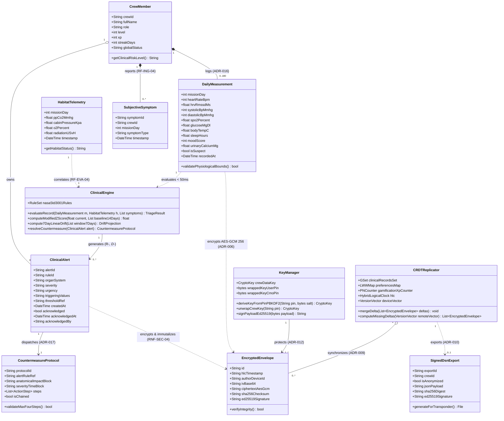

# 🧬 SDD-02: UML Class Diagram
### ASTHA — Software Design Description | NASA Space Apps Challenge 2026
**Reference Standards:** NASA-STD-8739.8 | IEEE Std 1016-2009 | UML 2.5 | **ADRs:** 006, 009, 010, 011, 012, 016, 017

---

## 1. Class Diagram for Clinical Domain, Security, and Synchronization

This model represents the data entities defined in **SRS §5.1**, the deterministic inference engine in **Clinical Engine Worker** (`ADR-005`), and the cryptographic persistence and replication contracts in **Data & Sync Worker** (`ADR-006`, `ADR-009`, `ADR-012`).

---

## 2. Class Responsibilities and SRS / ADR Traceability

### 2.1 Clinical and Data Entities (`SRS §5.1` & `ADR-016`)
* **`DailyMeasurement` (`RF-ING-01`, `RF-ING-05`, `ADR-016`)**: Encapsulates the 9 daily clinical variables (`HR, HRV, PAS, PAD, SpO2, glucose, temperature, sleep, mood`) plus optional urinary calcium. Its `validatePhysiologicalBounds()` method flags anomalous values with `isSuspect = true` **without discarding them**, fulfilling `RF-ING-05`.
* **`SubjectiveSymptom` (`RF-ING-04`, `SRS §5.1`)**: Closed catalog of 6 one-tap selectable symptoms: `blurredVision`, `headache`, `nausea`, `lumbarPain`, `orthostaticDizziness`, and `extremeFatigue`.

### 2.2 Deterministic Inference Engine (`ClinicalEngine`, `ADR-005`, `ADR-011`, `ADR-017`)
* **`ClinicalEngine`**: Operates inside the `Clinical Engine Worker` with zero network dependencies. Implements:
  * **10 Correlation Rules (`RF-EVA-04`, `SRS §6.2`)**: `R-ENV-01`, `R-ENV-02`, `R-SANS-01`, `R-SANS-02`, `R-RAD-01`, `R-RAD-02`, `R-COG-01`, `R-REN-01`, `R-REN-02`, `R-CARD-01`.
  * **3 Drift Rules (`RF-DER-01..04`, `ADR-011`)**: `D-01` (7-day linear regression), `D-02` (Modified Z-Score with MAD over days 1–14), and `D-03` (decreasing sleep + increasing DBP / PAD).
* **`CountermeasureProtocol` (`RF-GUI-01..04`, `ADR-017`)**: Structures alerts into the 3 mandatory blocks (*What is happening anatomically*, *Severity and estimated time*, *Actions*) and strictly validates that `steps.length <= 4` (**`ADR-017`**). Longer interventions (such as combined SPE or LBNP protocols) are chained via `isChained = true`.

### 2.3 Cryptographic Security, Privacy, and CRDT (`ADR-006`, `ADR-009`, `ADR-010`, `ADR-012`)
* **`KeyManager` (`ADR-012`, `RNF-SEC-02`)**: Implements cryptographic segregation compliant with the *Privacy Act of 1974* and *HIPAA*. Each crew member has a symmetric data key wrapped simultaneously with their personal PIN and the CMO's PIN via `PBKDF2`. Neither cabin displays nor the Sync Hub can decrypt individual envelopes.
* **`EncryptedEnvelope` (`ADR-006`, `RNF-SEC-01`, `RNF-SEC-03`, `RNF-SEC-04`)**: Envelope stored in IndexedDB with native `AES-GCM-256` encryption, `SHA-256` checksum to detect cosmic-radiation bit-flips (*Single Event Upsets - SEU*), and `Ed25519` signature in an *append-only* chained ledger.
* **`CRDTReplicator` (`ADR-009`, `RNF-NET-02`)**: Resolves offline conflicts without coordination using a `G-Set` (immutable clinical data), `LWW-Map` ordered by Hybrid Logical Clock `HLC` (UI preferences), and `PNCounter` (gamification XP score).
* **`SignedDsnExport` (`ADR-010`, `RNF-NET-04`, `RF-REG-02`)**: Packages a consolidated `Ed25519`-signed JSON report (with an anonymization option per `ADR-012`) for manual handoff to the spacecraft's external communications system.
