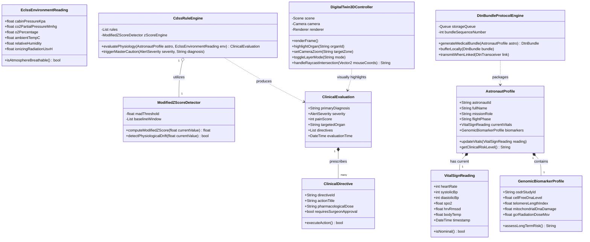

# 🧬 SDD-02: Diagrama de Clases UML
### ASTHA — Software Design Description | NASA Space Apps Challenge 2026
**Normas de Referencia:** NASA-STD-8739.8 | IEEE Std 1016-2009 | UML 2.5

---

## 1. Diagrama de Clases Estructural

---

## 2. Especificación Técnica de Clases Principales

### 2.1 `AstronautProfile`
* **Propósito:** Representa el perfil biomédico longitudinal de cada tripulante (e.g. Dra. Sian Proctor, Jared Isaacman).
* **Atributos:**
  * `astronautId: String`: Identificador unívoco del tripulante (`C001`, `C002`, `C003`, `C004`).
  * `currentVitals: VitalSignReading`: Registro telemétrico de signos vitales instantáneos.
  * `biomarkers: GenomicBiomarkerProfile`: Marcadores genómicos y epigenéticos anclados al repositorio **NASA OSDR OSD-574**.
* **Métodos:**
  * `updateVitals(reading)`: Actualiza la ventana temporal móvil y recalcula las medias basales.
  * `getClinicalRiskLevel()`: Retorna el nivel de alerta compuesto (`NOMINAL`, `WARNING`, `CRITICAL`).

### 2.2 `ModifiedZScoreDetector`
* **Propósito:** Filtro estadístico robusto de anomalías basado en la Mediana Absoluta de la Desviación (MAD).
* **Métodos:**
  * `computeModifiedZScore(value)`: Ejecuta la fórmula $M_i = 0.6745 \cdot (x_i - 	ilde{x}) / MAD$.
  * `detectPhysiologicalDrift(value)`: Retorna `true` si $|M_i| > 3.5$.

### 2.3 `CdssRuleEngine`
* **Propósito:** Motor de inferencia clínica que correlaciona signos vitales del tripulante con los parámetros ambientales del hábitat (**ECLSS NASA-STD-3001**).
* **Reglas Incorporadas:**
  * Detección de Síndrome Neuro-Ocular Asociado al Vuelo Espacial (**SANS**): Presión sistólica elevada + Cefalea pulsátil + Microgravedad prolongada.
  * Sobrecarga Cardiovascular: Taquicardia + Caída abrupta de HRV rMSSD (< 20 ms).
  * Acidosis Hipercápnica: Presión parcial de $	ext{CO}_2 > 3.0	ext{ mmHg}$ + Disnea telemétrica.
  * Radiación por Tormenta Solar (**SPE**): Tasa de dosis de radiación ionizante $> 50\,\mu	ext{Sv/h}$.

### 2.4 `DigitalTwin3DController`
* **Propósito:** Controla el viewport WebGL (Three.js) del gemelo digital biomecánico.
* **Métodos:**
  * `highlightOrgan(organId)`: Ilumina el órgano diana (Ojos, Corazón, Riñones, Huesos) con halo de advertencia.
  * `setCameraZoom(targetZone)`: Realiza una transición suave de cámara (lerp) hacia la zona anatómica comprometida.
  * `handleRaycastIntersection(mouseCoords)`: Determina la colisión de rayos 3D para activar el triage clínico al hacer clic en el cuerpo.
