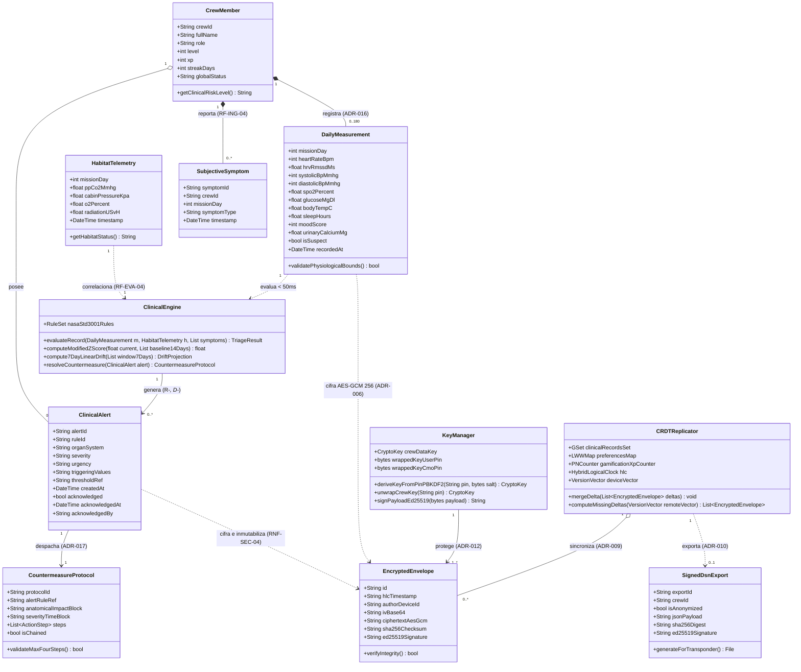

# 🧬 SDD-02: Diagrama de Clases UML
### ASTHA — Software Design Description | NASA Space Apps Challenge 2026
**Normas de Referencia:** NASA-STD-8739.8 | IEEE Std 1016-2009 | UML 2.5 | **ADRs:** 006, 009, 010, 011, 012, 016, 017

---

## 1. Diagrama de Clases del Dominio Clínico, Seguridad y Sincronización

Este modelo representa las entidades de datos definidas en el **SRS §5.1**, el motor de inferencia determinista en **Clinical Engine Worker** (`ADR-005`) y los contratos criptográficos de persistencia y replicación en **Data & Sync Worker** (`ADR-006`, `ADR-009`, `ADR-012`).

---

## 2. Responsabilidades de Clases y Trazabilidad SRS / ADR

### 2.1 Entidades Clínicas y de Datos (`SRS §5.1` & `ADR-016`)
* **`DailyMeasurement` (`RF-ING-01`, `RF-ING-05`, `ADR-016`)**: Encapsula las 9 variables clínicas diarias (`HR, HRV, PAS, PAD, SpO2, glucosa, temperatura, sueño, ánimo`) más calcio urinario opcional. Su método `validatePhysiologicalBounds()` marca valores anómalos con `isSuspect = true` **sin descartarlos**, cumpliendo `RF-ING-05`.
* **`SubjectiveSymptom` (`RF-ING-04`, `SRS §5.1`)**: Catálogo cerrado de 6 síntomas seleccionables con un toque: `blurredVision`, `headache`, `nausea`, `lumbarPain`, `orthostaticDizziness` y `extremeFatigue`.

### 2.2 Motor de Inferencia Determinista (`ClinicalEngine`, `ADR-005`, `ADR-011`, `ADR-017`)
* **`ClinicalEngine`**: Opera en el `Clinical Engine Worker` sin dependencias de red. Implementa:
  * **10 Reglas de Correlación (`RF-EVA-04`, `SRS §6.2`)**: `R-ENV-01`, `R-ENV-02`, `R-SANS-01`, `R-SANS-02`, `R-RAD-01`, `R-RAD-02`, `R-COG-01`, `R-REN-01`, `R-REN-02`, `R-CARD-01`.
  * **3 Reglas de Deriva (`RF-DER-01..04`, `ADR-011`)**: `D-01` (regresión lineal 7 días), `D-02` (Z-score modificado con MAD sobre días 1–14) y `D-03` (sueño decreciente + PAD creciente).
* **`CountermeasureProtocol` (`RF-GUI-01..04`, `ADR-017`)**: Estructura las alertas en los 3 bloques mandatorios (*Qué ocurre anatómicamente*, *Severidad y tiempo estimado*, *Acciones*) y valida estrictamente que `steps.length <= 4` (**`ADR-017`**). Las intervenciones largas (como protocolos combinados SPE o LBNP) se encadenan mediante `isChained = true`.

### 2.3 Seguridad Criptográfica, Privacidad y CRDT (`ADR-006`, `ADR-009`, `ADR-010`, `ADR-012`)
* **`KeyManager` (`ADR-012`, `RNF-SEC-02`)**: Implementa segregación criptográfica conforme al *Privacy Act de 1974* y *HIPAA*. Cada tripulante posee una clave de datos simétrica envuelta simultáneamente con su PIN personal y el PIN del CMO mediante `PBKDF2`. Ninguna pantalla de cabina ni el Sync Hub pueden descifrar sobres individuales.
* **`EncryptedEnvelope` (`ADR-006`, `RNF-SEC-01`, `RNF-SEC-03`, `RNF-SEC-04`)**: Sobre almacenado en IndexedDB con cifrado nativo `AES-GCM-256`, checksum `SHA-256` para detectar inversiones de bits por radiación cósmica (*Single Event Upsets - SEU*) y firma `Ed25519` en bitácora encadenada *append-only*.
* **`CRDTReplicator` (`ADR-009`, `RNF-NET-02`)**: Resuelve conflictos offline sin coordinación mediante `G-Set` (datos clínicos inmutables), `LWW-Map` ordenado por reloj híbrido `HLC` (preferencias de interfaz) y `PNCounter` (puntaje de gamificación XP).
* **`SignedDsnExport` (`ADR-010`, `RNF-NET-04`, `RF-REG-02`)**: Empaqueta un reporte consolidado en JSON firmado con `Ed25519` (y opción de anonimización según `ADR-012`) para entrega manual al sistema de comunicaciones externo de la nave.
