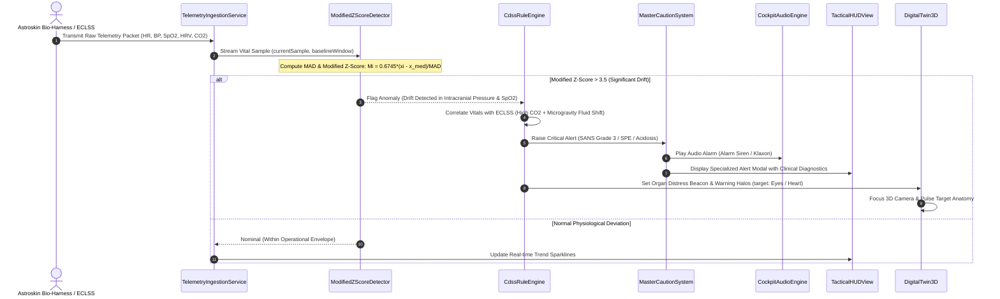
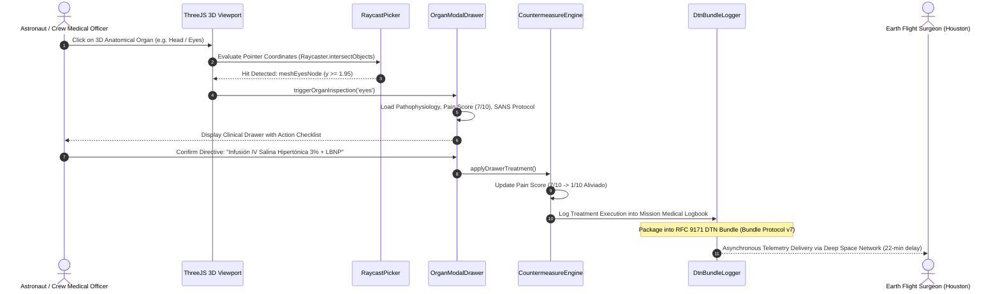
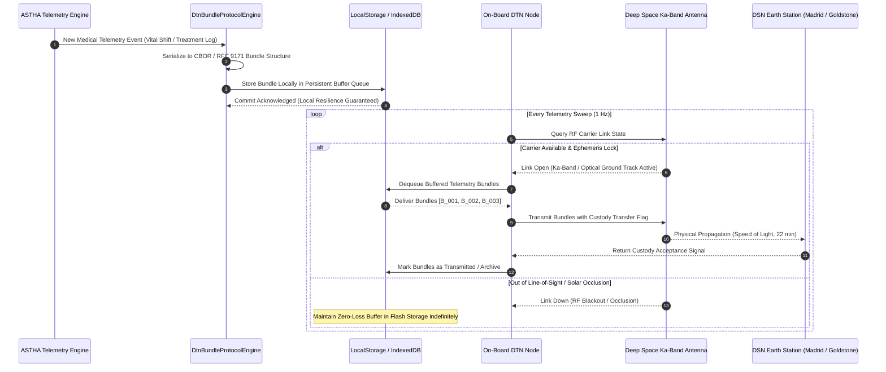

# ⏱️ SDD-03: Diagramas de Secuencia UML
### ASTHA — Software Design Description | NASA Space Apps Challenge 2026
**Normas de Referencia:** NASA-STD-8739.8 | IEEE Std 1016-2009 | UML 2.5

---

## 1. Escenario A: Ingesta en Tiempo Real, Detección de Deriva (Modified Z-Score) y Master Caution

Este flujo dinámico modela la recepción continua de bioseñales, el filtrado estadístico robusto contra falsos positivos y el disparo de la alarma centralizada **Master Caution & Warning** ante una deriva fisiológica crítica.

---

## 2. Escenario B: Triage Fisiológico Interactivo en 3D y Ejecución de Contramedidas

Describe la interacción directa cuando el astronauta o el oficial médico inspecciona un órgano comprometido mediante **raycasting 3D** en el gemelo digital y ejecuta las directivas del protocolo clínico guiado.

---

## 3. Escenario C: Empaquetamiento y Sincronización Asíncrona Resiliente DTN

Modela el protocolo de transporte tolerante a demoras e interrupciones (**RFC 9171 / CCSDS**) para transferir la bitácora médica de vuelo hacia la Tierra salvando los retardos relativistas y ventanas de ocultamiento orbital.

