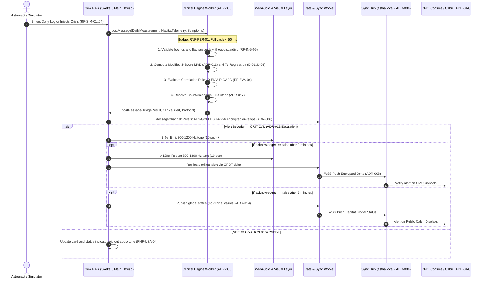
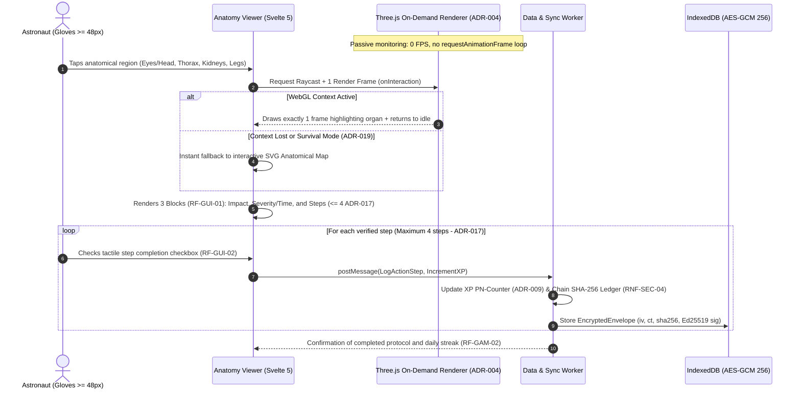

# ⏱️ SDD-03: UML Sequence Diagrams
### ASTHA — Software Design Description | NASA Space Apps Challenge 2026
**Reference Standards:** NASA-STD-8739.8 | IEEE Std 1016-2009 | UML 2.5 | **ADRs:** 004, 005, 006, 008, 009, 010, 011, 013, 014, 017

---

## 1. Scenario A: Web Worker Clinical Pipeline (< 50 ms) and Alarm Escalation (`ADR-005`, `ADR-011`, `ADR-013`)

Models the reactive, event-driven flow (zero polling) from daily logging or crisis injection through clinical evaluation and the timed escalation protocol for unacknowledged critical alarms.



---

## 2. Scenario B: On-Demand 3D Anatomical Triage (`ADR-004`), $\le 4$-Step Checklist (`ADR-017`), and Gamification

Models ergonomic touch interaction ($\ge 48\text{ px}$), the **zero idle frames** rule of the Three.js 3D renderer to satisfy `RNF-POW-01` (CPU $\le 3\%$), and verifiable countermeasure execution.



---

## 3. Scenario C: LAN Synchronization with Sync Hub (`ADR-008`) and Signed JSON Export (`ADR-010`)

Models partition tolerance without Internet (`RNF-NET-01`), conflict-free convergence via CRDT (`ADR-009`), and offline signed-file generation for handoff to the spacecraft DTN communications system (`ADR-010`).

```mermaid
sequenceDiagram
    autonumber
    actor CMO as Crew Medical Officer (CMO)
    participant ClientA as Device A (Data & Sync Worker)
    participant Hub as Rust Sync Hub (astha.local - ADR-008)
    participant ClientB as CMO Console (Data & Sync Worker)
    participant Transponder as Spacecraft DTN Router (External - ADR-010)

    Note over ClientA,Hub: Isolated spacecraft LAN (mDNS < 3s - RNF-NET-03, WSS TLS 1.3)
    
    alt Sync Hub Available on LAN
        ClientA->>Hub: Connects WSS + Sends local VersionVector (ADR-009)
        Hub-->>ClientA: Sends missing encrypted deltas (G-Set / LWW-Map / PN-Counter)
        ClientA->>Hub: Sends new encrypted EncryptedEnvelopes (Zero-Knowledge on Hub)
        Hub->>Hub: Verifies Ed25519 signature and appends to on-disk Op-Log
        Hub-->>ClientB: Relays encrypted deltas over WSS
        ClientB->>ClientB: Idempotent HLC merge and decrypts with CMO key (ADR-012)
    else Sync Hub Down or Isolated Module
        ClientA->>ClientA: Remains 100% autonomous; accumulates local envelopes for future convergence
    end

    Note over CMO,Transponder: DSN Link Window to Houston (ADR-010)
    CMO->>ClientB: Requests Asynchronous Export for Flight Surgeon (RF-REG-02, RNF-NET-04)
    ClientB->>ClientB: Consolidates trends and events + Anonymizes if non-medical use (ADR-012)
    ClientB->>ClientB: Signs JSON package with device Ed25519 private key
    ClientB-->>CMO: Downloads astha_export_signed.json file
    CMO->>Transponder: Physical/local handoff of JSON to external spacecraft DTN subsystem
```
