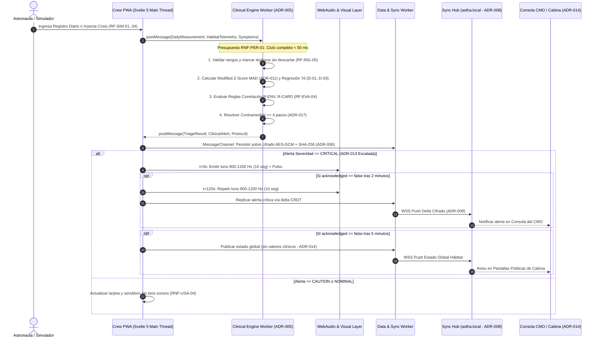
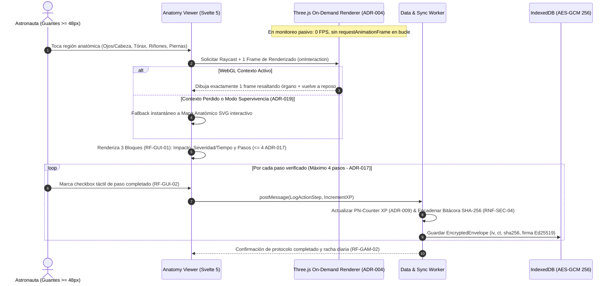

# ⏱️ SDD-03: Diagramas de Secuencia UML
### ASTHA — Software Design Description | NASA Space Apps Challenge 2026
**Normas de Referencia:** NASA-STD-8739.8 | IEEE Std 1016-2009 | UML 2.5 | **ADRs:** 004, 005, 006, 008, 009, 010, 011, 013, 014, 017

---

## 1. Escenario A: Pipeline Clínico en Web Worker (< 50 ms) y Escalada de Alarmas (`ADR-005`, `ADR-011`, `ADR-013`)

Modela el flujo reactivo dirigido por eventos (sin *polling*) desde el registro o inyección de crisis hasta la evaluación clínica y el protocolo temporal de escalada de alarmas críticas no reconocidas.



---

## 2. Escenario B: Triaje Anatómico 3D Bajo Demanda (`ADR-004`), Checklist $\le 4$ Pasos (`ADR-017`) y Gamificación

Modela la interacción ergonómica táctil ($\ge 48\text{ px}$), la regla de **cero fotogramas en reposo** del renderizador 3D Three.js para cumplir `RNF-POW-01` (CPU $\le 3\%$), y la ejecución verificable de contramedidas.



---

## 3. Escenario C: Sincronización LAN con Sync Hub (`ADR-008`) y Exportación JSON Firmada (`ADR-010`)

Modela la tolerancia a particiones sin Internet (`RNF-NET-01`), la convergencia libre de conflictos mediante CRDT (`ADR-009`), y la generación del archivo firmado fuera de red para su entrega al sistema de comunicaciones DTN de la nave (`ADR-010`).

```mermaid
sequenceDiagram
    autonumber
    actor CMO as Oficial Médico (CMO)
    participant ClientA as Dispositivo A (Data & Sync Worker)
    participant Hub as Sync Hub en Rust (astha.local - ADR-008)
    participant ClientB as Consola CMO (Data & Sync Worker)
    participant Transponder as Router DTN de la Nave (Externo - ADR-010)

    Note over ClientA,Hub: Red LAN aislada de la nave (mDNS < 3s - RNF-NET-03, WSS TLS 1.3)
    
    alt Sync Hub Disponible en LAN
        ClientA->>Hub: Conecta WSS + Envía VersionVector local (ADR-009)
        Hub-->>ClientA: Envía deltas cifrados faltantes (G-Set / LWW-Map / PN-Counter)
        ClientA->>Hub: Envía nuevos EncryptedEnvelope cifrados (Zero-Knowledge en Hub)
        Hub->>Hub: Verifica firma Ed25519 y anexa al Op-Log en disco
        Hub-->>ClientB: Retransmite deltas cifrados por WSS
        ClientB->>ClientB: Merge idempotente por HLC y descifra con clave del CMO (ADR-012)
    else Sync Hub Caído o Módulo Aislado
        ClientA->>ClientA: Sigue 100% autónomo; acumula sobres locales para convergencia futura
    end

    Note over CMO,Transponder: Ventana de Enlace DSN a Houston (ADR-010)
    CMO->>ClientB: Solicita Exportación Asíncrona para Flight Surgeon (RF-REG-02, RNF-NET-04)
    ClientB->>ClientB: Consolida tendencias y eventos + Anonimiza si es uso no médico (ADR-012)
    ClientB->>ClientB: Firma paquete JSON con clave privada Ed25519 del dispositivo
    ClientB-->>CMO: Descarga archivo astha_export_signed.json
    CMO->>Transponder: Entrega física/local del JSON al subsistema DTN externo de la nave
```
