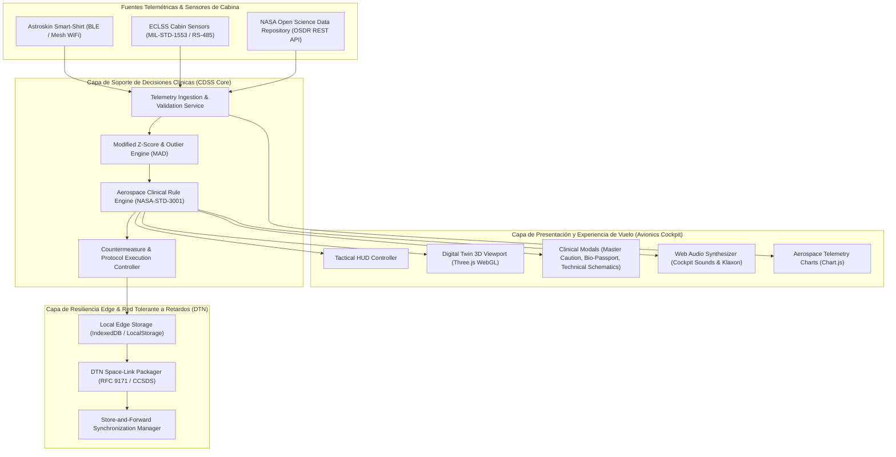

# 🧩 SDD-04: Diagrama de Componentes UML
### ASTHA — Software Design Description | NASA Space Apps Challenge 2026
**Normas de Referencia:** NASA-STD-8739.8 | IEEE Std 1016-2009 | UML 2.5

---

## 1. Diagrama de Componentes del Sistema

Muestra la descomposición modular de alto nivel de ASTHA, destacando los puertos y adaptadores de ingesta, el núcleo de soporte de decisiones, la persistencia local y la interfaz de cabina.

---

## 2. Descripción de Subsistemas e Interfaces

### 2.1 Subsistema de Ingesta y Adaptación de Sensores
* **`AstroskinBLE`**: Driver de comunicación inalámbrica de baja energía (Bluetooth Low Energy 5.0) para la ingesta continua de ECG de 3 derivaciones (250 Hz) y pletismografía inductiva respiratoria (25 Hz).
* **`ECLSS_Bus`**: Interfaz de hardware para el bus de instrumentación de cabina (MIL-STD-1553 / RS-485) que reporta $	ext{PPO}_2$, $	ext{PPCO}_2$, presión total y dosimetría de neutrones secundarios.
* **`OSDR_API`**: Gateway de sincronización previa al vuelo con los 116 estudios biológicos humanos del repositorio oficial **NASA Open Science Data Repository (OSDR)**.

### 2.2 Subsistema Núcleo de Soporte Clínico (CDSS Core)
* **`MAD_Engine`**: Algoritmo que calcula la dispersión no paramétrica para filtrar anomalías verdaderas frente a variaciones circadianas normales.
* **`ClinicalRules`**: Conjunto determinista de reglas médicas calibradas según los límites permisibles del estándar **NASA-STD-3001**.
* **`CountermeasureCtrl`**: Motor de despacho terapéutico que guía la ejecución de contramedidas paso a paso (farmacológicas, fluidoterapia, LBNP o purgas de $	ext{CO}_2$).

### 2.3 Subsistema de Presentación (Avionics Cockpit)
* **`Tactical HUD`**: Cabecera táctica con reloj de tiempo transcurrido de misión (MET) y selector de tripulante.
* **`ThreeJS Viewport`**: Escena WebGL con gemelo digital procedural, selector de capas (`Humano`, `Híbrido`, `Traje EVA`, `Rayos-X`) e interactividad por raycast.
* **`AudioFX`**: Sintetizador de tonos de audio de cabina mediante osciladores Web Audio (chime, blip, alarma Klaxon de dos tonos para emergencias críticas).
