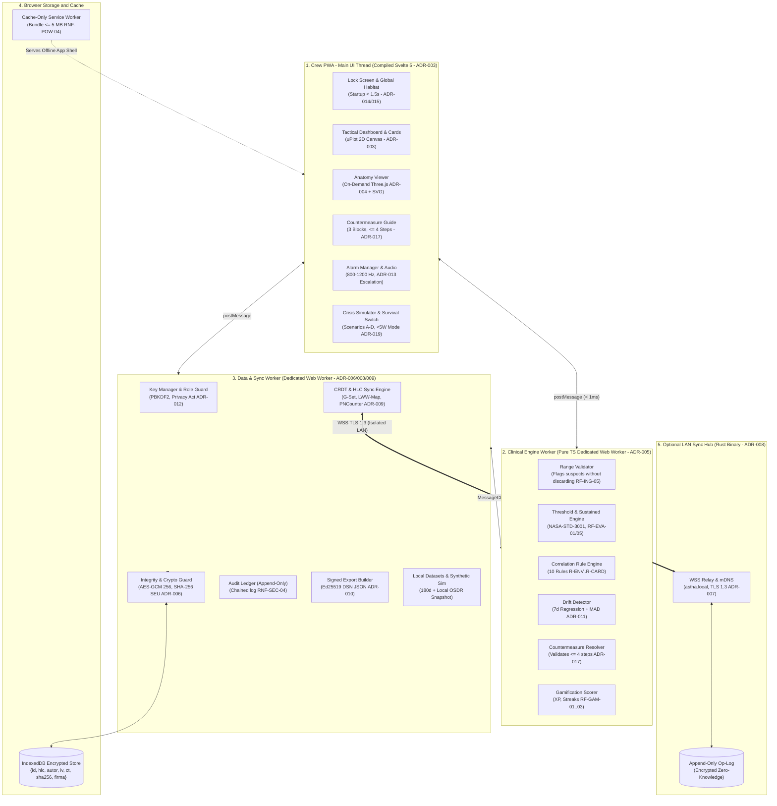

# 🧩 SDD-04: UML Component Diagram
### ASTHA — Software Design Description | NASA Space Apps Challenge 2026
**Reference Standards:** NASA-STD-8739.8 | IEEE Std 1016-2009 | UML 2.5 | C4 Model L2/L3 | **ADRs:** 003, 004, 005, 006, 008, 009, 010, 017

---

## 1. Container and Internal Component Architecture

In accordance with the C4-L2/L3 decomposition and **[ADR-005](08-Architecture-decisions.md#adr-005)**, the system strictly separates the **compiled Svelte 5 UI** (`ADR-003`), the **Deterministic Clinical Engine** (`Clinical Engine Worker`), and the **Encrypted Persistence & Synchronization Layer** (`Data & Sync Worker`).

---

## 2. Detailed Component Specification

### 2.1 Presentation Subsystem (`Crew PWA - UI`, `ADR-003`, `ADR-004`, `ADR-018`)
* **Core Technology:** **Svelte 5 (Runes)** compiled without a Virtual DOM. Only mutates affected DOM nodes upon receiving events from Workers (0 passive `setInterval` timers).
* **Charts (`uPlot`):** Replaces Chart.js/Recharts to minimize bundle weight and CPU usage. Draws threshold bands (`Nominal`, `Caution`, `Critical`) via custom 2D Canvas hooks.
* **Anatomical Viewer (`AnatomyViewer`):** Dynamically loads locally bundled Three.js after first paint. Operates **strictly on demand** (1 frame per interaction/state change, no auto-rotation or `requestAnimationFrame` loop). Provides an SVG fallback if the WebGL context is lost or the Commander activates Survival Mode (`ADR-019`).
* **Accessibility and Design (`ADR-018`, `RNF-USA-01..03`):** System fonts (`system-ui`, `ui-monospace`), touch targets $\ge 48\text{ px}$ with $\ge 12\text{ px}$ spacing for pressurized gloves, and the `alert-red-text` token (`#fca5a5`, $10.6:1$ WCAG AAA contrast ratio) separated from `alert-red` (`#ef4444` for pulses and borders).

### 2.2 Clinical Engine Subsystem (`Clinical Engine Worker`, `ADR-005`)
* **Strict Isolation:** Pure TypeScript with zero external dependencies. By architectural rule (enforced via lint), **`fetch`, `WebSocket`, DOM access, and continuous timers are prohibited**.
* **Deterministic Pipeline (`< 50 ms`, `RNF-PER-01`):**
  1. `RangeValidator`: Checks biological plausibility and flags anomalies with `isSuspect = true` without deleting them (`RF-ING-05`).
  2. `Threshold & Sustained`: Evaluates the 12 indicators against **NASA-STD-3001** and sustained conditions (`HRV < 20 ms`, `Sleep < 5.5 h >= 2 days`, `RF-EVA-05`).
  3. `CorrEngine`: Evaluates the 10 cross-domain rules (`R-ENV-01..02`, `R-SANS-01..02`, `R-RAD-01..02`, `R-COG-01`, `R-REN-01..02`, `R-CARD-01`).
  4. `DriftDetector`: Computes `D-01` ($O(1)$ 7-day regression), `D-02` (Modified Z-Score MAD $|M_i| \ge 2.5$, `ADR-011`), and `D-03` (combined pattern).
  5. `CounterResolver`: Selects the 3-block therapeutic protocol (`RF-GUI-01`) and enforces the strict $\le 4$-step rule (`ADR-017`).

### 2.3 Data, Encryption, and Sync Subsystem (`Data & Sync Worker`, `ADR-006`, `ADR-008`, `ADR-009`, `ADR-010`)
* **Native Cryptography (`crypto.subtle`):** Per-record `AES-GCM-256` encryption, `SHA-256` checksum against radiation-induced errors (*Single Event Upsets* `RNF-SEC-03`), `Ed25519` signatures, and PIN-based `PBKDF2` key derivation (`ADR-012`).
* **Conflict-Free Replication (`CRDT`):** Uses a `G-Set` for immutable clinical records, `LWW-Map` for configurations, and `PNCounter` for XP, ordered by a Hybrid Logical Clock (`HLC`) and `VersionVector`.
* **Optional Sync Hub (`ADR-008`):** Static **Rust** binary (`tokio`, `rustls`, `tokio-tungstenite`, `mdns-sd`) that advertises `astha.local` on the LAN and relays encrypted deltas without reading clinical contents (*Zero-Knowledge*).
* **DSN Export (`ADR-010`):** Builds an `Ed25519`-signed JSON package for external handoff to the spacecraft communications system.
