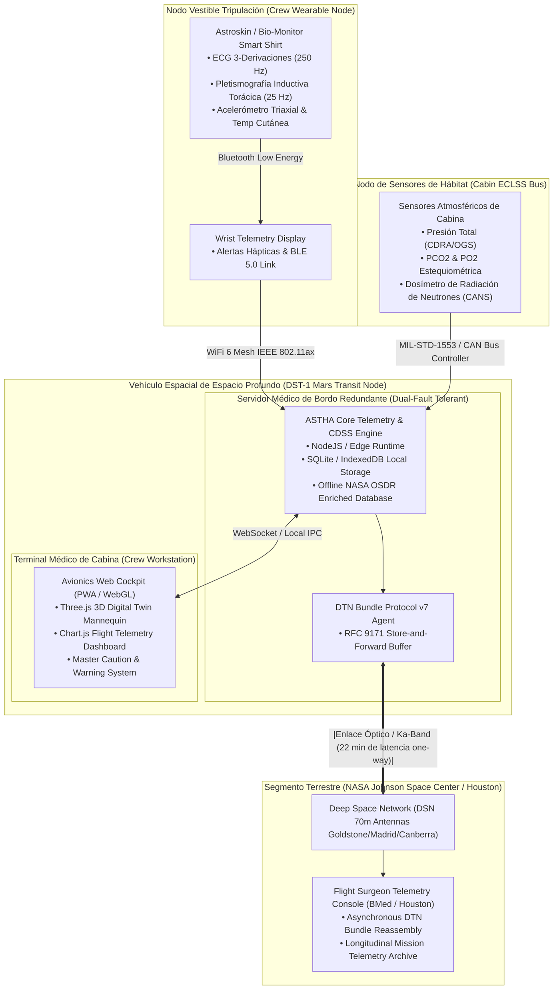

# 🚀 SDD-05: Diagrama de Despliegue UML
### ASTHA — Software Design Description | NASA Space Apps Challenge 2026
**Normas de Referencia:** NASA-STD-8739.8 | IEEE Std 1016-2009 | UML 2.5

---

## 1. Topología Física y de Red en Espacio Profundo

El diagrama de despliegue modela la distribución de nodos físicos entre los biosensores vestibles de la tripulación, la infraestructura informática de la nave espacial (*Deep Space Transport DST-1*), el enlace de telecomunicación DSN y el centro de control en Tierra (*NASA JSC / Houston*).

---

## 2. Especificación de Nodos de Hardware

### 2.1 Nodo Vestible de la Tripulación (*Crew Wearable Node*)
* **Hardware:** Prenda inteligente textil biocompatible (*Bio-Monitor Astroskin / CSA*).
* **Protocolo de Enlace:** Bluetooth Low Energy (BLE 5.0) encriptado con AES-128 CCM.
* **Potencia:** Consumo ultra-bajo ($\le 0.4	ext{ W}$) con batería recargable de 48 horas de autonomía en microgravedad.

### 2.2 Servidor Médico de Bordo (*Edge Medical Server*)
* **Hardware:** Arquitectura redundante tolerante a fallos (*Dual-Lockstep SBC* con protección contra eventos de radiación ionizante *Single Event Upsets - SEU*).
* **Entorno de Ejecución:** Runtime de borde determinista local (*NodeJS / WebAssembly*).
* **Persistencia:** Almacenamiento de estado sólido NVMe industrial de alta durabilidad sin depender de conectividad externa.

### 2.3 Terminal Médico de Cabina (*Crew Medical Terminal*)
* **Hardware:** Pantalla táctil industrial reforzada para cabina espacial (apta para uso con guantes $\ge 48	ext{px}$ y alto contraste visual según estándar **NASA-STD-3001 Vol 2**).
* **Software:** Interfaz de usuario PWA ejecutada en navegador Chromium embebido con aceleración WebGL por hardware para 60 FPS estables.

### 2.4 Enlace Espacio-Tierra (*Space-to-Ground Deep Space Link*)
* **Infraestructura:** Antenas de 70 metros de la **Deep Space Network (DSN)** situadas en Goldstone (EE.UU.), Madrid (España) y Canberra (Australia).
* **Banda de Frecuencia:** Transmisor de alta ganancia en Banda Ka (32 GHz) y transceptor láser óptico espacial.
* **Protocolo de Capa de Transporte:** **CCSDS 734.2-B-1 / RFC 9171 (DTN Bundle Protocol v7)** con custodia garantizada.
