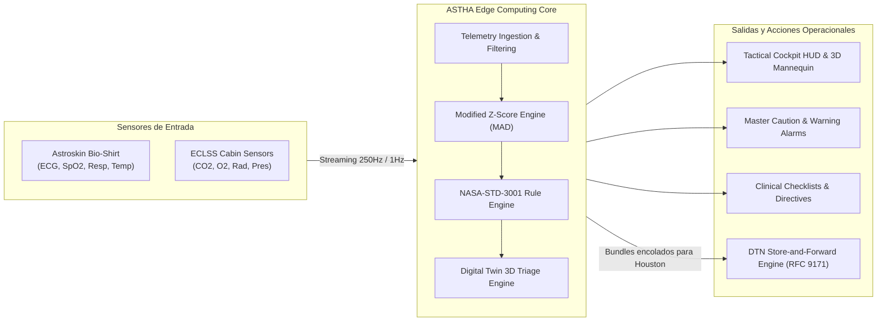

# 📘 Software Design Description (SDD) — Sistema ASTHA
### Autonomous Space Telemetry & Health Analytics | Fase 2: Diseño Detallado
**NASA Space Apps Challenge 2026** | *Create Health Monitoring Software for Astronauts on Space Missions*

---

## 📋 Control del Documento y Marco Normativo

| Parámetro | Especificación Formal |
| :--- | :--- |
| **Proyecto** | ASTHA — Autonomous Space Telemetry & Health Analytics |
| **Documento** | Software Design Description (SDD) — Colección Modular |
| **Versión / Baseline** | v2.0.0 (Fase 2: Arquitectura y Diseño Detallado de Software) |
| **Fecha de Publicación** | Noviembre 2026 |
| **Clasificación de Criticidad** | **NASA Class B** (Non-avionics human mission safety-critical / Life support situational awareness) |
| **Estándares Aplicados** | **IEEE Std 1016-2009** (Information Technology — Systems Design — Software Design Descriptions)<br>**NASA-STD-8739.8** (Software Assurance Standard)<br>**NASA-STD-3001** (Space Flight Human-System Standard, Vols 1 & 2)<br>**RFC 9171 / CCSDS 734.2-B-1** (Delay-Tolerant Networking Bundle Protocol Version 2)<br>**UML 2.5** (Unified Modeling Language - Object Management Group) |
| **Repositorio Oficial** | [angelcontres/AstroVital-SpaceApps](https://github.com/angelcontres/AstroVital-SpaceApps) |
| **Despliegue Operativo** | [https://angelcontres.github.io/AstroVital-SpaceApps/](https://angelcontres.github.io/AstroVital-SpaceApps/) |

---

## 🎯 1. Propósito y Enfoque Modular del SDD

Este directorio alberga la especificación técnica completa de la arquitectura y diseño de software para **ASTHA**. Para garantizar la máxima claridad, mantenibilidad y rigurosidad técnica requerida en revisiones de diseño de la NASA (*Preliminary Design Review - PDR* y *Critical Design Review - CDR*), el SDD ha sido descompuesto en siete (7) módulos especializados e interconectados:

```
docs/SDD/
├── README.md                                    # 📍 Índice Maestro y Control Documental (Este documento)
├── 01-Arquitectura-Global-del-Sistema.md        # 🏛️ Patrón Hexagonal, Edge Core y Principios Aeroespaciales
├── 02-Diagrama-de-Clases-UML.md                 # 🧬 Modelo de Dominio Clínico, Entidades y Servicios
├── 03-Diagramas-de-Secuencia-UML.md             # ⏱️ Escenarios Dinámicos: Ingesta/Z-Score, Triaje 3D y DTN
├── 04-Diagrama-de-Componentes-UML.md            # 🧩 Descomposición Modular, Puertos e Interfaces Internas
├── 05-Diagrama-de-Despliegue-UML.md             # 🚀 Topología de Hardware en DST-1 y Enlace Interplanetario
├── 06-Diseno-de-Datos-y-Contratos-de-Interfaz.md# 📦 Esquemas JSON, DTN Bundle Payload y Persistencia
└── 07-Matriz-de-Trazabilidad-SRS-a-SDD.md       # 🧭 Mapeo Bidireccional Requisitos (Fase 1) ➔ Diseño (Fase 2)
```

---

## 📑 2. Catálogo y Guía de Módulos del SDD

| Módulo | Título Formal | Enfoque de Diseño y Vistas IEEE 1016 | Diagramas y Artefactos |
| :--- | :--- | :--- | :--- |
| [**SDD-01**](01-Arquitectura-Global-del-Sistema.md) | **Arquitectura Global del Sistema** | Vista de Contexto y Principios de Diseño: Hexagonal (Ports & Adapters), Resiliencia Edge-First, Inferencia determinista sin nube, Tolerancia a 22 min de latencia. | Diagrama ASCII de Capas, Formulaciones matemáticas MAD Z-Score. |
| [**SDD-02**](02-Diagrama-de-Clases-UML.md) | **Diagrama de Clases UML** | Vista Lógica y Estructural: Modelo de dominio clínico orientado a objetos, desacoplamiento de capas, entidades de signos vitales, biomarcadores genómicos OSDR y adaptadores de hardware. | `classDiagram` formal en Mermaid (8 clases principales interrelacionadas). |
| [**SDD-03**](03-Diagramas-de-Secuencia-UML.md) | **Diagramas de Secuencia UML** | Vista de Interacción y Comportamiento Temporal: Protocolos dinámicos en 3 flujos críticos: (A) Ingesta continua y alarma Master Caution, (B) Triaje visual 3D interactivo y directiva médica, (C) Encolamiento asíncrono DTN Store-and-Forward hacia Houston. | 3 diagramas de secuencia `sequenceDiagram` numerados y explicados paso a paso. |
| [**SDD-04**](04-Diagrama-de-Componentes-UML.md) | **Diagrama de Componentes UML** | Vista de Desarrollo y Modularidad: Descomposición en subsistemas (Cockpit UI, CDSS Core, Persistencia Edge e Interfaz de Comunicaciones) con contratos de puertos explícitos. | Diagrama de componentes `flowchart TB` con subgrafos por subsistema. |
| [**SDD-05**](05-Diagrama-de-Despliegue-UML.md) | **Diagrama de Despliegue UML** | Vista Física y Topología de Red: Despliegue en tránsito a Marte (*Deep Space Transport DST-1*), sensores vestibles Astroskin, bus ECLSS 1553, servidor redundante edge y enlace DSN/DTN a JSC Houston. | Diagrama de despliegue `flowchart TB` con protocolos (BLE 5.0, Mil-Std-1553, CCSDS DTN). |
| [**SDD-06**](06-Diseno-de-Datos-y-Contratos-de-Interfaz.md) | **Diseño de Datos y Contratos de Interfaz** | Vista de Información y Contratos: Esquemas JSON formales para telemetría unificada y directivas de contramedidas, estructura del DTN Bundle Payload y esquema de persistencia local en SQLite/IndexedDB. | Esquemas JSON Schema Draft-07 y tabla relacional de base de datos. |
| [**SDD-07**](07-Matriz-de-Trazabilidad-SRS-a-SDD.md) | **Matriz de Trazabilidad SRS a SDD** | Vista de Aseguramiento de Calidad: Mapeo bidireccional riguroso entre los 8 Requisitos Funcionales (RF-01..08) y 3 No Funcionales (RNF-01..03) del SRS y los componentes de diseño del SDD. | Matriz RTM completa (Cero requisitos huérfanos). |

---

## 🏛️ 3. Resumen Ejecutivo de la Arquitectura de Software



### Pilares Fundamentales de la Solución:
1. **Autonomía Absoluta en Espacio Profundo:** El sistema opera al 100% sin requerir conectividad terrestre activa, superando el retardo de hasta 22 minutos por sentido entre la Tierra y Marte.
2. **Filtrado Estadístico Antirruido (Modified Z-Score con MAD):** Evita la fatiga por alarmas (*alarm fatigue*) en el personal de vuelo mediante el cálculo robusto de la desviación estándar estimada:
   $$\text{MAD} = \text{mediana}(|x_i - \tilde{x}|), \qquad M_i = \frac{0.6745 \cdot (x_i - \tilde{x})}{\text{MAD}}$$
3. **Gemelo Digital 3D de Baja Sobrecarga (Three.js WebGL):** Maniquí biomecánico optimizado para renderizado procedural a 60 FPS estables (< 16.6 ms de latencia por fotograma) sin requerir GPUs dedicadas de alta potencia.
4. **Resiliencia DTN (RFC 9171):** Ante la pérdida o atenuación del enlace electromagnético de espacio profundo, la telemetría y reportes médicos se preservan en colas transaccionales locales y se transmiten automáticamente cuando se restablece la ventana de visibilidad orbital.

---

## 🔍 4. Cómo Navegar este Diseño

Para una revisión estructurada del diseño:
* Si busca **comprender la estructura estática del código y clases**, comience por [SDD-02 (Diagrama de Clases)](02-Diagrama-de-Clases-UML.md).
* Si busca **auditar la respuesta dinámica ante emergencias y latencia**, examine [SDD-03 (Diagramas de Secuencia)](03-Diagramas-de-Secuencia-UML.md).
* Si busca **evaluar el despliegue físico en el transporte a Marte**, consulte [SDD-05 (Diagrama de Despliegue)](05-Diagrama-de-Despliegue-UML.md).
* Si busca **verificar la cobertura contractual contra los requisitos de la Fase 1**, diríjase a [SDD-07 (Matriz de Trazabilidad SRS a SDD)](07-Matriz-de-Trazabilidad-SRS-a-SDD.md).
