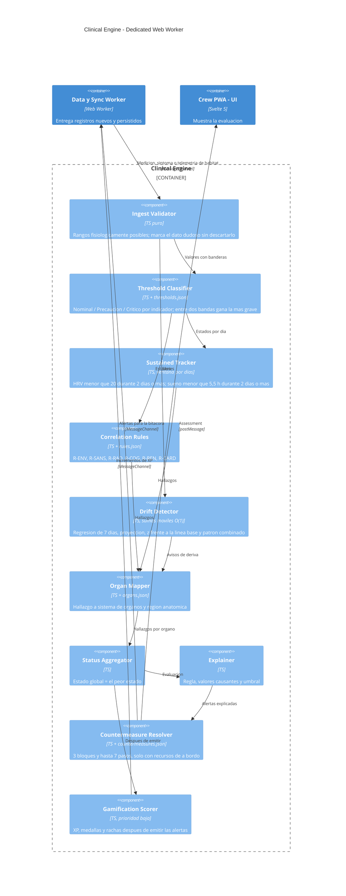
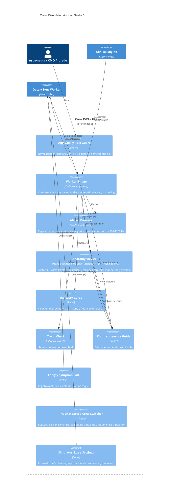
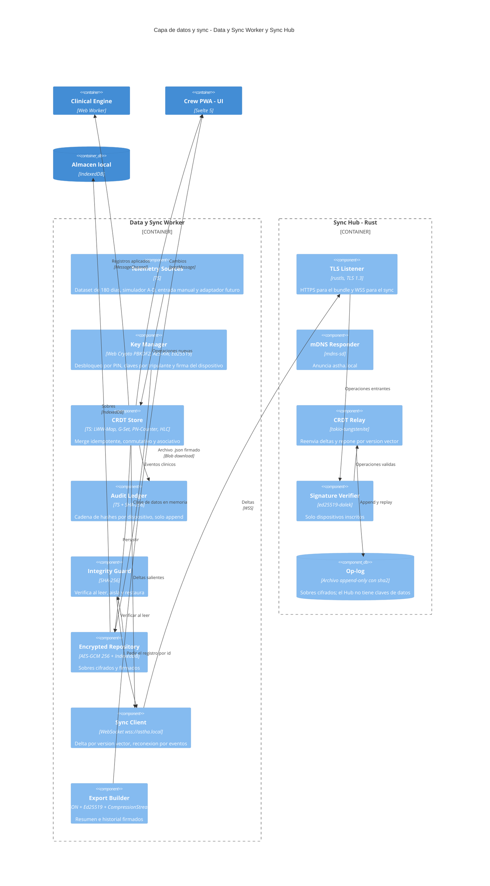

# C4 · Nivel 3 — Diagramas de Componentes

**Fuente de autoridad:** [SRS](../../SRS%20%E2%80%93%20Software%20de%20Monitoreo%20de%20Salud%20para%20Astronautas.md) §3, §4, §5 y §6 · **Trazabilidad:** [RTM](../../MATRIZ_DE_TRAZABILIDAD_RTM.md) · **Tokens visuales:** [WIREFRAME §4](../../WIREFRAME_Y_DISENO_UI_UX.md) · Convenciones en [01-contexto](01-contexto.md)

Contenido:

1. [Clinical Engine](#31-clinical-engine)
2. [Crew PWA (UI)](#32-crew-pwa-ui), con fichas de design system para Anatomy Viewer, Indicator Cards, Countermeasure Guide y Alarm Manager
3. [Capa de datos y sync](#33-capa-de-datos-y-sync) (worker del dispositivo + Sync Hub)
4. [Preguntas abiertas](#preguntas-abiertas)

---

## 3.1 Clinical Engine



| Componente | Tecnología | Responsabilidad | Requisitos que cubre |
| --- | --- | --- | --- |
| Ingest Validator | TS puro | Rechaza tipos inválidos y marca `flags.dubious` cuando el valor está fuera de los rangos posibles. Nunca descarta | RF-ING-05 · ⚠ la RTM (RF-ING-05) dice "descarte"; el SRS dice "sin descartarlos" y prevalece |
| Threshold Classifier | TS + `thresholds.json` (SRS §6.1 como datos) | Una búsqueda por indicador. Los valores entre bandas se asignan a la más grave (SRS §6.1, último párrafo) | RF-EVA-01 · AC-01 · **GAP**: el SRS dice que los umbrales con \* son "editables como datos (RNF-09)", pero RNF-09 no existe |
| Sustained Tracker | TS, estado por tripulante y día | Condiciones sostenidas por días consecutivos | RF-EVA-05 |
| Correlation Rules | TS + `rules.json` | Las 10 reglas de SRS §6.2, evaluadas como predicados sobre el último estado más los síntomas activos | RF-EVA-04, R-ENV-01, R-ENV-02, R-SANS-01, R-SANS-02, R-RAD-01, R-RAD-02, R-COG-01, R-REN-01, R-REN-02, R-CARD-01 · AC-05 |
| Drift Detector | TS. Sumas móviles (Σx, Σy, Σxy, Σx²) por indicador. Línea base con la media y la desviación de los días 1-14 | D-01 (proyección a 7 días cruza el umbral de precaución con el valor actual nominal), D-02 (z ≥ 2,5), D-03 (sueño ↓ y diastólica ↑) | RF-DER-01..04, D-01..D-03 · AC-02 · ⚠ RNF-PER-01, README y AC-CLIN-02 hablan de **Z-score modificado (MAD)**, mientras RF-DER-03 usa media y desviación. Se implementa RF-DER-03 y el MAD queda como pregunta abierta |
| Organ Mapper | TS + `organs.json` | Asigna 7 sistemas a 5 regiones del cuerpo (ojos/cabeza, tórax/corazón, lumbar/riñones, piernas/fémur, general/sangre) | RF-EVA-03, RF-ANA-02 · AC-03 · **GAP**: el SRS no dice a qué región van "cognitivo", "radiación" y "respiratorio/ambiental". Se propone: cognitivo → cabeza; radiación y respiratorio → general |
| Status Aggregator | TS | Peor estado entre indicadores y reglas activas, por tripulante y por región | RF-EVA-02 |
| Explainer | TS | Para cada alerta: `ruleId`, valores, umbral, unidad y texto no médico | RF-EVA-06, RF-GUI-04 |
| Countermeasure Resolver | TS + `countermeasures.json` | Bloques "qué ocurre / severidad y tiempo / acciones". Comprueba ≤ 7 pasos y que cada recurso esté en la lista de inventario | RF-GUI-01..04, RNF-USA-05 · AC-04 · ⚠ AC-CLIN-06 pide como máximo **4** pasos; RNF-USA-05 permite 7 |
| Gamification Scorer | TS, se ejecuta después de enviar el Assessment | XP por 150 min de ejercicio, informe matutino e hidratación. No puede retrasar ni tapar alertas | RF-GAM-01..03 |

**Contrato de salida (`Assessment`):** `{crewId, day, global, regions[5], indicators[{id, value, unit, status, slope, daysToCaution, z, dubious}], alerts[{id, ruleId, organ, status, urgency, values, threshold, explanation, countermeasureId}], latencyMs}`. El campo `latencyMs` permite verificar RNF-PER-01 en producción.

**Sin red:** el worker no importa `fetch` ni `WebSocket`. Una regla de lint lo prohíbe en `engine/**` como verificación estática de RF-EVA-07.

---

## 3.2 Crew PWA (UI)



| Componente | Tecnología | Responsabilidad | Requisitos que cubre |
| --- | --- | --- | --- |
| App Shell y Role Guard | Svelte 5. Pestañas según WIREFRAME §6.1 | Pestañas Biomédico, Entorno, Triage y Simulador. El botón de emergencia es visible en todas las vistas y abre el protocolo activo en 1 toque | RNF-USA-02, RNF-SEC-02 (lado UI; la aplicación real es criptográfica, ver §3.3) |
| Worker Bridge | Runes `$state` / `$derived` | Única entrada de datos a la UI. Agrupa los mensajes por frame con `requestAnimationFrame` solo cuando hay un mensaje pendiente | RNF-POW-01 |
| **Alarm Manager** | Svelte + Web Audio (`OscillatorNode`) | Ver ficha | RNF-USA-04, RF-GAM-03, RF-EVA-06 |
| **Anatomy Viewer** | Three.js empaquetado en local, render bajo demanda, hotspots HTML, respaldo SVG | Ver ficha | RF-ANA-01..04, RF-EVA-03 · SPEC §4.2 (avatar 3D) · CU-04 (carpeta) |
| **Indicator Cards** | Svelte | Ver ficha | RF-DSH-01, RF-DER-02 (flecha y aviso de deriva) |
| Trend Chart | uPlot (canvas 2D), un canvas por indicador visible | Serie de 180 días con bandas Nominal, Precaución y Crítico. Se destruye al salir de la vista | RF-DSH-02 · ⚠ la RTM dice Chart.js |
| **Countermeasure Guide** | Svelte | Ver ficha | RF-GUI-01..05, RNF-USA-05 |
| Entry y Symptom Pad | Svelte, controles de 48 px o más | 9 campos de RF-ING-01 con pasos grandes (+/−) y 5 síntomas de un toque | RF-ING-01, RF-ING-04, RNF-USA-01 · ⚠ SRS §5.1 habla de un "catálogo cerrado de 6 síntomas" y RF-ING-04 enumera 5 |
| Habitat Strip y Crew Switcher | Svelte | Cinta de estado rápido (WIREFRAME §6.1), resumen de tripulación para el CMO | RF-DSH-03, RF-DSH-04 |
| Simulator, Log y Settings | Svelte | Escenarios A-D, reset en 1 toque, avance de tiempo simulado, bitácora, exportación JSON, alto contraste, texto grande y modo rojo | RF-SIM-01..05, RF-REG-01..03, RF-ING-06, RNF-USA-03 |

### Tokens que usan las cuatro fichas

Tomados de WIREFRAME §4.1. Los ratios de contraste son medidos (WCAG 2.1, sobre `space-950` / `space-800`):

| Token | Valor | Contraste | Uso permitido (RNF-USA-03 pide ≥ 7:1) |
| --- | --- | --- | --- |
| `alert-green` | `#10b981` | 7,94 / 7,36 | Texto y relleno ✓ |
| `alert-yellow` | `#f59e0b` | 9,37 / 8,69 | Texto y relleno ✓ |
| `alert-red` | `#ef4444` | **5,35 / 4,96** | ⚠ **No cumple 7:1 para texto.** Solo para rellenos y bordes |
| `alert-red-text` *(propuesto)* | `#fca5a5` | 10,61 / 9,83 | Texto sobre estados críticos ✓ |
| `cyan-400` | `#38bdf8` | 9,40 / 8,71 | Acento ✓ |

**Modo espectral rojo (RNF-USA-03):** en monocromo de unos 630 nm, verde, amarillo y rojo no se distinguen. Por eso cada estado lleva siempre **patrón + símbolo + etiqueta** (RF-ANA-03) y nunca depende solo del color: ✓ Nominal (sin patrón), ▲ Precaución (rayado diagonal), ✕ Crítico (retícula y pulso).

**Fuentes:** solo pilas del sistema: `system-ui, sans-serif` para la interfaz y `ui-monospace, "SF Mono", monospace` para las cifras. ⚠ El WIREFRAME §4.2 nombra Inter y JetBrains Mono: se usan solo si ya están instaladas en el dispositivo; nunca se descargan.

**Táctil:** área de 48 × 48 px como mínimo y **12 px de separación** (RNF-USA-01). ⚠ WIREFRAME §1.2 dice 8 px y §4.3 usa contenedores de checkbox de 44 px: prevalece el SRS.

---

### Componente: Anatomy Viewer

#### Descripción
**Avatar 3D del astronauta** (decisión del equipo, 2026-11-15) con 5 regiones táctiles. Cada región muestra el peor estado de sus hallazgos. Es la entrada principal al triage visual (CU-02 (SRS §7), CU-04 (carpeta)). Se usa en la pestaña Triage. Se compone de tres capas:

1. **Escena 3D** (Three.js empaquetado en local): silueta procedural de bajo número de polígonos, como la del prototipo actual. Los materiales de cada región se tiñen según el estado. **Se dibuja solo bajo demanda**: nunca hay un bucle de render continuo.
2. **Capa de hotspots HTML** sobre el canvas: botones reales de 48 × 48 px o más, colocados proyectando un ancla 3D de cada región cada vez que se dibuja un frame. Aquí van el símbolo, el patrón, la etiqueta y el pulso de alerta (animación CSS en el compositor, sin redibujar el 3D).
3. **Respaldo SVG** (frontal/posterior): se ve mientras se carga Three.js (`import()` diferido) y siempre que no haya WebGL o se pierda el contexto.

#### Variantes
| Variante | Cuándo usarla |
| --- | --- |
| `full` | Pestaña Triage: avatar 3D girable, botones "Frontal" y "Posterior" (RF-ANA-01) y leyenda |
| `compact` | Resumen de tripulación (RF-DSH-03): **silueta SVG** de 96 px sin interacción. Un toque abre el tripulante. No usa WebGL, para no abrir un contexto por tripulante |
| `crisis` | Durante una alerta crítica: la cámara va a la región afectada (un único giro animado que termina) y el resto se atenúa al 40 % |
| `fallback` | Automática: SVG frontal/posterior si no hay WebGL o hay `webglcontextlost` |

#### Propiedades
| Propiedad | Tipo | Por defecto | Descripción |
| --- | --- | --- | --- |
| `regions` | `Record<RegionId, {status, alertCount}>` | todas `nominal` | Estado por región, del `Assessment`. Un cambio dispara **un** frame |
| `view` | `'front' \| 'back'` | `'front'` | Orientación de la cámara (RF-ANA-01). Entre medias el giro es libre |
| `selected` | `RegionId \| null` | `null` | Región seleccionada (`$bindable`) |
| `variant` | `'full' \| 'compact' \| 'crisis'` | `'full'` | Ver variantes |
| `maxPixelRatio` | `number` | `1.5` | Tope de resolución del canvas (GPU y RAM) |
| `onselect` | `(id: RegionId) => void` | — | Abre los indicadores, la tendencia y las contramedidas de la región (RF-ANA-04) |

`RegionId = 'head' | 'chest' | 'lumbar' | 'legs' | 'general'` (RF-ANA-02).

#### Política de render (presupuesto RNF-POW-01)
| Disparador | Frames que dibuja |
| --- | --- |
| Monitoreo pasivo, sin cambios | **0** |
| Cambio de estado de una región | 1 |
| `ResizeObserver` o cambio de vista Frontal/Posterior | 1, o la transición de cámara (≤ 400 ms) y se detiene |
| Arrastre para girar | 1 por `pointermove` (agrupados con `requestAnimationFrame` solo mientras el dedo está apoyado). Se detiene en `pointerup`, sin inercia |
| Pestaña oculta o `visibilitychange` | 0; al salir de Triage se llama a `dispose()` |

Prohibido: auto-rotación, halos o pulsos animados dentro de la escena, sombras dinámicas y post-procesado.

#### Estados
| Estado | Visual | Comportamiento |
| --- | --- | --- |
| Nominal | Material de la región verde tenue y hotspot con ✓ | — |
| Precaución | Material amarillo y hotspot con rayado diagonal y ▲ | Estático, sin animación (RNF-USA-04) |
| Crítico | Material rojo y hotspot con retícula, ✕ y pulso CSS de opacidad de 1,5 s | El pulso es CSS: la escena 3D **no** se redibuja. Se detiene al reconocer la alerta. Con `prefers-reduced-motion`, borde doble sin pulso |
| Foco / seleccionada | Hotspot con contorno de 3 px `cyan-400`; región con material más claro | 1 frame. Abre el panel de detalle |
| Pulsada | Escala 0,98 del hotspot durante 100 ms | Respuesta táctil inmediata (CSS) |
| Girando | Hotspots de la cara oculta atenuados y no pulsables | Solo dibuja mientras hay arrastre |
| Cargando 3D | Silueta SVG con los estados ya visibles | El triage funciona antes de que cargue Three.js |
| Sin WebGL / contexto perdido | Variante `fallback` (SVG) y aviso discreto "vista simplificada" | Sin pérdida de función clínica |
| Dato dudoso | Hotspot con "?" | El hallazgo procede de un valor marcado por RF-ING-05 |
| Sin datos | Material gris y hotspot con guion | Tripulante sin registro del día |

#### Accesibilidad
- **Rol**: el `<canvas>` es decorativo (`aria-hidden="true"`). La interacción accesible la dan los hotspots: `<button>` reales dentro de un contenedor `role="group"` con `aria-label="Avatar anatómico, vista frontal"`.
- **Teclado**: Tab y Shift+Tab recorren las regiones en orden cabeza → pies (también las de la cara oculta: al enfocarlas, la cámara gira hacia ellas). Enter o Espacio seleccionan. `V` alterna Frontal/Posterior. Las flechas giran la cámara en pasos de 45°. Escape cierra el detalle.
- **Lector de pantalla**: "Cabeza y ojos, Crítico, 2 alertas, botón". El estado se anuncia como texto, nunca solo por color.
- **Modo rojo y alto contraste**: el patrón y el símbolo de los hotspots son obligatorios, porque los materiales 3D no se distinguen en monocromo rojo. En alto contraste (RF-REG-03) los materiales pasan a colores planos sin iluminación.
- **Guantes**: los hotspots no encogen con el zoom de la cámara; mínimo 48 × 48 px y 12 px de separación (RNF-USA-01).

#### Do's and Don'ts
| ✅ Hacer | ❌ No hacer |
| --- | --- |
| Dibujar un frame solo cuando algo cambia | `requestAnimationFrame` en bucle o `setAnimationLoop` |
| Poner símbolos, patrones y pulsos en la capa HTML | Animar halos o brillos dentro de la escena |
| Empaquetar Three.js con versión fija junto al bundle | Cargarlo desde un CDN |
| Un solo contexto WebGL; `compact` en SVG | Un canvas 3D por tripulante en el resumen |
| Mantener vivo el respaldo SVG | Dejar el triage sin avatar si falla la GPU |

#### Ejemplo de código
```svelte
<script lang="ts">
  import { onMount } from 'svelte';
  import BodySvg from './BodySvg.svelte';            // respaldo y variante compact
  let { regions, view = 'front', selected = $bindable(null), variant = 'full', maxPixelRatio = 1.5, onselect } = $props();
  let canvas: HTMLCanvasElement, scene3d = $state<null | Awaited<ReturnType<typeof load>>>(null);
  let anchors = $state<Record<string, { x: number; y: number; hidden: boolean }>>({});
  const label = { nominal: 'Nominal', caution: 'Precaución', critical: 'Crítico' };

  async function load() {
    const { createAvatar } = await import('./avatar3d');   // Three.js local, import diferido
    return createAvatar(canvas, { maxPixelRatio, powerPreference: 'low-power' });
  }
  // Un frame por cambio: nunca un bucle
  function draw() { if (scene3d) anchors = scene3d.render(regions, view); }

  onMount(() => {
    if (variant === 'compact') return;
    load().then((s) => { scene3d = s; draw(); }).catch(() => (scene3d = null));
    const ro = new ResizeObserver(draw); ro.observe(canvas);
    return () => { ro.disconnect(); scene3d?.dispose(); };
  });
  $effect(() => { regions; view; draw(); });
</script>

{#if variant === 'compact' || !scene3d}
  <BodySvg {regions} {view} bind:selected {onselect} />
{/if}
{#if variant !== 'compact'}
  <div class="avatar" role="group" aria-label={`Avatar anatómico, vista ${view === 'front' ? 'frontal' : 'posterior'}`}>
    <canvas bind:this={canvas} aria-hidden="true" hidden={!scene3d}></canvas>
    {#each Object.entries(anchors) as [id, a] (id)}
      <button class="hotspot {regions[id].status}" class:selected={selected === id} disabled={a.hidden}
        style="translate: {a.x}px {a.y}px"
        aria-label={`${REGION_NAMES[id]}, ${label[regions[id].status]}, ${regions[id].alertCount} alertas`}
        onclick={() => { selected = id; onselect?.(id); }}>
        <svg aria-hidden="true"><use href={`#sym-${regions[id].status}`} /></svg>
      </button>
    {/each}
  </div>
{/if}
```

---

### Componente: Indicator Cards

#### Descripción
Tarjeta por indicador con valor, unidad, semáforo, flecha de tendencia y rango nominal impreso (RF-DSH-01). La cuadrícula muestra FC, PA, SpO2 y HRV en Biomédico, y ppCO2, presión, O2 y radiación en Entorno (RF-DSH-04).

#### Variantes
| Variante | Cuándo usarla |
| --- | --- |
| `vital` | Signo fisiológico de un tripulante |
| `habitat` | Telemetría ambiental compartida, con el icono de módulo |
| `compound` | PA sistólica/diastólica en una sola tarjeta con dos estados; se muestra el peor |
| `zen` | Modo Zen (WIREFRAME §6.3): solo cifra y estado, tipografía al 200 % |

#### Propiedades
| Propiedad | Tipo | Por defecto | Descripción |
| --- | --- | --- | --- |
| `indicator` | `{id, label, value, unit, status, nominalRange}` | — | Del `Assessment` |
| `trend` | `{slope, daysToCaution \| null}` | `null` | Flecha ↑ ↓ → y aviso de deriva D-01 cuando `daysToCaution ≤ 7` |
| `dubious` | `boolean` | `false` | Dato marcado por RF-ING-05 |
| `variant` | `'vital' \| 'habitat' \| 'compound' \| 'zen'` | `'vital'` | — |
| `onopen` | `() => void` | — | Abre Trend Chart filtrado |

#### Estados
| Estado | Visual | Comportamiento |
| --- | --- | --- |
| Nominal | Borde izquierdo verde de 4 px y ✓ | — |
| Precaución | Borde amarillo y ▲ | Estático |
| Crítico | Borde y fondo rojo al 12 %, texto `alert-red-text` y ✕ | Sin pulso propio: el pulso lo gestiona Alarm Manager, para no duplicar estímulos |
| Deriva (D-01/D-02/D-03) | Chip "Tendencia: precaución en N días" | Estado nominal con aviso amarillo (CU-04 (SRS §7)) |
| Dato dudoso | "?" junto al valor y tooltip con el rango posible | No cambia el estado calculado |
| Sin dato | Guion y "sin registro hoy" | — |
| Cargando | Valor anterior atenuado | Nunca un *spinner* animado (ahorra CPU) |

#### Accesibilidad
- **Rol**: `<article aria-labelledby>`. La cifra usa `font-variant-numeric: tabular-nums` para que no salte.
- **Teclado**: la tarjeta es un botón (Enter abre la gráfica).
- **Lector de pantalla**: "Frecuencia cardíaca, 98 latidos por minuto, Precaución, tendencia ascendente, nominal 55 a 85". Los cambios de estado se anuncian solo desde Alarm Manager, para evitar varias regiones `aria-live` compitiendo.

#### Do's and Don'ts
| ✅ Hacer | ❌ No hacer |
| --- | --- |
| Imprimir el rango nominal en la tarjeta | Mostrar el valor sin unidad |
| Usar cifras tabulares monoespaciadas | Animar el número al cambiar (CPU y distracción) |
| Mostrar el aviso de deriva aunque el valor sea nominal | Pintar la tarjeta de amarillo por deriva: el estado sigue siendo nominal |

#### Ejemplo de código
```svelte
<script lang="ts">
  let { indicator, trend = null, dubious = false, variant = 'vital', onopen } = $props();
  const arrow = $derived(!trend ? '' : trend.slope > 0 ? '↑' : trend.slope < 0 ? '↓' : '→');
</script>

<article class="card {indicator.status} {variant}" aria-labelledby="lbl-{indicator.id}">
  <button onclick={onopen}>
    <h3 id="lbl-{indicator.id}">{indicator.label}</h3>
    <p class="value">{indicator.value}{#if dubious}<span aria-label="dato dudoso">?</span>{/if}
      <small>{indicator.unit}</small> <span aria-hidden="true">{arrow}</span></p>
    <p class="range">Nominal: {indicator.nominalRange}</p>
    {#if trend?.daysToCaution != null && trend.daysToCaution <= 7}
      <p class="drift">Tendencia: precaución en {trend.daysToCaution} días</p>
    {/if}
  </button>
</article>
```

---

### Componente: Countermeasure Guide

#### Descripción
Protocolo para no médicos con tres bloques fijos: **qué ocurre anatómicamente**, **severidad y tiempo estimado de impacto**, y **acciones** como checklist verificable (RF-GUI-01, RNF-USA-05). Cada casilla marcada queda en la bitácora inmutable (RF-REG-01, RNF-SEC-04). En alertas rojas añade el bloque "Qué enviar al Flight Surgeon" (RF-GUI-05).

#### Variantes
| Variante | Cuándo usarla |
| --- | --- |
| `inline` | Panel derecho de Triage (WIREFRAME Vista A) |
| `emergency` | Pantalla completa de código rojo (WIREFRAME Vista B): SPE, CO2, SANS agudo |
| `daily` | Contramedidas de hábitos (ARED, hidratación) ligadas a gamificación |

#### Propiedades
| Propiedad | Tipo | Por defecto | Descripción |
| --- | --- | --- | --- |
| `protocol` | `{id, what, severity, timeToImpact, steps[≤7], resources[], fsMessage?}` | — | Del Countermeasure Resolver |
| `completed` | `Set<stepId>` | vacío | Se deriva de los eventos G-Set del almacén |
| `alert` | `Alert` | — | Para la explicación (RF-EVA-06): regla, valores y umbral |
| `variant` | `'inline' \| 'emergency' \| 'daily'` | `'inline'` | — |
| `oncheck` | `(stepId, checked) => void` | — | Emite un **evento nuevo**; nunca edita uno anterior |

#### Estados
| Estado | Visual | Comportamiento |
| --- | --- | --- |
| Sin iniciar | Pasos en blanco y paso 1 resaltado | — |
| En curso | Pasos hechos tachados con hora MET, siguiente paso resaltado | Orden sugerido. Se permite marcar fuera de orden, con aviso |
| Paso desmarcado | El paso vuelve a estar pendiente; la bitácora conserva "marcado" y "desmarcado" | Append-only (RNF-SEC-04) |
| Completado | Banda verde "Protocolo completado" | Registro en la bitácora (CU-03 (SRS §7)) |
| Sincronizando | Icono discreto junto a la hora | El paso marcado en otra tableta aparece por sync sin parpadeo |
| Recurso no disponible | — | No existe: el Resolver valida el inventario antes de mostrar el protocolo (RF-GUI-03) |

#### Accesibilidad
- **Rol**: `<section>` con `<h2>` por bloque. Lista ordenada `<ol>` con `<input type="checkbox">` nativos dentro de `<label>` de 48 px de alto.
- **Teclado**: Tab entre pasos y Espacio para marcar. Desde la alerta se llega en 1 toque (≤ 3 toques, RNF-USA-02).
- **Lector de pantalla**: "Paso 2 de 5, Test de rejilla de Amsler, sin marcar". Al completar: anuncio `polite`.
- **Lenguaje**: términos técnicos definidos en línea (RF-GUI-04). Hay que revisar la legibilidad Flesch-Szigriszt (RNF-USA-05).

#### Do's and Don'ts
| ✅ Hacer | ❌ No hacer |
| --- | --- |
| Un verbo de acción por paso y cantidades exactas ("LBNP a −35 mmHg, 60 min") | Pasos compuestos o vagos ("estabilizar al paciente") |
| Máximo 7 pasos; partir el protocolo si hace falta | Ocultar pasos en acordeones durante una emergencia |
| Mostrar el valor y el umbral que dispararon la alerta | Diagnósticos definitivos (fuera de alcance, SRS §1) |

#### Ejemplo de código
```svelte
<script lang="ts">
  let { protocol, completed, alert, variant = 'inline', oncheck } = $props();
</script>

<section class="guide {variant}" aria-labelledby="g-{protocol.id}">
  <h2 id="g-{protocol.id}">Qué ocurre</h2><p>{protocol.what}</p>
  <h2>Severidad</h2><p>{protocol.severity} · impacto estimado: {protocol.timeToImpact}</p>
  <p class="why">Regla {alert.ruleId}: {alert.explanation}</p>
  <h2>Acciones</h2>
  <ol>
    {#each protocol.steps as s, i (s.id)}
      <li><label><input type="checkbox" checked={completed.has(s.id)}
            onchange={(e) => oncheck(s.id, e.currentTarget.checked)} />
        <span>Paso {i + 1}: {s.text}</span></label></li>
    {/each}
  </ol>
  {#if protocol.fsMessage}<h2>Qué enviar al Flight Surgeon</h2><p>{protocol.fsMessage}</p>{/if}
</section>
```

---

### Componente: Alarm Manager

#### Descripción
Capa única que decide **cómo** se anuncia cada alerta, con canales sensoriales redundantes según RNF-USA-04: Precaución es visual estática sin sonido; Crítico es visual intermitente más tono de 800-1200 Hz. Es el único componente con `aria-live` asertivo y siempre está por encima de cualquier otro elemento, gamificación incluida (RF-GAM-03).

#### Variantes
| Variante | Cuándo usarla |
| --- | --- |
| `banner` | Precaución: franja amarilla estática bajo la cinta de estado |
| `critical` | Crítico: franja roja intermitente, tono y botón "Abrir protocolo" |
| `emergency` | Urgencia de emergencia (R-RAD-02, R-ENV-01): pasa a la vista `emergency` de Countermeasure Guide |

#### Propiedades
| Propiedad | Tipo | Por defecto | Descripción |
| --- | --- | --- | --- |
| `alerts` | `Alert[]` | `[]` | Activas, ordenadas por urgencia y luego por HLC |
| `role` | `'astronaut' \| 'cmo' \| 'display'` | — | El CMO puede anular falsos positivos (RNF-SEC-02); `display` no reconoce alertas |
| `audioUnlocked` | `boolean` | `false` | El `AudioContext` se habilita con el primer toque (política de autoplay) |
| `onack` | `(alertId) => void` | — | Emite un evento de reconocimiento a la bitácora |
| `onopen` | `(alertId) => void` | — | Abre la guía (1 toque) |

#### Estados
| Estado | Visual | Audio | Comportamiento |
| --- | --- | --- | --- |
| Inactivo | Nada | — | `AudioContext` suspendido (0 CPU) |
| Precaución | Franja amarilla estática con ▲ | Ninguno | Persiste hasta resolverse |
| Crítico sin reconocer | Franja roja con pulso de opacidad de 1,5 s (menos de 3 destellos/s, WCAG 2.3.1) y ✕ | Tono intermitente 960 Hz dentro de la banda 800-1200 Hz | Prioridad máxima |
| Crítico reconocido | Franja roja estática | Silencio | Sigue visible hasta que el engine resuelva la alerta |
| Varias alertas | Contador "3 alertas" y se muestra la más grave | Un solo tono | Sin apilar sonidos |
| Audio bloqueado | Icono 🔇 y aviso "Toca para activar el sonido de alarmas" | — | Degradación explícita |

#### Accesibilidad
- **Rol**: `role="alert"` (asertivo) para los críticos y `role="status"` para precaución.
- **Teclado**: atajo global para "Abrir protocolo". Escape **no** descarta un crítico: hay que reconocerlo explícitamente.
- **Lector de pantalla**: "Alerta crítica, neuro-ocular, sistólica 144 por encima de 135 con visión borrosa, regla R-SANS-01".
- **Movimiento reducido**: el pulso se sustituye por borde doble y el icono aumenta; el tono se mantiene.

#### Do's and Don'ts
| ✅ Hacer | ❌ No hacer |
| --- | --- |
| Un único `AudioContext`, suspendido cuando no hay críticos | Ficheros de audio o tonos fuera de 800-1200 Hz |
| Detener la animación al reconocer (CPU y fatiga) | Sonido en precaución (fatiga de alarmas) |
| Poner las notificaciones de XP en cola detrás de las alertas | Permitir silenciar críticos de forma global |

#### Ejemplo de código
```ts
// alarm-tone.ts: tono intermitente de 960 Hz sin timers JS (programado en el reloj de audio)
let ctx: AudioContext | null = null;
export function startCritical() {
  ctx ??= new AudioContext();
  ctx.resume();
  const osc = ctx.createOscillator(), gain = ctx.createGain();
  osc.frequency.value = 960;                       // RNF-USA-04: banda 800-1200 Hz
  const t = ctx.currentTime;
  for (let i = 0; i < 20; i++) {                   // 0,25 s encendido / 0,25 s apagado, 10 s
    gain.gain.setValueAtTime(0.6, t + i * 0.5);
    gain.gain.setValueAtTime(0, t + i * 0.5 + 0.25);
  }
  osc.connect(gain).connect(ctx.destination);
  osc.start(t); osc.stop(t + 10);
  osc.onended = () => ctx?.suspend();              // vuelve a 0 CPU
}
```

**GAP:** el SRS no define si un crítico sin reconocer debe volver a sonar ni cada cuánto (la escalada). El ejemplo suena 10 s; la política de repetición queda abierta.

---

## 3.3 Capa de datos y sync



| Componente | Tecnología | Responsabilidad | Requisitos que cubre |
| --- | --- | --- | --- |
| Telemetry Sources | TS. El reloj simulado programa **un** `setTimeout` hasta el siguiente evento del dataset (sin polling) | Reproduce el dataset sintético de 180 días por tripulante, inyecta los escenarios A-D, aplica reset y avance de tiempo, entrada manual y contrato JSON para sensores futuros | RF-ING-02, RF-ING-03, RF-SIM-01..05, SRS §5.2 (sensores) |
| Key Manager | Web Crypto: PBKDF2-SHA-256 (PIN → KEK), AES-KW, AES-GCM 256, Ed25519 | Propuesta: una clave de datos por tripulante (K_t) y una de hábitat (K_hab). Cada dispositivo guarda K_t envuelta con el PIN del dueño y con el del CMO. Así RBAC es criptográfico: un astronauta no puede descifrar a otro. Las claves desenvueltas son `extractable: false` y solo viven en memoria del worker | RNF-SEC-01, RNF-SEC-02 · **GAP**: no hay requisito de aprovisionamiento de claves, PIN ni recuperación |
| CRDT Store | TS propio, sin dependencias. **HLC** = (ms de pared, contador, nodeId) da orden total para LWW | **G-Set**: mediciones, síntomas, alertas, reconocimientos, pasos de checklist, anulaciones del CMO y entradas de bitácora (todo lo clínico es inmutable). **LWW-Map**: preferencias, perfil y modo de pantalla (lo único que se sobrescribe, y nunca es clínico). **PN-Counter**: XP. El id de cada elemento es el SHA-256 del sobre, así que la deduplicación es natural | RNF-NET-02 (cero pérdida y cero sobrescritura destructiva del dato clínico), RF-GAM-02 · ⚠ RNF-NET-02 dice "marcas de tiempo vectoriales": aquí el HLC ordena los LWW y el **version vector** por nodo guía el intercambio de deltas, así que se usan los dos conceptos (confirmar) |
| Audit Ledger | TS + SHA-256 | Cada dispositivo mantiene su propia cadena (`prev = hash de su entrada anterior`), porque con escrituras concurrentes desde varios dispositivos no puede haber una única cadena lineal. La vista global ordena por HLC. No hay operación de borrar ni editar | RNF-SEC-04, RF-REG-01 |
| Integrity Guard | SHA-256 sobre el texto cifrado, además de la etiqueta AES-GCM | Al leer, si el hash no coincide: aísla el registro en `quarantine`, lo pide al Hub por id (réplica espejo) y, si no hay Hub, lo excluye del estado derivado y avisa "dato aislado". Nunca bloquea la app | RNF-SEC-03 · AC-TECH-06 §2 · Nota: protege el almacenamiento, no la RAM del navegador |
| Encrypted Repository | AES-GCM 256 con IV aleatorio de 96 bits por registro, firma Ed25519 del autor | Sobre `{id, hlc, author, keyRef, iv, ct, sha256, sig}`. localStorage no se usa para datos clínicos | RNF-SEC-01, SRS §5.1 |
| Sync Client | `WebSocket` nativo | Al conectar envía su version vector y recibe solo lo que le falta; después hace push por evento. Reconecta ante los eventos `online`, `visibilitychange` o una acción del usuario, más un único reintento con *backoff* exponencial (tope de 5 min), que se suspende con la pantalla oculta. Sin Hub, la app sigue completamente operativa | RNF-NET-01, RNF-NET-02, RNF-NET-03, RNF-POW-01 |
| Export Builder | JSON + firma Ed25519 + SHA-256; gzip opcional con `CompressionStream` | Historial (RF-ING-06) y resumen asíncrono para el Flight Surgeon (RF-REG-02, RF-GUI-05) con un esquema derivado de SRS §5.1. Se descarga como archivo | RF-ING-06, RF-REG-02, RF-GUI-05, RNF-NET-04 · ⚠ AC-TECH-05 pide Brotli o Zstd y bundle DTN: aquí lo empaqueta el router DTN, fuera del sistema |
| TLS Listener | `rustls` (TLS 1.3), certificado de la CA de la nave | Origen seguro `https://astha.local`. Responde los *ping frames* del WS | RNF-NET-01 (contexto seguro) |
| mDNS Responder | `mdns-sd` | Anuncia `astha.local` y `_astha._tcp`. El navegador lo resuelve con el resolvedor `.local` del sistema operativo | RNF-NET-03 (< 3 s) · ⚠ depende de que el SO del dispositivo resuelva `.local` (riesgo que hay que verificar en el hardware) |
| CRDT Relay | `tokio` `current_thread` + `tokio-tungstenite` | No hace merge semántico (no puede descifrar): reenvía sobres y responde peticiones por version vector | RNF-NET-02 |
| Signature Verifier | `ed25519-dalek` | Rechaza sobres de dispositivos no inscritos o con firma inválida y los registra (FE-01 de CU-10 (carpeta)) | RNF-SEC-04 · CU-10 (carpeta) FE-01 |
| Op-log | Archivo segmentado append-only y `sha2` | Replay para dispositivos nuevos o reparados (HU-15, escenario 2) | RNF-NET-02, RNF-SEC-03 |

---

## Preguntas abiertas

1. **Desbloqueo con PIN frente a RNF-PER-02 (< 1,5 s).** PBKDF2 con un número alto de iteraciones puede costar cientos de ms en hardware de gama media. Propuesta: medir el arranque hasta la pantalla de bloqueo, que ya muestra el estado global de la tripulación sin datos personales, y no hasta después del PIN.
2. **¿Z-score clásico (RF-DER-03) o modificado con MAD (RNF-PER-01, AC-CLIN-02)?** El engine puede calcular los dos con coste despreciable, pero el umbral de 2,5 no significa lo mismo en cada caso.
3. **¿Qué pueden mostrar las pantallas de cabina?** Si muestran signos vitales individuales necesitan las K_t, lo que choca con RNF-SEC-02. Propuesta: solo hábitat y semáforo global por tripulante.
4. **Escalada de alarmas no reconocidas:** no está definida en el repo.
5. **Asignación de cognitivo, radiación y respiratorio a regiones anatómicas** (ver Organ Mapper).
