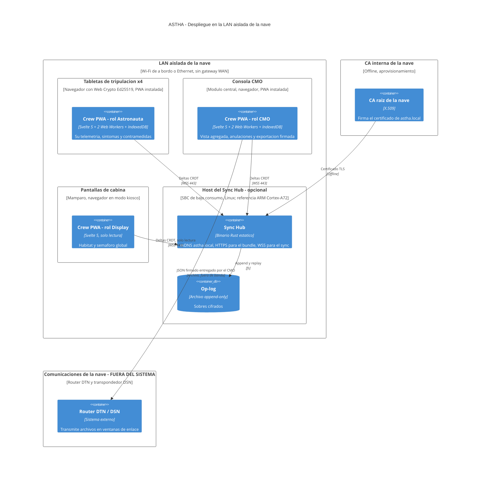

# C4 · Nivel 4 — Diagrama de Despliegue

**Fuente de autoridad:** [SRS](../../SRS%20%E2%80%93%20Software%20de%20Monitoreo%20de%20Salud%20para%20Astronautas.md) §4.4 (dispositivos de la nave) · **Trazabilidad:** [RTM](../../MATRIZ_DE_TRAZABILIDAD_RTM.md) · Convenciones en [01-contexto](01-contexto.md)

## Diagrama

## Nodos y artefactos

| Elemento | Tecnología | Responsabilidad | Requisitos que cubre (IDs del repo) |
| --- | --- | --- | --- |
| **LAN aislada** | Wi-Fi de a bordo o Ethernet local, sin ruta por defecto hacia WAN | Único medio de comunicación entre dispositivos. Verificación: captura de paquetes sin tráfico fuera de la LAN | RNF-NET-01 (verificación Wireshark), RF-EVA-07 · ⚠ CU-10 (carpeta) habla de Wi-Fi 802.11s, Bluetooth Mesh y Gossip por UDP multicast; un navegador no tiene acceso a UDP ni a BLE mesh |
| **Tabletas de tripulación (×4)** | Navegador moderno con Web Crypto Ed25519 (Chromium 137+, Firefox 129+ o Safari 17+), PWA instalada desde `https://astha.local`, raíz de la CA de la nave en el almacén de confianza | Nodo autónomo completo con rol Astronauta | RNF-USA-01 (guantes), RNF-POW-02 (16 h con batería, < 350 mW), RNF-POW-03, RNF-SEC-01, RNF-SEC-02 · SRS §5.1 (4 tripulantes) |
| **Consola CMO** | Ídem, pantalla de mayor tamaño (1920 × 1080 según WIREFRAME §2) | Rol CMO: tiene las K_t de toda la tripulación envueltas con su PIN, puede anular falsos positivos y genera la exportación firmada | RF-DSH-03, RF-REG-02, RF-GUI-05, RNF-SEC-02, RNF-NET-04 |
| **Pantallas de cabina** | Navegador en modo kiosco, misma PWA con rol `display` | Lectura: telemetría de hábitat y semáforo global. Sin reconocimiento de alertas | RF-DSH-04, RNF-USA-03 (modo rojo nocturno) · **GAP**: ningún requisito define qué datos personales pueden mostrar (ver pregunta abierta 3 en [03-componentes](03-componentes.md#preguntas-abiertas)) |
| **Host del Sync Hub (opcional)** | SBC Linux de bajo consumo. El AC-TECH-01 cita ARM Cortex-A72 como hardware de referencia. Binario Rust estático, servicio `systemd` | Descubrimiento, origen HTTPS, relé WSS y réplica. Si se apaga, cada dispositivo sigue siendo autónomo y vuelve a converger al reconectar | RNF-NET-01..03, RNF-SEC-03 (réplica) · **GAP**: no hay presupuesto de energía ni RAM para el Hub (los RNF-POW del SRS hablan de tabletas y consolas) |
| **Op-log** | Archivo append-only en almacenamiento persistente del host | Recuperación de dispositivos reemplazados (HU-15, escenario 2) | RNF-NET-02 |
| **CA interna** | PKI offline | Hace posible el contexto seguro que exigen `crypto.subtle` y los Service Workers | Habilita RNF-SEC-01 y el SW (RNF-PER-02) · **GAP**: ni la PKI ni la rotación de certificados están especificadas |
| **Router DTN / DSN** | Sistema externo | Fuera del sistema. Recibe el `.json` firmado que entrega el CMO | Límite de RNF-NET-04 · ⚠ CU-11, HU-14 y AC-TECH-05 asignan a ASTHA el empaquetado DTN (RFC 5050), la cola persistente de 30 días y la recepción de respuestas |

## Escenarios operativos

| Escenario | Comportamiento | Requisitos |
| --- | --- | --- |
| Hub encendido, todos conectados | Convergencia por WSS. El aviso de sync de otro nodo llega en milisegundos | RNF-NET-02 · AC-TECH-04 §1 (< 3 s) |
| Hub apagado o ausente | Cada dispositivo funciona solo: triage, alarmas, guía y bitácora locales. No hay convergencia entre dispositivos | RNF-NET-02, RF-EVA-07 · SRS §1 ("un solo nodo") |
| Módulo aislado (compuerta cerrada) | El dispositivo sigue operando. Al volver a la LAN, el delta por version vector fusiona sin pérdida | RNF-NET-02 · CU-10 FA-01 (carpeta) |
| Tableta reemplazada | Se instala desde `https://astha.local`, se inscribe su clave Ed25519, se envuelven las K_t con el PIN y se hace replay desde el op-log | HU-15, escenario 2 · **GAP** de aprovisionamiento |
| Registro corrupto (SEU en almacenamiento) | Integrity Guard lo aísla y lo restaura desde el Hub; sin Hub, lo excluye y avisa | RNF-SEC-03 · AC-TECH-06 §2 |
| Exportación a Tierra | El CMO genera el JSON firmado → archivo → sistema de comunicaciones. ASTHA no espera respuesta | RNF-NET-04, RF-GUI-05 · AC-TECH-03 §3 |
| Contingencia eléctrica (CU-12 de la carpeta) | No hay señal del EPS que un navegador pueda recibir. Se podría reenviar por el Hub en el futuro | **GAP** / ⚠ CU-12 y AC-TECH-02 §3 no tienen respaldo en los RNF del SRS |

## Aprovisionamiento (previo al vuelo; propuesta, sin requisito en el repo)

1. Instalar la raíz de la CA de la nave en cada dispositivo.
2. Generar el certificado de `astha.local` para el host del Hub.
3. Visitar `https://astha.local` para instalar la PWA. El Service Worker precachea el bundle.
4. Generar el par Ed25519 del dispositivo (`extractable: false`) e inscribir su clave pública en el Hub.
5. Fijar los PIN y envolver las K_t según el rol (dueño y CMO).
