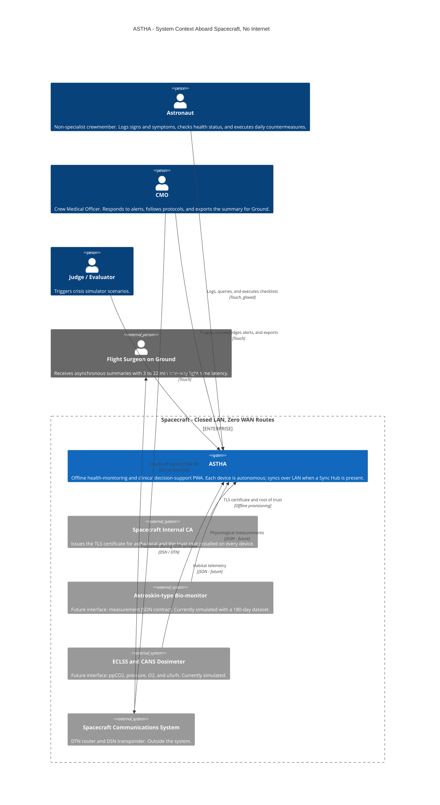

# C4 · Level 1 — Context Diagram

**System:** ASTHA (Autonomous Space Telemetry & Health Analytics) · **Authority source:** [SRS](../SRS%20%E2%80%93%20Software%20de%20Monitoreo%20de%20Salud%20para%20Astronautas.md) §2, §4.4, §5.2 · **Traceability:** [Existing RTM](../MATRIZ_DE_TRAZABILIDAD_RTM.md) (no new matrix is created; see [00-README](00-README.md) for GAPs)

> Conventions: IDs `RF-*`, `RNF-*`, `R-*`, `D-*`, and `AC-0x` come from the SRS. `CU-xx` IDs are cited as **CU-xx (SRS §7)** or **CU-xx (folder)** because both catalogs reuse the same numbers with different meanings. `GAP` = uncovered in the repository. `⚠` = the repository contradicts itself or contradicts the project brief.

## Diagram

## Elements

| Element | Type | Technology / Channel | Responsibility | Covered Requirements (Repo IDs) |
| --- | --- | --- | --- | --- |
| **ASTHA** | System | Offline PWA (Svelte 5 + Web Workers + IndexedDB) and optional Rust Sync Hub | Ingestion, tripartite triage, drift detection, anatomy, countermeasures, simulator, audit log, and export, with zero external network | RF-ING-01..07, RF-EVA-01..07, RF-DER-01..04, RF-GUI-01..05, RF-ANA-01..04, RF-DSH-01..04, RF-GAM-01..03, RF-SIM-01..05, RF-REG-01..03, RNF-POW-01..04, RNF-PER-01..02, RNF-USA-01..05, RNF-SEC-01..04, RNF-NET-01..04 · AC-01..05 |
| **Astronaut** | Person | Personal touchscreen tablet | Morning check-in, one-tap symptoms, anatomical lookup, daily countermeasures | SRS §2.1 · CU-01, CU-02, CU-04 (SRS §7) · RF-ING-01, RF-ING-04, RF-ANA-04, RNF-USA-01, RNF-USA-02 |
| **CMO** | Person | Core module medical console | Crew-wide overview, red-alert response, false-positive override, Ground export | SRS §2.1 · CU-03, CU-06, CU-08 (SRS §7) · RF-DSH-03, RF-GUI-05, RF-REG-02, RNF-SEC-02 |
| **Judge / Evaluator** | Person | Any device running ASTHA | Autonomy demonstration via scenarios A-D | SRS §2.1 · CU-09 (SRS §7) · RF-SIM-01..05 |
| **Flight Surgeon** | External person | Receives file over DSN, outside the system | Validates trends and treatments asynchronously. ASTHA never waits for a reply | SRS §2.1 · RF-GUI-05, RF-REG-02, RNF-NET-04 · ⚠ CU-11 (folder) states ASTHA queues DTN bundles and receives replies: here it remains outside the system (see [00-README §3](00-README.md#3-differences-between-the-brief-and-the-repository)) |
| **Spacecraft Internal CA** | External system | Offline PKI (X.509) | Makes `astha.local` a secure context: `crypto.subtle` and Service Workers require HTTPS | Enables RNF-SEC-01 and RNF-NET-01 · **GAP**: no repository document defines the PKI or provisioning |
| **Astroskin-type Bio-monitor** | External system (future) | Single-measurement JSON contract (SRS §5.2, "replaceable adapter") | Live vital-signs source. Currently substituted by the synthetic dataset | SRS §2.3, §5.2 · RF-ING-03 · **GAP**: no requirement specifies transport or cadence. ⚠ The RTM and CU-01 (folder) mention 1 Hz BLE; the SRS specifies 1 record per day |
| **ECLSS / CANS** | External system (future) | JSON contract (ppCO2, pressure, % O2, µSv/h) | Shared crew environmental telemetry | RF-ING-02, RF-DSH-04, RF-EVA-04 · **GAP**: transport undefined (CU (folder) mentions Serial/Modbus, which a browser cannot read) |
| **Communications System** | External system | DTN router and DSN | Transports the signed JSON to Ground. ASTHA only produces the file | RNF-NET-04 · boundary: RNF-NET-01 (zero WAN packets from ASTHA) |

## Context Decisions

1. **The system boundary is the spacecraft LAN.** The "DSN link" is not an ASTHA interface. The CMO exports a signed JSON file from ASTHA and hands it to the communications system. This makes RNF-NET-01 (zero WAN traffic) and RF-EVA-07 trivially verifiable: the ASTHA process has no network route outside the LAN.
2. **Per-device autonomy.** Every ASTHA instance completes triage independently (SRS §1, "single-node PWA"). The Sync Hub improves cross-device consistency, but is not required for clinical function (RNF-NET-02).
3. **Live sensors are out of scope** (SRS §1 and §2.3). They are shown to make the adapter boundary explicit.
