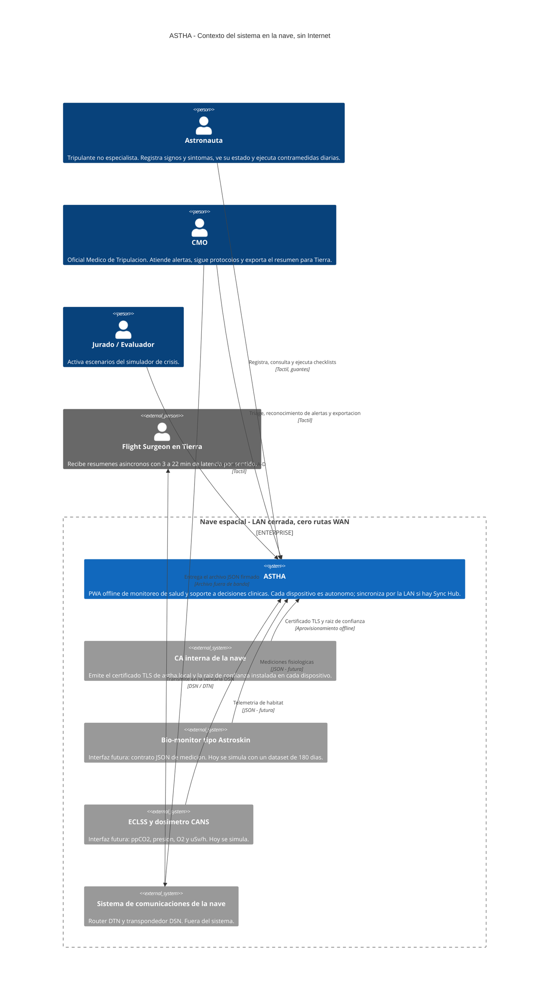

# C4 · Nivel 1 — Diagrama de Contexto

**Sistema:** ASTHA (Autonomous Space Telemetry & Health Analytics) · **Fuente de autoridad:** [SRS](../SRS%20%E2%80%93%20Software%20de%20Monitoreo%20de%20Salud%20para%20Astronautas.md) §2, §4.4, §5.2 · **Trazabilidad:** [RTM existente](../MATRIZ_DE_TRAZABILIDAD_RTM.md) (no se crea una matriz nueva; ver [00-README](00-README.md) para GAPs)

> Convenciones: los IDs `RF-*`, `RNF-*`, `R-*`, `D-*` y `AC-0x` son los del SRS. Los `CU-xx` se citan como **CU-xx (SRS §7)** o **CU-xx (carpeta)** porque los dos catálogos usan los mismos números con significados distintos. `GAP` = sin cobertura en el repo. `⚠` = el repo se contradice o contradice el encargo.

## Diagrama

## Elementos

| Elemento | Tipo | Tecnología / canal | Responsabilidad | Requisitos que cubre (IDs del repo) |
| --- | --- | --- | --- | --- |
| **ASTHA** | Sistema | PWA offline (Svelte 5 + Web Workers + IndexedDB) y Sync Hub opcional en Rust | Ingesta, triage tripartito, deriva, anatomía, contramedidas, simulador, bitácora y exportación, sin red externa | RF-ING-01..07, RF-EVA-01..07, RF-DER-01..04, RF-GUI-01..05, RF-ANA-01..04, RF-DSH-01..04, RF-GAM-01..03, RF-SIM-01..05, RF-REG-01..03, RNF-POW-01..04, RNF-PER-01..02, RNF-USA-01..05, RNF-SEC-01..04, RNF-NET-01..04 · AC-01..05 |
| **Astronauta** | Persona | Tableta táctil personal | Registro matutino, síntomas con un toque, consulta anatómica, contramedidas diarias | SRS §2.1 · CU-01, CU-02, CU-04 (SRS §7) · RF-ING-01, RF-ING-04, RF-ANA-04, RNF-USA-01, RNF-USA-02 |
| **CMO** | Persona | Consola médica del módulo central | Visión de toda la tripulación, atención de alertas rojas, anulación de falsos positivos, exportación a Tierra | SRS §2.1 · CU-03, CU-06, CU-08 (SRS §7) · RF-DSH-03, RF-GUI-05, RF-REG-02, RNF-SEC-02 |
| **Jurado / Evaluador** | Persona | Cualquier dispositivo con ASTHA | Demostración de la autonomía con los escenarios A-D | SRS §2.1 · CU-09 (SRS §7) · RF-SIM-01..05 |
| **Flight Surgeon** | Persona externa | Recibe el archivo vía DSN, fuera del sistema | Valida tendencias y tratamientos de forma asíncrona. ASTHA nunca espera su respuesta | SRS §2.1 · RF-GUI-05, RF-REG-02, RNF-NET-04 · ⚠ CU-11 (carpeta) dice que ASTHA encola bundles DTN y recibe respuestas: aquí queda fuera del sistema (ver [00-README §3](00-README.md#3-diferencias-entre-el-encargo-y-el-repo)) |
| **CA interna de la nave** | Sistema externo | PKI offline (X.509) | Hace que `astha.local` sea un contexto seguro: `crypto.subtle` y los Service Workers exigen HTTPS | Habilita RNF-SEC-01 y RNF-NET-01 · **GAP**: ningún documento del repo define la PKI ni el aprovisionamiento |
| **Bio-monitor tipo Astroskin** | Sistema externo (futuro) | Contrato JSON de una medición (SRS §5.2, "adaptador reemplazable") | Fuente real de signos vitales. Hoy la sustituye el dataset sintético | SRS §2.3, §5.2 · RF-ING-03 · **GAP**: no hay requisito sobre transporte ni frecuencia. ⚠ La RTM y CU-01 (carpeta) hablan de BLE a 1 Hz; el SRS dice 1 registro por día |
| **ECLSS / CANS** | Sistema externo (futuro) | Contrato JSON (ppCO2, presión, % O2, µSv/h) | Telemetría ambiental compartida por la tripulación | RF-ING-02, RF-DSH-04, RF-EVA-04 · **GAP**: transporte sin definir (CU (carpeta) menciona Serial/Modbus, que un navegador no puede leer) |
| **Sistema de comunicaciones** | Sistema externo | Router DTN y DSN | Transporta el JSON firmado a Tierra. ASTHA solo produce el archivo | RNF-NET-04 · límite: RNF-NET-01 (cero paquetes WAN desde ASTHA) |

## Decisiones de contexto

1. **La frontera del sistema es la LAN de la nave.** El "enlace DSN" no es una interfaz de ASTHA. El CMO saca de ASTHA un archivo JSON firmado y lo entrega al sistema de comunicaciones. Así RNF-NET-01 (cero tráfico WAN) y RF-EVA-07 se pueden verificar de forma trivial: el proceso de ASTHA no tiene ninguna ruta de red fuera de la LAN.
2. **Autonomía por dispositivo.** Cada instancia de ASTHA completa el triage sola (SRS §1, "PWA de un solo nodo"). El Sync Hub mejora la consistencia entre dispositivos, pero no es necesario para la función clínica (RNF-NET-02).
3. **Los sensores reales quedan fuera de alcance** (SRS §1 y §2.3). Se dibujan para dejar clara la frontera del adaptador.
