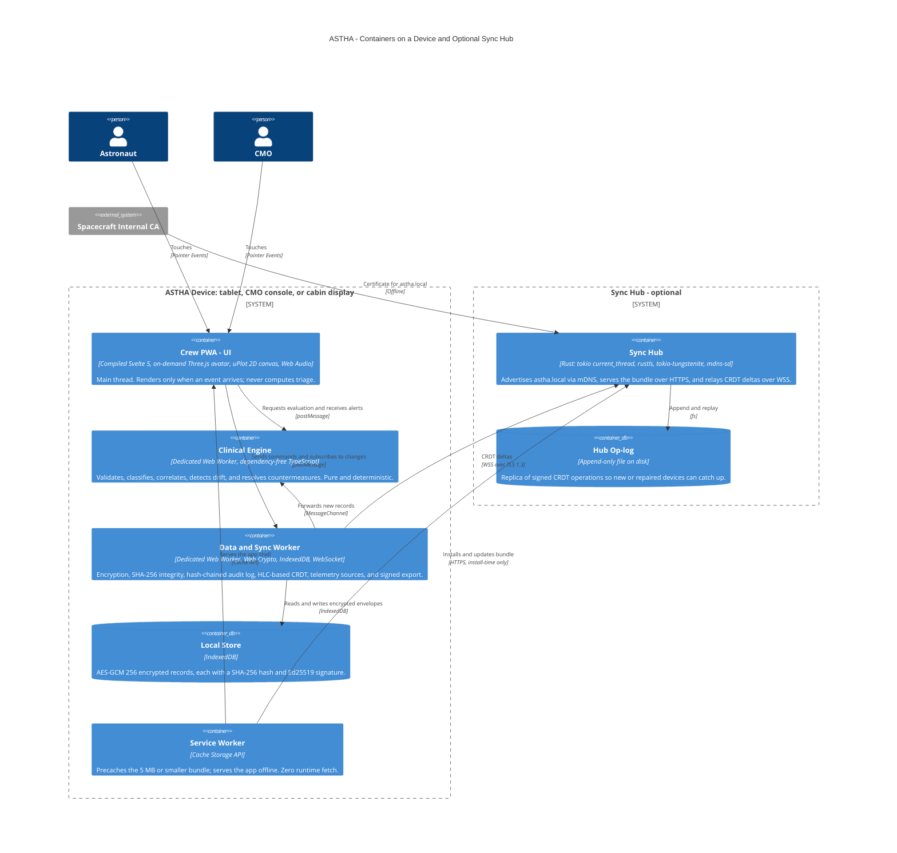

# C4 · Level 2 — Container Diagram

**Authority source:** [SRS](../SRS%20%E2%80%93%20Software%20de%20Monitoreo%20de%20Salud%20para%20Astronautas.md) §4 (RNF) and §5 · **Traceability:** [RTM](../MATRIZ_DE_TRAZABILIDAD_RTM.md) · Conventions in [01-contexto](01-contexto.md)

## Diagram

## Elements

| Element | Technology | Responsibility | Covered Requirements (Repo IDs) |
| --- | --- | --- | --- |
| **Crew PWA - UI** | Svelte 5 (runes, compiled without VDOM), locally bundled 3D avatar with Three.js rendered on demand only (with SVG fallback), uPlot (2D canvas) for time series, Web Audio for alarm tone, system fonts (`system-ui`, `ui-monospace`) | Panels, body viewer, guide, habitat, habits, simulator, and audit log. Reacts only to worker messages. Zero `setInterval` | RF-ING-01, RF-ING-04, RF-ANA-01..04, RF-DSH-01..04, RF-GUI-01..04, RF-GAM-01..02, RF-SIM-05 (UI), RF-REG-03, RNF-USA-01..05, RNF-POW-01, RNF-PER-02 |
| **Clinical Engine** | Dedicated Web Worker, pure TypeScript, zero third-party libraries. Thresholds, rules, and catalogs stored as JSON data | Triage pipeline: validation → classification → sustained conditions → correlation → drift → organ mapping → worst status → explanation → countermeasures | RF-ING-05, RF-EVA-01..07, RF-DER-01..04, RF-GUI-01..04 (resolution), RF-GAM-01..03 (computation), R-ENV-01..R-CARD-01, D-01..D-03, RNF-PER-01, RNF-POW-01 |
| **Data and Sync Worker** | Dedicated Web Worker. Web Crypto (AES-GCM 256, SHA-256, Ed25519, PBKDF2), IndexedDB, WebSocket, `CompressionStream` | Encrypted persistence, integrity and self-healing, append-only audit log, CRDT (LWW-Map + G-Set + PN-Counter with Hybrid Logical Clock), sync client, sources (dataset, simulator, manual, future adapter), import/export | RF-ING-02, RF-ING-03, RF-ING-06, RF-SIM-01..05, RF-REG-01..02, RF-GUI-05, RNF-SEC-01..04, RNF-NET-01..04, RNF-POW-03 |
| **Local Store** | IndexedDB (no localStorage for clinical data) | Object stores (`ASTHA_EDGE_DB`): `envelopes_gset` `{id, hlc, autor, keyRef, iv, ct, sha256, firma}` with a redundant `envelopes_replica`, `quarantine`, `audit_chain` (one chain per device), and `key_vault` (wrapped keys) | RNF-SEC-01, RNF-SEC-03, RNF-SEC-04, SRS §5.1, §5.2 · ⚠ AC-TECH-06 and the V&V Matrix state SQLite/SQLCipher; SRS §5.2 specifies IndexedDB, and the SRS prevails |
| **Service Worker** | Cache Storage, *cache-only* strategy after installation, atomic per-version update | Offline startup, zero remote resources, bundle size budget | RNF-POW-04, RNF-PER-02, RF-EVA-07, AC-TECH-03 §2 (no CDN) |
| **Sync Hub (optional)** | Rust: `tokio` (`current_thread` runtime), `rustls`, `tokio-tungstenite`, `mdns-sd`, `ed25519-dalek`, `sha2`. Single static binary | `astha.local` discovery (mDNS), HTTPS for bundle installation, WSS relay for CRDT deltas, per-device signature verification, recovery replica | RNF-NET-01, RNF-NET-02, RNF-NET-03, RNF-SEC-03 (mirror replica, AC-TECH-06 §2) · ⚠ CU-10, HU-15, and AC-TECH-04 call for a serverless mesh: see [00-README §3](00-README.md#3-differences-between-the-brief-and-the-repository) |
| **Hub Op-log** | Segmented append-only file, one record per line with SHA-256 | Replica durability. The Hub never decrypts clinical data: it stores encrypted envelopes | RNF-NET-02, RNF-SEC-01 (the Hub has no access to plaintext data) · **GAP**: no retention or capacity requirement exists |

## Resource Budgets and Low-Power Rationale

The budgets are taken from SRS §4.1. The "Planned allocation" column is a **design estimate** that must be verified using the methods specified in the SRS for each RNF.

| Budget (SRS) | Limit | Planned Allocation and Compliance Rationale |
| --- | --- | --- |
| CPU in passive monitoring (RNF-POW-01) | ≤ 3 % | No polling. Workers sleep until a message arrives. Svelte updates only changed DOM nodes (no VDOM or diffing). uPlot redraws one canvas per series only when a new data point arrives. Alert animations use CSS `opacity` (compositor-only, no layout) and stop upon acknowledgment. WebSocket stayalive relies on Hub *ping frames*, which the browser answers without waking JS. **3D Avatar:** no render loop. A single frame is drawn only when something changes (region status, rotation, resize). In passive monitoring it costs 0 frames/s |
| Power (RNF-POW-02) | < 350 mW | Follows from the above, plus `#030712` background (OLED pixels off, per WIREFRAME §1.3) and zero background timers. The GPU only works while the user rotates the avatar or a status changes; otherwise it stays idle (`powerPreference: 'low-power'`). `visibilitychange` suspends uPlot and avatar rendering |
| RAM (RNF-POW-03) | ≤ 150 MB | 180 days × 4 crew members × 1 record/day (SRS §5.1) equals ~720 measurements: less than 1 MB in memory as a `Float32Array` per indicator. Each worker takes only a few MB. **3D Avatar:** single WebGL context, low-poly procedural geometry, no textures, and `pixelRatio ≤ 1.5`; estimated in the tens of MB, **must be measured**. Leaving the Triage tab frees geometries and materials (`dispose()`). Drift detection uses incremental sums and stores no window copies |
| Bundle (RNF-POW-04) | ≤ 5 MB | Svelte 5 runtime is a few tens of KB, uPlot is a few tens of KB, local Three.js (~150-180 KB gzip; reducible by importing only used modules), fallback anatomical SVG, JSON catalogs, and synthetic dataset (~273 KB, `data/human_telemetry_astronauts.json`). ⚠ `data/nasa_official_telemetry/` is ~24 MB and **cannot be included in the bundle** |
| Triage (RNF-PER-01) | < 50 ms | Pipeline complexity is O(rules) per record. The 7-day regression updates in O(1) using rolling sums (Σx, Σy, Σxy, Σx²). Cross-worker `postMessage` hops cost on the order of 1 ms. Measured with `performance.now()` around the pipeline (verification required by the SRS) |
| Cold start (RNF-PER-02) | < 1.5 s | SW serves the shell from cache, Svelte skips VDOM hydration, the initial view paints the last saved state, and the engine recalculates afterward. Three.js loads via dynamic `import()` **after** first paint; until then, the SVG silhouette displays current statuses. ⚠ See the open question on PIN unlock in [03-componentes](03-componentes.md#open-questions) |

### WebGL / Three.js: Permitted Only for the Avatar and Under Strict Conditions

Team decision (2026-11-15): the 3D avatar is mandatory (SPEC §2 and §4.2, folder CU-04: "2D/3D figure"). The original brief prohibited WebGL; it is admitted **only in the Anatomy Viewer** under the following conditions:

| Condition | Rationale |
| --- | --- |
| Version-pinned Three.js, packaged in the bundle and served by the SW | Zero CDN (RNF-NET-01, AC-TECH-03 §2) |
| No continuous `requestAnimationFrame`; on-demand frames only | RNF-POW-01 (≤ 3 % CPU) and "zero polling" |
| No auto-rotation or in-scene animations. Alert pulses live in the HTML overlay layer (CSS) | Any 3D animation forces a continuous render loop |
| Single WebGL context per device. The `compact` view in the crew summary remains SVG | Every context consumes memory and browsers cap concurrent contexts |
| SVG fallback if WebGL is unavailable or context is lost (`webglcontextlost`) | Visual triage cannot depend on the GPU |

⚠ The current `index.html` violates three conditions: it loads Three.js r128 from CDN, runs continuous `requestAnimationFrame` loops (`animate3d`, line 2985; `animateSparklines`, line 3919), and performs auto-rotation (`autoRotate3d`).

### Rejected Technologies (Brief + RNF)

| Rejected | Reason |
| --- | --- |
| React, Recharts, Chart.js | Heavier runtime and VDOM than compiled Svelte. Chart.js appears under RF-DSH-02 in the RTM and in `index.html` |
| Electron | Ships a full browser per app, far exceeding the 150 MB RAM budget |
| Heavy WASM | Bundle size and memory overhead. Native Web Crypto covers AES-GCM, SHA-256, and Ed25519. PBKDF2 replaces Argon2 |
| CDNs and remote fonts | Violate RNF-NET-01 and AC-TECH-03 §2. `index.html` currently loads Tailwind, Chart.js, Three.js, and `lucide@latest` from CDN |

### Secure Context

`crypto.subtle` and Service Workers exist only within a **secure context**. Therefore, the canonical origin is `https://astha.local`, served by the Hub with a certificate from the internal CA. That CA root is installed on each device during provisioning. Without a Hub, an already-installed PWA continues operating from the SW cache under the same origin. **GAP:** no requirement addresses first-time installation without a Hub (possible alternative: serving the bundle from `http://localhost`, which browsers also treat as a secure context).
