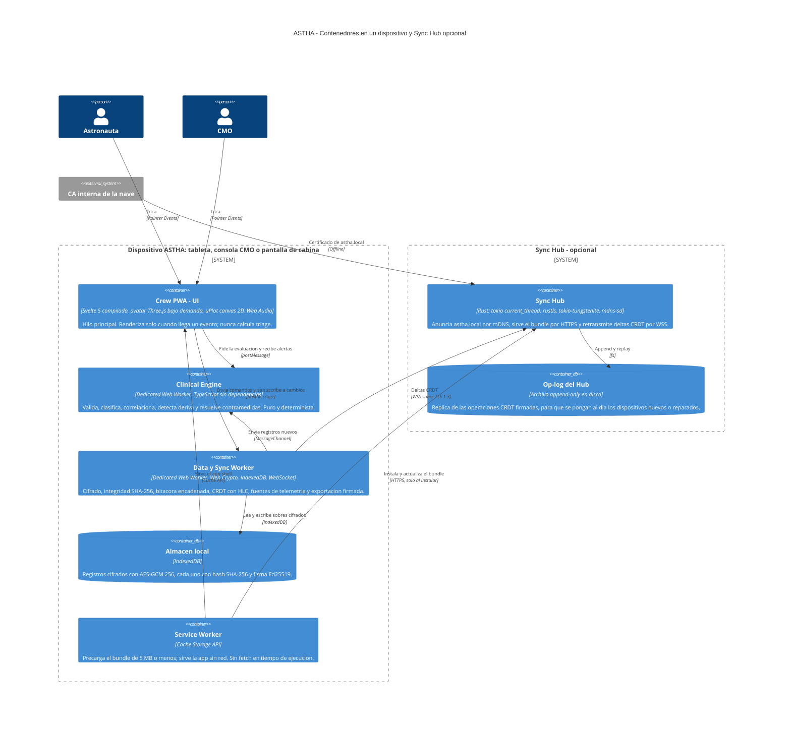

# C4 · Nivel 2 — Diagrama de Contenedores

**Fuente de autoridad:** [SRS](../SRS%20%E2%80%93%20Software%20de%20Monitoreo%20de%20Salud%20para%20Astronautas.md) §4 (RNF) y §5 · **Trazabilidad:** [RTM](../MATRIZ_DE_TRAZABILIDAD_RTM.md) · Convenciones en [01-contexto](01-contexto.md)

## Diagrama

## Elementos

| Elemento | Tecnología | Responsabilidad | Requisitos que cubre (IDs del repo) |
| --- | --- | --- | --- |
| **Crew PWA - UI** | Svelte 5 (runes, compilado sin VDOM), avatar 3D con Three.js empaquetado en local y renderizado solo bajo demanda (con SVG de respaldo), uPlot (canvas 2D) para las series, Web Audio para el tono de alarma, fuentes del sistema (`system-ui`, `ui-monospace`) | Paneles, cuerpo, guía, hábitat, hábitos, simulador y bitácora. Solo reacciona a mensajes de los workers. Cero `setInterval` | RF-ING-01, RF-ING-04, RF-ANA-01..04, RF-DSH-01..04, RF-GUI-01..04, RF-GAM-01..02, RF-SIM-05 (UI), RF-REG-03, RNF-USA-01..05, RNF-POW-01, RNF-PER-02 |
| **Clinical Engine** | Dedicated Web Worker, TypeScript puro, sin librerías. Umbrales, reglas y catálogos como datos JSON | Pipeline de triage: validación → clasificación → condiciones sostenidas → correlación → deriva → órgano → peor estado → explicación → contramedidas | RF-ING-05, RF-EVA-01..07, RF-DER-01..04, RF-GUI-01..04 (resolución), RF-GAM-01..03 (cálculo), R-ENV-01..R-CARD-01, D-01..D-03, RNF-PER-01, RNF-POW-01 |
| **Data y Sync Worker** | Dedicated Web Worker. Web Crypto (AES-GCM 256, SHA-256, Ed25519, PBKDF2), IndexedDB, WebSocket, `CompressionStream` | Persistencia cifrada, integridad y autorrecuperación, bitácora append-only, CRDT (LWW-Map + G-Set + PN-Counter con reloj híbrido), cliente de sync, fuentes (dataset, simulador, manual, adaptador futuro), import/export | RF-ING-02, RF-ING-03, RF-ING-06, RF-SIM-01..05, RF-REG-01..02, RF-GUI-05, RNF-SEC-01..04, RNF-NET-01..04, RNF-POW-03 |
| **Almacén local** | IndexedDB (sin localStorage para datos clínicos) | Almacenes de objetos para sobres `{id, hlc, autor, iv, ct, sha256, sig}`, una cadena de bitácora por dispositivo y claves envueltas | RNF-SEC-01, RNF-SEC-03, RNF-SEC-04, SRS §5.1, §5.2 · ⚠ AC-TECH-06 y la Matriz V&V dicen SQLite/SQLCipher; el SRS §5.2 dice IndexedDB, y prevalece el SRS |
| **Service Worker** | Cache Storage, estrategia *cache-only* tras la instalación, actualización atómica por versión | Arranque offline, cero recursos remotos, presupuesto de bundle | RNF-POW-04, RNF-PER-02, RF-EVA-07, AC-TECH-03 §2 (sin CDN) |
| **Sync Hub (opcional)** | Rust: `tokio` (runtime `current_thread`), `rustls`, `tokio-tungstenite`, `mdns-sd`, `ed25519-dalek`, `sha2`. Binario único y estático | Descubrimiento `astha.local` (mDNS), HTTPS para instalar el bundle, relé WSS de deltas CRDT, verificación de firmas por dispositivo, réplica para recuperación | RNF-NET-01, RNF-NET-02, RNF-NET-03, RNF-SEC-03 (réplica espejo, AC-TECH-06 §2) · ⚠ CU-10, HU-15 y AC-TECH-04 piden una malla sin servidor central: ver [00-README §3](00-README.md#3-diferencias-entre-el-encargo-y-el-repo) |
| **Op-log del Hub** | Archivo append-only segmentado, un registro por línea con SHA-256 | Durabilidad de la réplica. El Hub no descifra datos clínicos: guarda sobres cifrados | RNF-NET-02, RNF-SEC-01 (el Hub no tiene acceso a datos en claro) · **GAP**: no hay requisito de retención ni de capacidad |

## Presupuestos y justificación de bajo consumo

Los presupuestos son los del SRS §4.1. La columna "Reparto previsto" es una **estimación de diseño** que hay que verificar con los métodos que el SRS indica para cada RNF.

| Presupuesto (SRS) | Límite | Reparto previsto y por qué cumple |
| --- | --- | --- |
| CPU en monitoreo pasivo (RNF-POW-01) | ≤ 3 % | Sin polling. Los workers duermen hasta recibir un mensaje. Svelte actualiza solo los nodos que cambian (sin VDOM ni diffing). uPlot redibuja un canvas por serie solo cuando llega un dato. Las animaciones de alerta usan `opacity` en CSS (compositor, sin layout) y se detienen al reconocer la alerta. El WebSocket se mantiene vivo con *ping frames* del Hub, que el navegador responde sin despertar JS. **Avatar 3D:** sin bucle de render. Se dibuja un frame solo cuando cambia algo (estado de una región, giro, tamaño). En monitoreo pasivo cuesta 0 frames/s |
| Energía (RNF-POW-02) | < 350 mW | Consecuencia de lo anterior, más el fondo `#030712` (píxeles apagados en OLED, según el WIREFRAME §1.3) y sin timers en segundo plano. La GPU solo trabaja mientras el usuario gira el avatar o cambia un estado; el resto del tiempo está en reposo (`powerPreference: 'low-power'`). `visibilitychange` suspende el render de uPlot y del avatar |
| RAM (RNF-POW-03) | ≤ 150 MB | 180 días × 4 tripulantes × 1 registro/día (SRS §5.1) son unas 720 mediciones: menos de 1 MB en memoria como `Float32Array` por indicador. Los workers cuestan unos pocos MB cada uno. **Avatar 3D:** un único contexto WebGL, geometría procedural de bajo número de polígonos, sin texturas y `pixelRatio ≤ 1,5`; estimado en decenas de MB, **hay que medirlo**. Al salir de la pestaña Triage se liberan geometrías y materiales (`dispose()`). La deriva usa sumas incrementales y no guarda copias de ventanas |
| Bundle (RNF-POW-04) | ≤ 5 MB | Runtime de Svelte 5 de pocas decenas de KB, uPlot de unas decenas de KB, Three.js local (del orden de 150-180 KB gzip; reducible importando solo los módulos que se usan), SVG anatómico de respaldo, catálogos JSON y dataset sintético (~273 KB, `data/human_telemetry_astronauts.json`). ⚠ `data/nasa_official_telemetry/` pesa unos 24 MB y **no puede entrar en el bundle** |
| Triage (RNF-PER-01) | < 50 ms | El pipeline es O(reglas) por registro. La regresión de 7 días se actualiza en O(1) con sumas móviles (Σx, Σy, Σxy, Σx²). El salto entre workers por `postMessage` cuesta del orden de 1 ms. Se mide con `performance.now()` alrededor del pipeline (verificación que pide el SRS) |
| Arranque en frío (RNF-PER-02) | < 1,5 s | El SW sirve el shell desde caché, Svelte no hidrata un VDOM, la primera vista pinta el último estado guardado y el engine recalcula después. Three.js se carga con `import()` dinámico **después** del primer pintado; hasta entonces se ve la silueta SVG con los estados. ⚠ Ver la pregunta abierta sobre el desbloqueo con PIN en [03-componentes](03-componentes.md#preguntas-abiertas) |

### WebGL / Three.js: permitido solo para el avatar y con condiciones

Decisión del equipo (2026-11-15): el avatar 3D es obligatorio (SPEC §2 y §4.2, CU-04 de la carpeta: "figura 2D/3D"). El encargo original prohibía WebGL; se admite **solo en el Anatomy Viewer** y con estas condiciones:

| Condición | Por qué |
| --- | --- |
| Three.js con versión fija, empaquetado en el bundle y servido por el SW | Sin CDN (RNF-NET-01, AC-TECH-03 §2) |
| Sin `requestAnimationFrame` continuo; solo frames bajo demanda | RNF-POW-01 (≤ 3 % CPU) y "cero polling" |
| Sin auto-rotación ni animaciones dentro de la escena 3D. Los pulsos de alerta van en la capa HTML superpuesta (CSS) | Una animación 3D obliga a renderizar en bucle |
| Un solo contexto WebGL por dispositivo. La vista `compact` del resumen de tripulación sigue en SVG | Cada contexto cuesta memoria y los navegadores limitan cuántos hay |
| Respaldo SVG si no hay WebGL o se pierde el contexto (`webglcontextlost`) | El triage visual no puede depender de la GPU |

⚠ El `index.html` actual incumple tres condiciones: carga Three.js r128 por CDN, tiene bucles `requestAnimationFrame` continuos (`animate3d`, línea 2985; `animateSparklines`, línea 3919) y hace auto-rotación (`autoRotate3d`).

### Tecnologías descartadas (encargo + RNF)

| Descartada | Motivo |
| --- | --- |
| React, Recharts, Chart.js | Runtime y VDOM más pesados que Svelte compilado. Chart.js aparece en RF-DSH-02 de la RTM y en `index.html` |
| Electron | Un navegador completo por app, muy por encima de 150 MB de RAM |
| WASM pesado | Bundle y memoria. Web Crypto nativo cubre AES-GCM, SHA-256 y Ed25519. PBKDF2 sustituye a Argon2 |
| CDN y fuentes remotas | Violan RNF-NET-01 y AC-TECH-03 §2. `index.html` carga hoy Tailwind, Chart.js, Three.js y `lucide@latest` desde CDN |

### Contexto seguro

`crypto.subtle` y los Service Workers solo existen en un **contexto seguro**. Por eso el origen canónico es `https://astha.local`, servido por el Hub con un certificado de la CA interna. La raiz de esa CA se instala en cada dispositivo durante el aprovisionamiento. Sin Hub, la PWA ya instalada sigue funcionando desde la caché del SW con el mismo origen. **GAP:** no hay requisito para la primera instalación sin Hub (alternativa posible: servir el bundle en `http://localhost`, que el navegador también trata como contexto seguro).
