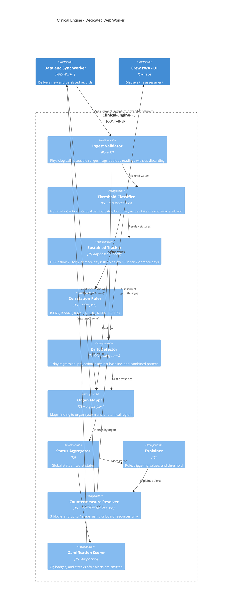
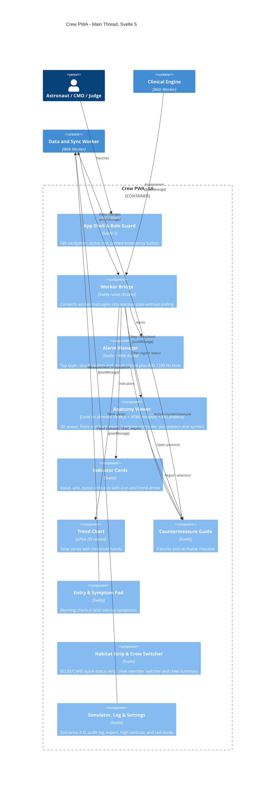
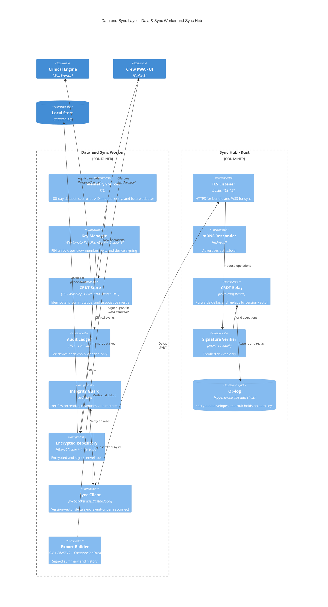

# C4 · Level 3 — Component Diagrams

**Authority source:** [SRS](../SRS%20%E2%80%93%20Software%20de%20Monitoreo%20de%20Salud%20para%20Astronautas.md) §3, §4, §5, and §6 · **Traceability:** [RTM](../MATRIZ_DE_TRAZABILIDAD_RTM.md) · **Visual tokens:** [WIREFRAME §4](../WIREFRAME_Y_DISENO_UI_UX.md) · Conventions in [01-contexto](01-contexto.md)

Contents:

1. [Clinical Engine](#31-clinical-engine)
2. [Crew PWA (UI)](#32-crew-pwa-ui), with design system spec sheets for Anatomy Viewer, Indicator Cards, Countermeasure Guide, and Alarm Manager
3. [Data and Sync Layer](#33-data-and-sync-layer) (device worker + Sync Hub)
4. [Open Questions](#open-questions)

---

## 3.1 Clinical Engine



| Component | Technology | Responsibility | Covered Requirements |
| --- | --- | --- | --- |
| Ingest Validator | Pure TS | Rejects invalid types and sets `flags.dubious` when a value falls outside plausible physiological bounds. Never discards | RF-ING-05 · ⚠ the RTM (RF-ING-05) says "discard"; the SRS states "without discarding them" and prevails |
| Threshold Classifier | TS + `thresholds.json` (SRS §6.1 as data) | Single lookup per indicator. Values on band boundaries are assigned to the more severe band (SRS §6.1, final paragraph) | RF-EVA-01 · AC-01 · **GAP**: the SRS states that thresholds marked with \* are "editable as data (RNF-09)", yet RNF-09 does not exist |
| Sustained Tracker | TS, state per crew member and day | Sustained conditions across consecutive days | RF-EVA-05 |
| Correlation Rules | TS + `rules.json` | The 10 rules from SRS §6.2, evaluated as predicates over the latest state plus active symptoms | RF-EVA-04, R-ENV-01, R-ENV-02, R-SANS-01, R-SANS-02, R-RAD-01, R-RAD-02, R-COG-01, R-REN-01, R-REN-02, R-CARD-01 · AC-05 |
| Drift Detector | TS. Rolling sums (Σx, Σy, Σxy, Σx²) per indicator. Days 1-14 baseline using median and MAD | D-01 (7-day projection crosses caution threshold while current value is nominal), D-02 using Modified Z-score (\|M\| ≥ 2.5, [ADR-011](../SDD/08-Architecture-decisions.md#adr-011)), D-03 (sleep ↓ and diastolic ↑) | RF-DER-01..04, D-01..D-03 · AC-02 · ⚠ RF-DER-03 in the SRS still mentions mean and standard deviation |
| Organ Mapper | TS + `organs.json` | Maps 7 organ systems to 5 body regions (eyes/head, chest/heart, lumbar/kidneys, legs/femur, general/blood) | RF-EVA-03, RF-ANA-02 · AC-03 · **GAP**: the SRS does not specify which regions "cognitive", "radiation", and "respiratory/environmental" map to. Proposed mapping: cognitive → head; radiation and respiratory → general |
| Status Aggregator | TS | Worst status across active indicators and rules, per crew member and per region | RF-EVA-02 |
| Explainer | TS | For each alert: `ruleId`, values, threshold, unit, and non-medical plain-language text | RF-EVA-06, RF-GUI-04 |
| Countermeasure Resolver | TS + `countermeasures.json` | Blocks: "what is happening / severity & time / actions". Enforces ≤ 4 steps ([ADR-017](../SDD/08-Architecture-decisions.md#adr-017)) and verifies every resource is in the onboard inventory list | RF-GUI-01..04, RNF-USA-05 · AC-04 · AC-CLIN-06 · ⚠ RNF-USA-05 in the SRS still allows 7 |
| Gamification Scorer | TS, runs after sending Assessment | XP for 150 min exercise, morning report, and hydration. Cannot delay or obscure alerts | RF-GAM-01..03 |

**Output contract (`Assessment`):** `{crewId, day, global, regions[5], indicators[{id, value, unit, status, slope, daysToCaution, z, dubious}], alerts[{id, ruleId, organ, status, urgency, values, threshold, explanation, countermeasureId}], latencyMs}`. The `latencyMs` field enables production verification of RNF-PER-01.

**Zero network:** the worker imports neither `fetch` nor `WebSocket`. A lint rule forbids both in `engine/**` as a static verification of RF-EVA-07.

---

## 3.2 Crew PWA (UI)



| Component | Technology | Responsibility | Covered Requirements |
| --- | --- | --- | --- |
| App Shell & Role Guard | Svelte 5. Tabs per WIREFRAME §6.1 | Biomedical, Environment, Triage, and Simulator tabs. The emergency button is visible across all views and opens the active protocol in 1 tap | RNF-USA-02, RNF-SEC-02 (UI side; true enforcement is cryptographic, see §3.3) |
| Worker Bridge | `$state` / `$derived` runes | Sole data entry point into the UI. Batches messages per frame via `requestAnimationFrame` only when a message is pending | RNF-POW-01 |
| **Alarm Manager** | Svelte + Web Audio (`OscillatorNode`) | See spec sheet | RNF-USA-04, RF-GAM-03, RF-EVA-06 |
| **Anatomy Viewer** | Locally bundled Three.js, on-demand render, HTML hotspots, SVG fallback | See spec sheet | RF-ANA-01..04, RF-EVA-03 · SPEC §4.2 (3D avatar) · CU-04 (folder) |
| **Indicator Cards** | Svelte | See spec sheet | RF-DSH-01, RF-DER-02 (trend arrow and drift advisory) |
| Trend Chart | uPlot (2D canvas), one canvas per visible indicator | 180-day time series with Nominal, Caution, and Critical bands. Destroyed on view exit | RF-DSH-02 · ⚠ the RTM cites Chart.js |
| **Countermeasure Guide** | Svelte | See spec sheet | RF-GUI-01..05, RNF-USA-05 |
| Entry & Symptom Pad | Svelte, controls ≥ 48 px | 9 fields from RF-ING-01 with large steppers (+/−) and 5 one-tap symptoms | RF-ING-01, RF-ING-04, RNF-USA-01 · ⚠ SRS §5.1 cites a "closed catalog of 6 symptoms" while RF-ING-04 lists 5 |
| Habitat Strip & Crew Switcher | Svelte | Quick-status strip (WIREFRAME §6.1), crew summary for the CMO | RF-DSH-03, RF-DSH-04 |
| Simulator, Log & Settings | Svelte | Scenarios A-D, 1-tap reset, simulated time advance, audit log, JSON export, high contrast, large text, and red mode | RF-SIM-01..05, RF-REG-01..03, RF-ING-06, RNF-USA-03 |

### Tokens Used by the Four Spec Sheets

Taken from WIREFRAME §4.1. Contrast ratios are measured (WCAG 2.1, against `space-950` / `space-800`):

| Token | Value | Contrast | Permitted Usage (RNF-USA-03 requires ≥ 7:1) |
| --- | --- | --- | --- |
| `alert-green` | `#10b981` | 7.94 / 7.36 | Text and fill ✓ |
| `alert-yellow` | `#f59e0b` | 9.37 / 8.69 | Text and fill ✓ |
| `alert-red` | `#ef4444` | **5.35 / 4.96** | ⚠ **Fails 7:1 for text.** Fills and borders only |
| `alert-red-text` ([ADR-018](../SDD/08-Architecture-decisions.md#adr-018)) | `#fca5a5` | 10.61 / 9.83 | Text over critical states ✓ |
| `cyan-400` | `#38bdf8` | 9.40 / 8.71 | Accent ✓ |

**Red Spectral Mode (RNF-USA-03):** under ~630 nm monochrome lighting, green, yellow, and red are indistinguishable. Therefore, every status always carries **pattern + symbol + label** (RF-ANA-03) and never relies on color alone: ✓ Nominal (no pattern), ▲ Caution (diagonal hatching), ✕ Critical (crosshatch and pulse).

**Fonts:** system font stacks only: `system-ui, sans-serif` for UI and `ui-monospace, "SF Mono", monospace` for numerals. ⚠ WIREFRAME §4.2 names Inter and JetBrains Mono: they are used only if already installed on the device; never downloaded.

**Touch targets:** minimum 48 × 48 px hit area and **12 px spacing** (RNF-USA-01). ⚠ WIREFRAME §1.2 says 8 px and §4.3 uses 44 px checkbox containers: the SRS prevails.

---

### Component: Anatomy Viewer

#### Description
**Astronaut 3D avatar** (team decision, 2026-11-15) with 5 touchable regions. Each region displays the worst status among its findings. It serves as the primary entry point for visual triage (CU-02 (SRS §7), CU-04 (folder)) and lives in the Triage tab. It comprises three layers:

1. **3D scene** (locally bundled Three.js): low-poly procedural silhouette matching the current prototype. Region materials are tinted by status. **Rendered strictly on demand**: there is never a continuous render loop.
2. **HTML hotspot layer** over the canvas: real `<button>` elements ≥ 48 × 48 px positioned by projecting a 3D anchor per region whenever a frame is drawn. This layer holds the symbol, pattern, label, and alert pulse (compositor CSS animation without redrawing the 3D scene).
3. **SVG fallback** (front/back): displayed while Three.js loads (deferred `import()`) and whenever WebGL is unavailable or context is lost.

#### Variants
| Variant | When to Use |
| --- | --- |
| `full` | Triage tab: rotatable 3D avatar, "Front" and "Back" buttons (RF-ANA-01), and legend |
| `compact` | Crew summary (RF-DSH-03): 96 px non-interactive **SVG silhouette**. One tap opens the crew member. Uses no WebGL to avoid opening one context per crew member |
| `crisis` | During a critical alert: the camera rotates to the affected region (a single animated turn that stops) and all other regions dim to 40 % |
| `fallback` | Automatic: front/back SVG if WebGL is unavailable or `webglcontextlost` occurs |

#### Props
| Prop | Type | Default | Description |
| --- | --- | --- | --- |
| `regions` | `Record<RegionId, {status, alertCount}>` | all `nominal` | Per-region status from `Assessment`. A change triggers **one** frame |
| `view` | `'front' \| 'back'` | `'front'` | Camera orientation (RF-ANA-01). Free rotation between views |
| `selected` | `RegionId \| null` | `null` | Selected region (`$bindable`) |
| `variant` | `'full' \| 'compact' \| 'crisis'` | `'full'` | See variants |
| `maxPixelRatio` | `number` | `1.5` | Canvas resolution cap (GPU and RAM) |
| `onselect` | `(id: RegionId) => void` | — | Opens the region's indicators, trend, and countermeasures (RF-ANA-04) |

`RegionId = 'head' | 'chest' | 'lumbar' | 'legs' | 'general'` (RF-ANA-02).

#### Render Policy (RNF-POW-01 Budget)
| Trigger | Frames Drawn |
| --- | --- |
| Passive monitoring, no changes | **0** |
| Region status change | 1 |
| `ResizeObserver` or Front/Back view switch | 1, or camera transition (≤ 400 ms) then stops |
| Drag to rotate | 1 per `pointermove` (coalesced with `requestAnimationFrame` only while pointer is down). Stops on `pointerup`, zero inertia |
| Hidden tab or `visibilitychange` | 0; leaving Triage calls `dispose()` |

Prohibited: auto-rotation, animated halos or pulses inside the 3D scene, dynamic shadows, and post-processing.

#### States
| State | Visual | Behavior |
| --- | --- | --- |
| Nominal | Muted green region material and hotspot with ✓ | — |
| Caution | Yellow material and hotspot with diagonal hatching and ▲ | Static, no animation (RNF-USA-04) |
| Critical | Red material and hotspot with crosshatch, ✕, and 1.5 s CSS opacity pulse | Pulse is CSS-only: the 3D scene is **not** redrawn. Stops on alert acknowledgment. Under `prefers-reduced-motion`, double border without pulse |
| Focus / selected | Hotspot with 3 px `cyan-400` outline; brighter region material | 1 frame. Opens detail panel |
| Pressed | Hotspot scale 0.98 for 100 ms | Immediate tactile feedback (CSS) |
| Rotating | Rear-face hotspots dimmed and non-clickable | Renders only during active drag |
| Loading 3D | SVG silhouette with statuses already visible | Triage works before Three.js finishes loading |
| No WebGL / context lost | `fallback` variant (SVG) and subtle "simplified view" notice | Zero loss of clinical function |
| Dubious data | Hotspot with "?" | Finding originates from a value flagged by RF-ING-05 |
| No data | Gray material and hotspot with dash | Crew member has no record for today |

#### Accessibility
- **Role**: the `<canvas>` is decorative (`aria-hidden="true"`). Accessible interaction is provided by hotspots: native `<button>` elements inside a `role="group"` container with `aria-label="Anatomical avatar, front view"`.
- **Keyboard**: Tab and Shift+Tab step through regions in head-to-foot order (including rear-face regions: focusing them rotates the camera toward them). Enter or Space selects. `V` toggles Front/Back. Arrow keys rotate the camera in 45° steps. Escape closes the detail panel.
- **Screen reader**: "Head and eyes, Critical, 2 alerts, button". Status is announced as text, never by color alone.
- **Red mode and high contrast**: hotspot patterns and symbols are mandatory because 3D materials are indistinguishable under monochrome red light. In high contrast (RF-REG-03), materials switch to unlit flat colors.
- **Gloves**: hotspots do not shrink with camera zoom; minimum 48 × 48 px with 12 px spacing (RNF-USA-01).

#### Do's and Don'ts
| ✅ Do | ❌ Don't |
| --- | --- |
| Draw one frame only when something changes | Run `requestAnimationFrame` in a loop or `setAnimationLoop` |
| Place symbols, patterns, and pulses in the HTML layer | Animate halos or glows inside the 3D scene |
| Bundle version-pinned Three.js locally | Load it from a CDN |
| Single WebGL context; `compact` in SVG | One 3D canvas per crew member in the crew summary |
| Keep the SVG fallback live | Leave triage without an avatar if the GPU fails |

#### Code Example
```svelte
<script lang="ts">
  import { onMount } from 'svelte';
  import BodySvg from './BodySvg.svelte';            // fallback and compact variant
  let { regions, view = 'front', selected = $bindable(null), variant = 'full', maxPixelRatio = 1.5, onselect } = $props();
  let canvas: HTMLCanvasElement, scene3d = $state<null | Awaited<ReturnType<typeof load>>>(null);
  let anchors = $state<Record<string, { x: number; y: number; hidden: boolean }>>({});
  const label = { nominal: 'Nominal', caution: 'Caution', critical: 'Critical' };

  async function load() {
    const { createAvatar } = await import('./avatar3d');   // local Three.js, deferred import
    return createAvatar(canvas, { maxPixelRatio, powerPreference: 'low-power' });
  }
  // One frame per change: never a render loop
  function draw() { if (scene3d) anchors = scene3d.render(regions, view); }

  onMount(() => {
    if (variant === 'compact') return;
    load().then((s) => { scene3d = s; draw(); }).catch(() => (scene3d = null));
    const ro = new ResizeObserver(draw); ro.observe(canvas);
    return () => { ro.disconnect(); scene3d?.dispose(); };
  });
  $effect(() => { regions; view; draw(); });
</script>

{#if variant === 'compact' || !scene3d}
  <BodySvg {regions} {view} bind:selected {onselect} />
{/if}
{#if variant !== 'compact'}
  <div class="avatar" role="group" aria-label={`Anatomical avatar, ${view === 'front' ? 'front' : 'back'} view`}>
    <canvas bind:this={canvas} aria-hidden="true" hidden={!scene3d}></canvas>
    {#each Object.entries(anchors) as [id, a] (id)}
      <button class="hotspot {regions[id].status}" class:selected={selected === id} disabled={a.hidden}
        style="translate: {a.x}px {a.y}px"
        aria-label={`${REGION_NAMES[id]}, ${label[regions[id].status]}, ${regions[id].alertCount} alerts`}
        onclick={() => { selected = id; onselect?.(id); }}>
        <svg aria-hidden="true"><use href={`#sym-${regions[id].status}`} /></svg>
      </button>
    {/each}
  </div>
{/if}
```

---

### Component: Indicator Cards

#### Description
Per-indicator card showing value, unit, status indicator, trend arrow, and printed nominal range (RF-DSH-01). The grid displays HR, BP, SpO2, and HRV in Biomedical, and ppCO2, pressure, O2, and radiation in Environment (RF-DSH-04).

#### Variants
| Variant | When to Use |
| --- | --- |
| `vital` | Crew member's physiological sign |
| `habitat` | Shared environmental telemetry, with module icon |
| `compound` | Systolic/diastolic BP in a single card with two statuses; displays the worst |
| `zen` | Zen Mode (WIREFRAME §6.3): numeral and status only, typography at 200 % |

#### Props
| Prop | Type | Default | Description |
| --- | --- | --- | --- |
| `indicator` | `{id, label, value, unit, status, nominalRange}` | — | From `Assessment` |
| `trend` | `{slope, daysToCaution \| null}` | `null` | Arrow ↑ ↓ → and D-01 drift advisory when `daysToCaution ≤ 7` |
| `dubious` | `boolean` | `false` | Reading flagged by RF-ING-05 |
| `variant` | `'vital' \| 'habitat' \| 'compound' \| 'zen'` | `'vital'` | — |
| `onopen` | `() => void` | — | Opens filtered Trend Chart |

#### States
| State | Visual | Behavior |
| --- | --- | --- |
| Nominal | 4 px green left border and ✓ | — |
| Caution | Yellow border and ▲ | Static |
| Critical | Border and 12 % red background, `alert-red-text` text, and ✕ | No card-level pulse: Alarm Manager handles pulsing to avoid duplicate stimuli |
| Drift (D-01/D-02/D-03) | Chip "Trend: caution in N days" | Nominal status with yellow advisory (CU-04 (SRS §7)) |
| Dubious data | "?" beside the value and tooltip showing plausible range | Does not alter computed status |
| No data | Dash and "no record today" | — |
| Loading | Dimmed previous value | Never an animated *spinner* (saves CPU) |

#### Accessibility
- **Role**: `<article aria-labelledby>`. Numerals use `font-variant-numeric: tabular-nums` to prevent layout jitter.
- **Keyboard**: the card is a button (Enter opens the chart).
- **Screen reader**: "Heart rate, 98 beats per minute, Caution, rising trend, nominal 55 to 85". Status transitions are announced solely by Alarm Manager to avoid competing `aria-live` regions.

#### Do's and Don'ts
| ✅ Do | ❌ Don't |
| --- | --- |
| Print the nominal range on the card | Display a value without its unit |
| Use monospaced tabular numerals | Animate numbers on change (CPU and distraction) |
| Show the drift advisory even when current status is nominal | Tint the card yellow for drift: the status remains nominal |

#### Code Example
```svelte
<script lang="ts">
  let { indicator, trend = null, dubious = false, variant = 'vital', onopen } = $props();
  const arrow = $derived(!trend ? '' : trend.slope > 0 ? '↑' : trend.slope < 0 ? '↓' : '→');
</script>

<article class="card {indicator.status} {variant}" aria-labelledby="lbl-{indicator.id}">
  <button onclick={onopen}>
    <h3 id="lbl-{indicator.id}">{indicator.label}</h3>
    <p class="value">{indicator.value}{#if dubious}<span aria-label="dubious data">?</span>{/if}
      <small>{indicator.unit}</small> <span aria-hidden="true">{arrow}</span></p>
    <p class="range">Nominal: {indicator.nominalRange}</p>
    {#if trend?.daysToCaution != null && trend.daysToCaution <= 7}
      <p class="drift">Trend: caution in {trend.daysToCaution} days</p>
    {/if}
  </button>
</article>
```

---

### Component: Countermeasure Guide

#### Description
Non-specialist protocol with three fixed blocks: **what is happening anatomically**, **severity and estimated time to impact**, and **actions** as a verifiable checklist (RF-GUI-01, RNF-USA-05). Every checked box is written to the immutable audit log (RF-REG-01, RNF-SEC-04). On red alerts, it appends the "What to send to the Flight Surgeon" block (RF-GUI-05).

#### Variants
| Variant | When to Use |
| --- | --- |
| `inline` | Right-hand Triage panel (WIREFRAME View A) |
| `emergency` | Full-screen Code Red view (WIREFRAME View B): SPE, CO2, acute SANS |
| `daily` | Habit countermeasures (ARED, hydration) tied to gamification |

#### Props
| Prop | Type | Default | Description |
| --- | --- | --- | --- |
| `protocol` | `{id, what, severity, timeToImpact, steps[≤4], resources[], fsMessage?}` | — | From Countermeasure Resolver |
| `completed` | `Set<stepId>` | empty | Derived from G-Set events in the store |
| `alert` | `Alert` | — | For the explanation (RF-EVA-06): rule, values, and threshold |
| `variant` | `'inline' \| 'emergency' \| 'daily'` | `'inline'` | — |
| `oncheck` | `(stepId, checked) => void` | — | Emits a **new event**; never edits an existing one |

#### States
| State | Visual | Behavior |
| --- | --- | --- |
| Not started | Unchecked steps with Step 1 highlighted | — |
| In progress | Completed steps struck through with MET timestamp, next step highlighted | Suggested order. Out-of-order checking is allowed with a notice |
| Step unchecked | Step returns to pending; audit log retains both "checked" and "unchecked" | Append-only (RNF-SEC-04) |
| Completed | Green "Protocol completed" banner | Logged to audit log (CU-03 (SRS §7)) |
| Syncing | Subtle icon beside timestamp | A step checked on another tablet appears via sync without flicker |
| Resource unavailable | — | Impossible: the Resolver validates inventory before surfacing the protocol (RF-GUI-03) |

#### Accessibility
- **Role**: `<section>` with `<h2>` per block. Ordered list `<ol>` with native `<input type="checkbox">` inside 48 px tall `<label>` elements.
- **Keyboard**: Tab between steps and Space to toggle. Reached from an alert in 1 tap (≤ 3 taps, RNF-USA-02).
- **Screen reader**: "Step 2 of 5, Amsler grid test, unchecked". On completion: `polite` announcement.
- **Language**: technical terms defined inline (RF-GUI-04). Flesch-Szigriszt readability must be verified (RNF-USA-05).

#### Do's and Don'ts
| ✅ Do | ❌ Don't |
| --- | --- |
| One action verb per step with exact quantities ("LBNP at −35 mmHg, 60 min") | Compound or vague steps ("stabilize patient") |
| Maximum 4 steps; chain protocols if needed | Hide steps inside accordions during an emergency |
| Show the value and threshold that triggered the alert | Definitive medical diagnoses (out of scope, SRS §1) |

#### Code Example
```svelte
<script lang="ts">
  let { protocol, completed, alert, variant = 'inline', oncheck } = $props();
</script>

<section class="guide {variant}" aria-labelledby="g-{protocol.id}">
  <h2 id="g-{protocol.id}">What is happening</h2><p>{protocol.what}</p>
  <h2>Severity</h2><p>{protocol.severity} · estimated impact: {protocol.timeToImpact}</p>
  <p class="why">Rule {alert.ruleId}: {alert.explanation}</p>
  <h2>Actions</h2>
  <ol>
    {#each protocol.steps as s, i (s.id)}
      <li><label><input type="checkbox" checked={completed.has(s.id)}
            onchange={(e) => oncheck(s.id, e.currentTarget.checked)} />
        <span>Step {i + 1}: {s.text}</span></label></li>
    {/each}
  </ol>
  {#if protocol.fsMessage}<h2>What to send to the Flight Surgeon</h2><p>{protocol.fsMessage}</p>{/if}
</section>
```

---

### Component: Alarm Manager

#### Description
Single top-level layer governing **how** each alert is announced, using redundant sensory channels per RNF-USA-04: Caution is static visual without sound; Critical is pulsing visual plus an 800-1200 Hz tone. It is the sole component using assertive `aria-live` and always renders above every other element, including gamification (RF-GAM-03).

#### Variants
| Variant | When to Use |
| --- | --- |
| `banner` | Caution: static yellow strip beneath the status strip |
| `critical` | Critical: pulsing red strip, tone, and "Open protocol" button |
| `emergency` | Emergency urgency (R-RAD-02, R-ENV-01): switches Countermeasure Guide to `emergency` view |

#### Props
| Prop | Type | Default | Description |
| --- | --- | --- | --- |
| `alerts` | `Alert[]` | `[]` | Active alerts, sorted by urgency then HLC |
| `role` | `'astronaut' \| 'cmo' \| 'display'` | — | CMO may override false positives (RNF-SEC-02); `display` cannot acknowledge alerts |
| `audioUnlocked` | `boolean` | `false` | `AudioContext` unlocks on first tap (autoplay policy) |
| `onack` | `(alertId) => void` | — | Emits an acknowledgment event to the audit log |
| `onopen` | `(alertId) => void` | — | Opens the guide (1 tap) |

#### States
| State | Visual | Audio | Behavior |
| --- | --- | --- | --- |
| Idle | Nothing | — | `AudioContext` suspended (0 CPU) |
| Caution | Static yellow strip with ▲ | None | Persists until resolved |
| Unacknowledged Critical | Red strip with 1.5 s opacity pulse (< 3 flashes/s, WCAG 2.3.1) and ✕ | Intermittent 960 Hz tone inside the 800-1200 Hz band | Highest priority |
| Acknowledged Critical | Static red strip | Silent | Remains visible until the engine resolves the alert |
| Multiple alerts | "3 alerts" counter showing the most severe | Single tone | Never stacks audio tones |
| Audio blocked | 🔇 icon and "Tap to enable alarm sound" notice | — | Explicit graceful degradation |

#### Accessibility
- **Role**: `role="alert"` (assertive) for critical alerts and `role="status"` for caution.
- **Keyboard**: global shortcut for "Open protocol". Escape does **not** dismiss a critical alert: explicit acknowledgment is required.
- **Screen reader**: "Critical alert, neuro-ocular, systolic 144 above 135 with blurred vision, rule R-SANS-01".
- **Reduced motion**: the pulse is replaced by a double border and enlarged icon; the audio tone remains.

#### Do's and Don'ts
| ✅ Do | ❌ Don't |
| --- | --- |
| Single `AudioContext`, suspended when no critical alerts are active | Audio asset files or frequencies outside 800-1200 Hz |
| Stop visual pulsing on acknowledgment (CPU and alarm fatigue) | Play sound on Caution (alarm fatigue) |
| Queue XP notifications behind alerts | Allow global muting of critical alerts |

#### Code Example
```ts
// alarm-tone.ts: 960 Hz intermittent tone without JS timers (scheduled on the audio clock)
let ctx: AudioContext | null = null;
export function startCritical() {
  ctx ??= new AudioContext();
  ctx.resume();
  const osc = ctx.createOscillator(), gain = ctx.createGain();
  osc.frequency.value = 960;                       // RNF-USA-04: 800-1200 Hz band
  const t = ctx.currentTime;
  for (let i = 0; i < 20; i++) {                   // 0.25 s on / 0.25 s off, 10 s
    gain.gain.setValueAtTime(0.6, t + i * 0.5);
    gain.gain.setValueAtTime(0, t + i * 0.5 + 0.25);
  }
  osc.connect(gain).connect(ctx.destination);
  osc.start(t); osc.stop(t + 10);
  osc.onended = () => ctx?.suspend();              // returns to 0 CPU
}
```

**Escalation:** per [ADR-013](../SDD/08-Architecture-decisions.md#adr-013), an unacknowledged 10 s tone repeats at 2 min and replicates to the CMO console; at 5 min it alerts on the cabin displays.

---

## 3.3 Data and Sync Layer



| Component | Technology | Responsibility | Covered Requirements |
| --- | --- | --- | --- |
| Telemetry Sources | TS. Simulated clock schedules **one** `setTimeout` until the next dataset event (no polling) | Replays the 180-day synthetic dataset per crew member, injects scenarios A-D, applies reset and time advance, manual entry, and JSON contract for future sensors | RF-ING-02, RF-ING-03, RF-SIM-01..05, SRS §5.2 (sensors) |
| Key Manager | Web Crypto: PBKDF2-SHA-256 (PIN → KEK), AES-KW, AES-GCM 256, Ed25519 | Proposed design: one data key per crew member (K_t) and one habitat key (K_hab). Each device stores K_t wrapped with the owner's PIN and the CMO's PIN. This enforces cryptographic RBAC: one astronaut cannot decrypt another's records. Unwrapped keys are `extractable: false` and live solely in worker memory | RNF-SEC-01, RNF-SEC-02 · **GAP**: no key, PIN, or recovery provisioning requirement exists |
| CRDT Store | Custom dependency-free TS. **HLC** = (wall ms, counter, nodeId) provides total order for LWW | **G-Set**: measurements, symptoms, alerts, acknowledgments, checklist steps, CMO overrides, and audit-log entries (all clinical data is immutable). **LWW-Map**: preferences, profile, and display mode (the only overwritable state, never clinical). **PN-Counter**: XP. Each item's ID is the envelope's SHA-256, giving natural deduplication | RNF-NET-02 (zero loss and zero destructive overwrite of clinical data), RF-GAM-02 · ⚠ RNF-NET-02 says "vector timestamps": here HLC orders LWW items and a per-node **version vector** drives delta exchange, combining both concepts (confirm) |
| Audit Ledger | TS + SHA-256 | Each device maintains its own chain (`prev = hash of its previous entry`), since concurrent writes across devices prevent a single linear chain. The global view sorts by HLC. No delete or edit operation exists | RNF-SEC-04, RF-REG-01 |
| Integrity Guard | SHA-256 over ciphertext, in addition to the AES-GCM tag | On read, if the hash mismatches: isolates the record in `quarantine`, requests it from the Hub by ID (mirror replica), or—without a Hub—excludes it from derived state and raises a "quarantined data" notice. Never crashes or blocks the app | RNF-SEC-03 · AC-TECH-06 §2 · Note: protects storage, not browser RAM |
| Encrypted Repository | AES-GCM 256 with random 96-bit IV per record, author's Ed25519 signature | Envelope `{id, hlc, author, keyRef, iv, ct, sha256, sig}`. localStorage is never used for clinical data | RNF-SEC-01, SRS §5.1 |
| Sync Client | Native `WebSocket` | On connect, sends its version vector and receives only missing items; then pushes per event. Reconnects on `online`, `visibilitychange`, or user action, plus a single exponential *backoff* retry (5 min cap) suspended while hidden. Without a Hub, the app remains fully operational | RNF-NET-01, RNF-NET-02, RNF-NET-03, RNF-POW-01 |
| Export Builder | JSON + Ed25519 signature + SHA-256; optional gzip via `CompressionStream` | History (RF-ING-06) and asynchronous Flight Surgeon summary (RF-REG-02, RF-GUI-05) using a schema derived from SRS §5.1. Downloaded as a file | RF-ING-06, RF-REG-02, RF-GUI-05, RNF-NET-04 · ⚠ AC-TECH-05 asks for Brotli or Zstd and a DTN bundle: here the DTN router packages it outside the system |
| TLS Listener | `rustls` (TLS 1.3), spacecraft CA certificate | Secure origin `https://astha.local`. Answers WS *ping frames* | RNF-NET-01 (secure context) |
| mDNS Responder | `mdns-sd` | Advertises `astha.local` and `_astha._tcp`. The browser resolves it via the OS `.local` resolver | RNF-NET-03 (< 3 s) · ⚠ depends on the device OS resolving `.local` (risk requiring verification on target hardware) |
| CRDT Relay | `tokio` `current_thread` + `tokio-tungstenite` | Performs no semantic merge (cannot decrypt): forwards envelopes and serves version-vector requests | RNF-NET-02 |
| Signature Verifier | `ed25519-dalek` | Rejects envelopes from unenrolled devices or with invalid signatures and logs them (CU-10 (folder) FE-01) | RNF-SEC-04 · CU-10 (folder) FE-01 |
| Op-log | Append-only segmented file and `sha2` | Replay for new or repaired devices (HU-15, scenario 2) | RNF-NET-02, RNF-SEC-03 |

---

## Open Questions

1. ~~PIN unlock vs. RNF-PER-02~~ **Resolved in [ADR-015](../SDD/08-Architecture-decisions.md#adr-015):** the 1.5 s budget is measured to the lock screen showing habitat telemetry and global status indicators.
2. ~~Classical vs. Modified Z-score?~~ **Resolved in [ADR-011](../SDD/08-Architecture-decisions.md#adr-011):** Modified Z-score (MAD).
3. ~~What may cabin displays show?~~ **Resolved in [ADR-014](../SDD/08-Architecture-decisions.md#adr-014):** habitat telemetry and per-crewmember global status indicator, with zero clinical values.
4. ~~Escalation of unacknowledged alarms~~ **Resolved in [ADR-013](../SDD/08-Architecture-decisions.md#adr-013):** repeat at 2 min and replicate to the CMO; at 5 min, alert on cabin displays.
5. **Mapping of cognitive, radiation, and respiratory systems to anatomical regions** (see Organ Mapper).
