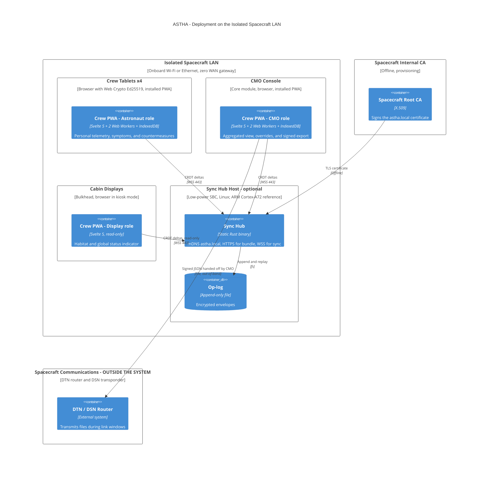

# C4 · Level 4 — Deployment Diagram

**Authority source:** [SRS](../SRS%20%E2%80%93%20Software%20de%20Monitoreo%20de%20Salud%20para%20Astronautas.md) §4.4 (spacecraft devices) · **Traceability:** [RTM](../MATRIZ_DE_TRAZABILIDAD_RTM.md) · Conventions in [01-contexto](01-contexto.md)

## Diagram

## Nodes and Artifacts

| Element | Technology | Responsibility | Covered Requirements (Repo IDs) |
| --- | --- | --- | --- |
| **Isolated LAN** | Onboard Wi-Fi or local Ethernet, no default route to WAN | Sole communication medium between devices. Verification: packet capture showing zero off-LAN traffic | RNF-NET-01 (Wireshark verification), RF-EVA-07 · ⚠ CU-10 (folder) mentions Wi-Fi 802.11s, Bluetooth Mesh, and UDP multicast Gossip; browsers have no access to UDP or BLE mesh |
| **Crew Tablets (×4)** | Modern browser with Web Crypto Ed25519 (Chromium 137+, Firefox 129+, or Safari 17+), PWA installed from `https://astha.local`, spacecraft CA root in trust store | Complete autonomous node with Astronaut role | RNF-USA-01 (gloves), RNF-POW-02 (16 h on battery, < 350 mW), RNF-POW-03, RNF-SEC-01, RNF-SEC-02 · SRS §5.1 (4 crew members) |
| **CMO Console** | Same, larger display (1920 × 1080 per WIREFRAME §2) | CMO role: holds all crew members' K_t wrapped with CMO PIN, can override false positives, and generates the signed export | RF-DSH-03, RF-REG-02, RF-GUI-05, RNF-SEC-02, RNF-NET-04 |
| **Cabin Displays** | Browser in kiosk mode, same PWA in `display` role | Read-only: habitat telemetry and global status indicator. No alert acknowledgment | RF-DSH-04, RNF-USA-03 (nighttime red mode) · **GAP**: no requirement defines what personal data they may show (see Open Question 3 in [03-componentes](03-componentes.md#open-questions)) |
| **Sync Hub Host (optional)** | Low-power Linux SBC. AC-TECH-01 cites ARM Cortex-A72 as reference hardware. Static Rust binary, `systemd` service | Discovery, HTTPS origin, WSS relay, and replica. If powered off, every device remains autonomous and reconverges upon reconnect | RNF-NET-01..03, RNF-SEC-03 (replica) · **GAP**: no power or RAM budget exists for the Hub (SRS RNF-POW applies to tablets and consoles) |
| **Op-log** | Append-only file on host persistent storage | Recovery of replaced devices (HU-15, scenario 2) | RNF-NET-02 |
| **Internal CA** | Offline PKI | Enables the secure context required by `crypto.subtle` and Service Workers | Enables RNF-SEC-01 and the SW (RNF-PER-02) · **GAP**: neither PKI nor certificate rotation is specified |
| **DTN / DSN Router** | External system | Outside the system. Receives the signed `.json` handed off by the CMO | RNF-NET-04 boundary · ⚠ CU-11, HU-14, and AC-TECH-05 assign DTN packaging (RFC 5050), the 30-day persistent queue, and response reception to ASTHA |

## Operational Scenarios

| Scenario | Behavior | Requirements |
| --- | --- | --- |
| Hub online, all connected | Convergence over WSS. Sync notification from another node arrives within milliseconds | RNF-NET-02 · AC-TECH-04 §1 (< 3 s) |
| Hub offline or absent | Every device operates standalone: local triage, alarms, guide, and audit log. No cross-device convergence | RNF-NET-02, RF-EVA-07 · SRS §1 ("single-node") |
| Isolated module (hatch closed) | Device continues operating. Upon rejoining the LAN, version-vector delta sync merges without loss | RNF-NET-02 · CU-10 FA-01 (folder) |
| Replaced tablet | Installed from `https://astha.local`, enrolls its Ed25519 key, wraps K_t keys with PIN, and replays from the op-log | HU-15, scenario 2 · provisioning **GAP** |
| Corrupted record (SEU in storage) | Integrity Guard quarantines and restores it from the Hub; without a Hub, excludes it and alerts | RNF-SEC-03 · AC-TECH-06 §2 |
| Export to Ground | CMO generates signed JSON → file → communications system. ASTHA does not wait for a reply | RNF-NET-04, RF-GUI-05 · AC-TECH-03 §3 |
| Power contingency (folder CU-12) | No EPS signal exists that a browser can receive. Could be forwarded via the Hub in the future | **GAP** / ⚠ CU-12 and AC-TECH-02 §3 have no backing in the SRS RNFs |

## Provisioning (Pre-flight; Proposed, No Requirement in Repo)

1. Install the spacecraft CA root on each device.
2. Generate the `astha.local` certificate for the Hub host.
3. Visit `https://astha.local` to install the PWA. The Service Worker precaches the bundle.
4. Generate the device's Ed25519 key pair (`extractable: false`) and enroll its public key on the Hub.
5. Set PINs and wrap K_t keys according to role (owner and CMO).
